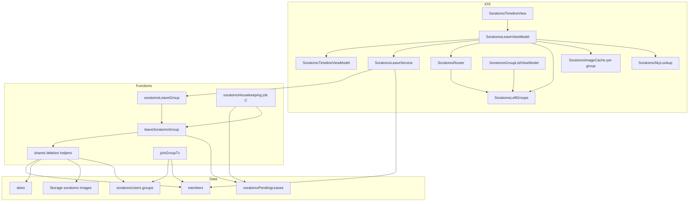
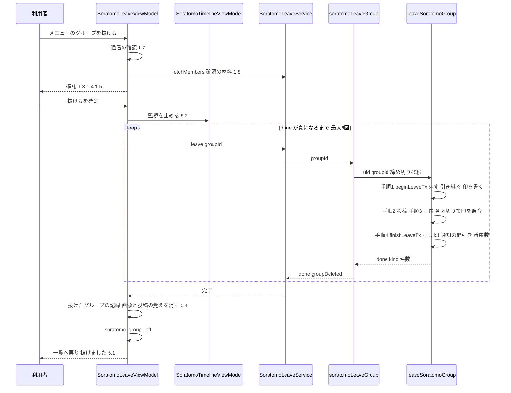
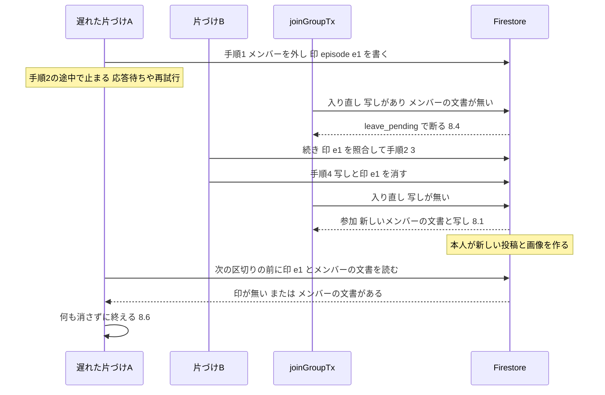
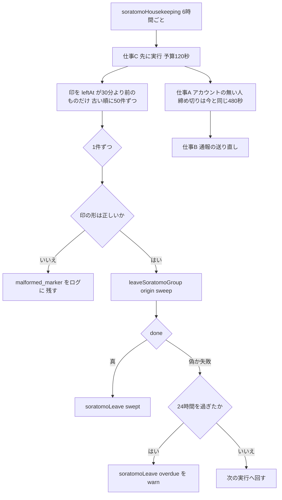

# Design Document — soratomo-leave-group（そらとも：グループだけ抜ける）⭐️

## Overview

**Purpose**: そらとものメンバーが、アカウントを残したまま1つのグループだけを抜けられるようにする。抜けた人のそのグループの投稿と画像は消え、オーナーと人数は退会と同じ規則で整う。
**Users**: グループのメンバー（抜ける人）と、残るメンバー。Android版・改造したアプリからの要求にも、サーバーの規則が同じく効く（9.6）。
**Impact**: 新しいCallable `soratomoLeaveGroup`（8本目）を足す。「片づけ中の印」（新しいコレクション`soratomoPendingLeaves`）を足し、6時間ごとの定期実行`soratomoHousekeeping`に「途中で止まった抜けるを終える仕事C」を足す。参加`joinGroupTx`は、片づけ中なら`leave_pending`で断る。アプリは、タイムラインの右上のメニューに入口を置き、完了まで待ってからグループ一覧へ戻る。

### Goals
- 抜けるの片づけ（release-gate specの要件1〜3の1グループ版）を、何度呼んでも同じ結果で、24時間以内に必ず終える（4.1〜4.6）。
- 入り直しの競合を構造で防ぐ。片づけ中の参加は`leave_pending`で断る（8.4）。遅れて走った片づけは、入り直した後の投稿・画像・メンバーの記録に触れない（8.6・8.7）。
- 抜けた本人に、エラーの文言を見せない（5.2）。オフラインの間も、抜けたグループを見せない（5.3・5.6）。端末の画像は、そのグループの分だけ消す（5.4・5.5）。
- 退会・利用停止・アカウントの無い人の後始末の、消す範囲と結果を変えない（10.2）。

### Non-Goals
- オーナーによるグループの削除・除名・オーナーの手動の譲渡（要件の対象外）。
- 認証の関門（`requireSoratomoUser`）の変更。クレームの確認を外すこと・匿名アカウントの拒否は、public-launch specが持つ。本specの新しいCallableは、退会と同じ`requireFlag: false`で作るだけにする（9.1の補足）。
- What's New・オンボーディングの文言、1.15.0の版数、デプロイの順序（public-launch spec）。
- 抜けたことの通知・タイムラインへの知らせ（決定事項2）。
- 取り残しの画像を拾う運用の道具（2026-10-11の決定で作らない）。

## 設計の前提

`.kiro/steering/`は無い。行番号は、ブランチ`機能-そらとも-グループだけ抜ける`のHEAD `22422a3`（＝`a922c92`＋要件のコミット）の現物で確かめた。要件の「前提と制約」の行番号は、すべて現物と一致した。本書で新たに使った事実は次のとおり。

| # | 事実 | 現物 | 設計への効き方 |
|---|---|---|---|
| P1 | 手順1（`leaveOrDeleteGroupTx`）は、呼び手がメンバーでなくても、グループの人数とオーナーを書き直す（`removed: false`でも`tx.update`する）。メンバーの文書が0件のグループなら、グループと招待コードを消す | `functions/soratomoDeletion.js:152-170` | 抜けるのCallableから素の`deleteUserDataInGroup`を呼ぶと、メンバーでない人が任意のグループIDで他人のグループを書き換えられる。3.13・3.14のため、先に「本人のメンバーの文書・所属の写し・片づけ中の印」を読み、どれも無ければ何も書かずに返す |
| P2 | 参加は、所属の写しを`tx.create`で作る（`functions/soratomoStore.js:290`）。メンバーの文書だけで「すでにメンバーか」を決める（`:278`） | 同左 | 写しが残っている間の参加は、コミットで`ALREADY_EXISTS`になり`internal`に化ける（8.4の現状の失敗） |
| P3 | 手順2・3は、入り直したかを見ない。手順4は、メンバーの文書があれば写しを消さない | `functions/soratomoDeletion.js:331`・`:337`・`:269` | 遅れた手順2・3が、入り直した後の投稿と画像を消しうる（8.6の現状の失敗）。全グループ版の既存のテスト`soratomoDeletion.test.js:921`は、遅れた削除が入り直したメンバーを「外し直す」ことを正しいとしている（退会なので） |
| P4 | 投稿の作成はメンバーの文書を確かめる。画像の作成もルールで確かめる | `functions/soratomoStore.js:331`・`storage.rules:241-246` | メンバーの文書が無い間は、新しい投稿も画像も増えない。片づけの「順序の不変条件」の土台になる |
| P5 | Storageのゲートウェイの`listFiles`は、名前（パス）だけを返す | `functions/soratomoStorage.js:96` | 画像の「どれが古いか」は、名前からは分からない（パス`soratomo/{groupId}/{uid}/{skyId}/`に時刻が無く、`skyId`はアプリが作る自動ID）。時刻での見分けには頼らず、順序の不変条件で守る（research.mdの「画像の新旧の見分け」） |
| P6 | 端末の画像のキャッシュは、そらとも専用の1つのKingfisherのキャッシュで、鍵はStorageのパス | `Services/SoratomoStorageImageProvider.swift:73-92`。KFImageの使い場所は3か所（`Views/Soratomo/SoratomoTimelineView.swift:567-568`・`SoratomoSkyDetailView.swift:233-240`） | Kingfisher 8.6.2のディスクのファイル名は鍵のSHA-256（`DiskStorage.swift`の`usesHashedFileName`）。接頭辞での一覧も削除もできない。グループ単位で消すには、グループごとにキャッシュを分ける |
| P7 | 一覧は、オンラインならグループを読めない1件を飛ばす。オフラインでは、端末のキャッシュの文書が返る | `Services/SoratomoGroupService.swift:196-212`（`getDocument()`の既定は、オフラインならキャッシュ） | オフラインでは、抜けたグループが端末のキャッシュから一覧に出うる。端末に「抜けたグループの記録」を持って隠す（5.3・5.6） |
| P8 | タイムラインの監視は札を手放すと止まり、止めた後の結果は渡さない | `Services/SoratomoServiceContracts.swift:50-81`・`Services/SoratomoGroupService.swift:283-289` | 片づけを呼ぶ前に監視を止めれば、`.notMember`がルーターへ届かず、「グループを開けませんでした」が出ない（5.2） |
| P9 | 招待画面は、いまの`ownerId`と自分のuidを比べて、再発行をオーナーにだけ出す | `ViewModels/SoratomoInviteViewModel.swift:108`・`Views/Soratomo/SoratomoInviteView.swift:143` | 3.9は既存の振る舞いで満たす（手順1が`ownerId`を書き換える） |
| P10 | 単一の項目の範囲の条件のクエリは、自動の単一項目インデックスで動く。コレクショングループの範囲のクエリは、手動のインデックスが要る | Firestoreの公式文書（research.mdの出典）。既存の例は`functions/soratomo.js:544`（`forwardStatus`の単一項目のクエリ・`firestore.indexes.json`に無い） | 片づけ中の印をルートのコレクションに置き、`leftAt`の範囲で引けば、インデックスの追加が要らない。soratomo specは「collectionGroupのクエリは使わない」と決めている（soratomo specのdesign.md 995行・`firestore.rules:564`） |

## Requirements Traceability

| Requirement | Summary | Components | Interfaces | Flows |
|-------------|---------|------------|------------|-------|
| 1.1 | 入口はタイムラインから | SoratomoTimelineView（右上のメニュー） | — | 抜ける |
| 1.2, 1.3, 1.6 | 消す前の確認・消えるもの・キャンセル | SoratomoLeaveViewModel・SoratomoTimelineView | `LeaveConfirmation` | 抜ける |
| 1.4, 1.5 | オーナーの引き継ぎ先・最後の1人 | SoratomoLeaveViewModel（`predictLeave`） | `SoratomoGroupServiceProtocol.fetchMembers` | 抜ける |
| 1.7 | 通信できなければ始めない | SoratomoLeaveViewModel | `isOnline` | 抜ける |
| 1.8 | 確認の材料を読めなければ出さない | SoratomoLeaveViewModel | `fetchMembers` | 抜ける |
| 1.9 | 処理中の表示と操作の止め | SoratomoTimelineView・SoratomoLeaveViewModel | `phase` | 抜ける |
| 2.1, 2.2, 2.3 | 投稿・画像・取り残しの画像を消す | leaveSoratomoGroup（手順2・3） | `deleteSkiesByQuery`・`deleteImagesByPrefix` | 抜ける |
| 2.4, 2.5 | ほかのグループ・ほかのメンバーに及ぼさない | leaveSoratomoGroup（`authorId`と`soratomo/{groupId}/{uid}/`だけ） | — | 抜ける |
| 2.6, 9.1 | 機能フラグに関わらない | soratomoLeaveGroup（`requireFlag: false`） | API Contract | 抜ける |
| 2.7 | 通報の記録を消さない | leaveSoratomoGroup（`soratomoReports`に触れない） | — | — |
| 3.1, 3.2, 3.6, 3.7, 3.8, 3.10 | メンバーから外す・人数・引き継ぎ・最後の1人 | beginLeaveTx（既存の手順1の書き方を共用） | `core.planMembershipRemoval` | 抜ける |
| 3.3, 3.4, 3.5 | 写し・所属数・通知の間引き・ほかの記録を変えない | finishLeaveTx | — | 抜ける |
| 3.9 | 引き継いだ人に再発行を出す | 既存（SoratomoInviteViewModel:108） | — | — |
| 3.11 | 消えたグループのコードは見つからない | 既存（joinGroupTx:270・:277） | — | — |
| 3.12, 8.7 | 同時に起きても人数と所属数が合う | beginLeaveTx・finishLeaveTx・joinGroupTx（トランザクション） | — | 入り直しの競合 |
| 3.13 | 本人だけ | soratomoLeaveGroup（uidは`request.auth`だけ） | API Contract | — |
| 3.14 | メンバーでなく残りも無ければ、何も変えず完了と同じ応答 | beginLeaveTx（`nothing`） | API Contract | 抜ける |
| 4.1, 4.2 | 予算切れで続きから・冪等 | leaveSoratomoGroup・soratomoLeaveGroup（45秒） | `{ done }` | 抜ける |
| 4.3 | 完了まで自動で繰り返す | SoratomoLeaveService（最大8回） | `SoratomoLeaveServiceProtocol.leave` | 抜ける |
| 4.4, 4.5 | 失敗の後の分岐（メンバーのままか） | SoratomoLeaveViewModel・SoratomoLeaveService | `membershipOnServer` | 抜ける |
| 4.6 | 24時間以内にサーバーが終える | 仕事C（sweepPendingLeaves）・soratomoPendingLeaves | Batch Contract | 片づけの続き |
| 4.7 | 退会・利用停止・ほかのグループの抜けると同時でも同じ結果 | leaveSoratomoGroup（印の照合）・既存の共通の削除 | — | 入り直しの競合 |
| 4.8, 11.5 | 24時間を過ぎたものをログで見つける | 仕事C（`soratomoLeave: overdue`） | Monitoring | 片づけの続き |
| 5.1, 5.2 | 一覧へ戻って「抜けました」・エラーを出さない | SoratomoLeaveViewModel・SoratomoTimelineViewModel（監視の停止）・SoratomoRouter（`finishLeaving`） | — | 抜ける |
| 5.3, 5.6 | 片づけ前・オフラインでも一覧に出さない | SoratomoLeftGroups・SoratomoGroupListViewModel | — | — |
| 5.4, 5.5 | そのグループの画像と投稿の覚えだけ消す | SoratomoImageCache（グループごと）・SoratomoSkyLookup | `removeGroup`・`forget(groupId:)` | 抜ける |
| 5.7 | 抜けた後に古い通知を開く | SoratomoRouter（`resolvePending`）・SoratomoLeftGroups | — | — |
| 6.1, 6.2, 6.3, 6.4, 6.5 | ほかのメンバーの画面 | 既存（監視・投稿詳細の`.gone`・メンバー一覧の読み込み） | — | — |
| 6.6, 6.7, 6.8 | 知らせない | 何も足さない | — | — |
| 7.1 | 外した後は通知が行かない | 既存（`functions/soratomo.js:337`の宛先はその時点のメンバー） | — | — |
| 7.2, 7.3 | 通知の設定を変えない | 何も足さない | — | — |
| 8.1, 8.2, 8.3 | 片づけ後の入り直し | 既存のjoinGroupTx | — | 入り直しの競合 |
| 8.4, 8.5 | 片づけ中の参加は`leave_pending` | joinGroupTx・REASON_TO_CODE・SoratomoError・SoratomoGroupFormViewModel（入力を残す既存の振る舞い） | API Contract | 入り直しの競合 |
| 8.6 | 遅れた片づけが入り直した後に及ばない | leaveSoratomoGroup（印の照合・手順1を走らせ直さない） | `isLeaveEpisodeCurrent` | 入り直しの競合 |
| 9.2 | 未ログインは拒否 | soratomoLeaveGroup（既存の`requireSoratomoUser`） | — | — |
| 9.3, 9.4 | 利用停止中・未同意も受け付ける | leaveSoratomoGroup（停止と同意を見ない） | — | — |
| 9.5 | 未同意のメンバーはガイドラインが先 | 既存（変えない） | — | — |
| 9.6 | どのクライアントにも同じ規則 | サーバーの規則だけで守る（アプリの判断に頼らない） | — | — |
| 10.1, 10.2 | 退会・利用停止・後始末を変えない | deleteUserDataInGroup・deleteSoratomoUserData（呼び方と結果を変えない） | — | — |
| 10.3, 10.5 | 既存のCallableの条件と応答（8.4を除く） | soratomo.js（新しい1本を足すだけ） | — | — |
| 10.4 | ルールを緩めない | firestore.rules（拒否だけの新しい`match`を足す） | — | — |
| 10.6 | 守られる・破られるの両方をテスト | Testing Strategy | — | — |
| 11.1, 11.2, 11.3, 11.4 | ログと計測に名前を出さない・件数を残す | soratomoLeaveGroup（`okLogFields`）・SoratomoAnalytics | Monitoring | — |
| 12.1, 12.2, 12.3, 12.4 | イベント・`leave_pending` | SoratomoAnalytics | `SoratomoEvent` | — |
| 12.5 | 審査に出す前に着弾を確かめる | Migration（public-launchの手順に載せる） | — | — |

## Architecture

### Existing Architecture Analysis

- 書き手はFunctionsだけ（グループ・メンバー・招待コード・所属の写し・通知の間引き）。アプリはCallableを呼び、Firestoreを読むだけ（`firestore.rules:561-563`）。抜けるもCallableにする（クライアントの書き込みは開けない・10.4）。
- 削除は`functions/soratomoDeletion.js`の「共通の削除」に集まっている。手順1（メンバーを外す）→手順2（投稿）→手順3（画像・通知の間引き）→手順4（写しを最後に消す）の順で、写しが「利用者→グループ」の唯一の経路（同`:15-18`）。本specはこの順と部品を使い、1グループ版の入口を足す。退会用の`deleteUserDataInGroup`・`deleteSoratomoUserData`の呼び方と結果は変えない（10.2）。
- 定期実行`soratomoHousekeeping`（`functions/soratomo.js:561-583`）は、仕事ごとに別の`try`で囲み、片方の失敗で他方を止めない。同時に1つだけ動く（`maxInstances: 1`）。仕事Cを同じ型で足す。
- アプリは、サービスのprotocol（`SoratomoServiceContracts.swift`）とViewModelを分け、Callableの窓口をDataSourceで差し替える型（`SoratomoAccountDeletionService.swift:26-33`）。抜けるも同じ型にする。既存のprotocolにはメソッドを足さない（既存のモックを壊さない）。

### Architecture Pattern & Boundary Map



**Architecture Integration**:
- Selected pattern: 既存の「Callable→Admin SDKのトランザクションと共通の削除」に、1グループ版の入口と「片づけ中の印」を足す。印は、①定期実行が途中で止まった抜けるを見つける目印、②遅れた片づけが自分の回の片づけかを確かめる札（`episodeId`）、の2役を持つ。
- Domain/feature boundaries: サーバーが規則（本人だけ・人数とオーナー・消す範囲・冪等・入り直しとの競合）をすべて持つ（9.6）。アプリは、確認の文言・処理中の表示・端末の後片づけ・端末の記録だけを持つ。
- Existing patterns preserved: Callableの包み（`soratomoCallable`）・`requireFlag: false`・45秒の予算と`{ done }`・アプリの最大8回の繰り返し。トランザクションは読みを先に（`soratomoStore.js:20`）。ログは内部IDと件数だけ。
- New components rationale: `soratomoPendingLeaves`は、アカウントのある人の途中の片づけを見つけるため（今は手段が無い・前提と制約）。`SoratomoLeftGroups`は、オフラインのキャッシュから抜けたグループが出るのを止めるため（P7）。グループごとの画像のキャッシュは、P6のため。
- Steering compliance: steeringは無い。soratomo specとrelease-gate specの約束（collectionGroupを使わない・既存のルールを緩めない・退会を変えない）を守る。

### Technology Stack

| Layer | Choice / Version | Role in Feature | Notes |
|-------|------------------|-----------------|-------|
| Backend | Cloud Functions v2（firebase-functions ^7.4.0・Node 22・asia-northeast1） | Callable 1本の追加・定期実行に仕事Cを追加 | 新しい依存は無い |
| Data | Firestore（firebase-admin ^14.5.0） | `soratomoPendingLeaves`の追加・参加のトランザクションに読みを1件追加 | インデックスの追加は無い（P10） |
| Storage | Cloud Storage（既存のゲートウェイ） | 画像の削除 | ゲートウェイの口は変えない（P5） |
| iOS | SwiftUI・FirebaseFunctions・FirebaseFirestore・Kingfisher 8.6.2 | 入口・確認・処理中・後片づけ | Kingfisherの`ImageCache(name:cacheDirectoryURL:)`をグループごとに使う（P6） |

## System Flows

### 抜ける（アプリ→サーバー→完了）



- 監視を止めてから呼ぶので、手順1の後にタイムラインが`.notMember`を受け取らない（P8・5.2）。
- 失敗（通信・想定外・回数の上限）では、サーバーのメンバーの文書を読んで分ける。メンバーのままなら4.4、外れていれば4.5として抜けたものと扱う。読めなければ4.4と同じに扱い、監視を張り直す。後でメンバーでないと分かれば、4.5と同じにする（要件への差し戻しD1）。

### 入り直しの競合（8.4・8.6・8.7）



- 順序の不変条件: メンバーの文書が無い間は、新しい投稿と画像を作れない（P4）。片づけ中（写しがある）の参加は断る（8.4）。写しは手順4で最後に消す。よって、1回の実行の中では、入り直した後のものに触れない。
- 残る穴は「2つの実行が重なる」場合だけ（アプリの呼び出しと定期実行・二重の要求・改造したアプリ）。これを、区切りごとの照合で閉じる。照合では、印が同じ`episodeId`のまま残り、メンバーの文書が無いことを確かめる。照合は「読む（クエリか一覧）→照合→消す」の順で行う。照合が通った時点で入り直しが起きていないので、その前に読んだものは、すべて入り直す前のものである。
- 定期実行は手順1（メンバーを外す）を走らせない。メンバーの文書があれば、その印は古いとみなして印だけを消す。遅れた片づけが、入り直したメンバーを外し直すことは無い（P3の退会とは違う）。

### 途中で止まった片づけの続き（4.6・4.8）



- 30分より新しい印は扱わない。アプリの繰り返し（最大8回×75秒）が続いている間に、定期実行が同じ回を進めないため。
- 抜けるの確定（`leftAt`）から最初の実行までは、最大で6時間30分。そこで終わらなくても、24時間の間にあと2回の機会がある。

## Components and Interfaces

| Component | Domain/Layer | Intent | Req Coverage | Key Dependencies | Contracts |
|-----------|--------------|--------|--------------|------------------|-----------|
| soratomoLeaveGroup（新規） | Functions（`soratomo.js`） | 本人の抜けるの入口 | 2.6, 3.13, 3.14, 4.1, 9.1〜9.4, 11.2〜11.4 | leaveSoratomoGroup (P0) | API |
| leaveSoratomoGroup（新規） | Functions（`soratomoDeletion.js`） | 1グループ版の片づけ（印・照合・続き） | 2.1〜2.5, 2.7, 3.1〜3.8, 3.10, 3.12, 3.14, 4.1, 4.2, 4.7, 8.6, 8.7 | 共通の削除の部品 (P0)・Storageのゲートウェイ (P0) | Service |
| 共通の削除の部品（変更） | Functions（`soratomoDeletion.js`） | 手順1の読み書きを分け、手順2・3に「消す前の照合」の口を足す | 10.2 | — | Service |
| joinGroupTx（変更） | Functions（`soratomoStore.js`） | 片づけ中の参加を`leave_pending`で断る | 8.4, 8.7, 10.3 | — | Service |
| 仕事C sweepPendingLeaves（新規） | Functions（`soratomo.js`の`soratomoHousekeeping`） | 途中で止まった抜けるを終える | 4.6, 4.8, 11.5 | leaveSoratomoGroup (P0) | Batch |
| soratomoPendingLeaves（新規） | Firestore・ルール | 片づけ中の印 | 4.6, 8.6 | — | State |
| SoratomoLeaveService（新規） | iOS Service | Callableの繰り返しとメンバーの再確認 | 4.3, 4.4, 4.5 | FirebaseFunctions (P0)・Firestore (P0) | Service |
| SoratomoLeaveViewModel（新規） | iOS ViewModel | 確認・処理中・結果の分岐・後片づけ | 1.2〜1.9, 4.3〜4.5, 5.1, 5.2, 5.4, 12.1 | SoratomoLeaveService (P0)・SoratomoGroupService (P0) | State |
| SoratomoTimelineView・ViewModel（変更） | iOS View | 入口・確認・処理中の表示・監視の停止と再開 | 1.1, 1.9, 5.2 | SoratomoLeaveViewModel (P0) | — |
| SoratomoRouter（変更） | iOS Service | 抜けた後の遷移・抜けたグループの通知 | 5.1, 5.7 | SoratomoLeftGroups (P1) | — |
| SoratomoLeftGroups（新規） | iOS 端末の記録 | 抜けたグループを端末で隠す | 5.3, 5.6, 5.7 | UserDefaults | State |
| SoratomoGroupListViewModel・SoratomoGroupFormViewModel（変更） | iOS ViewModel | 一覧で隠す・入り直しで記録を外す | 5.3, 5.6, 8.5 | SoratomoLeftGroups (P1) | — |
| SoratomoImageCache（変更）・SoratomoSkyLookup（変更） | iOS キャッシュ | グループ単位で消す | 5.4, 5.5 | Kingfisher (P0) | — |
| SoratomoError・SoratomoAnalytics（変更） | iOS | `leave_pending`の文言とイベント | 8.5, 12.1〜12.4, 11.1 | — | — |

### Backend: Functions

#### soratomoLeaveGroup（Callable・新規）

| Field | Detail |
|-------|--------|
| Intent | 本人が1つのグループを抜け、片づけを予算の範囲で進める |
| Requirements | 2.6, 3.13, 3.14, 4.1, 9.1, 9.2, 9.3, 9.4, 11.2, 11.3, 11.4 |

**Responsibilities & Constraints**
- `soratomoCallable`で作る。`requireFlag: false`（退会の`soratomoDeleteMyData`と同じ・`functions/soratomo.js:257`）。理由（9.1・2.6）をコメントに残す。ログインは既存の`requireSoratomoUser`が求める（9.2）。認証の関門そのものは変えない（public-launch specが匿名アカウントの拒否を足す）。
- 抜ける相手は`request.auth.uid`だけ。要求の本文からは`groupId`だけを読む（3.13）。
- 入力の検査: `core.isAutoId(data.groupId)`でなければ、`SoratomoDomainError("invalid_input")`を投げる（`soratomoCreateSky`の`functions/soratomo.js:207`と同じ型）。共通の削除が投げる`TypeError`を`internal`にしないため、呼ぶ前に検査する。
- 利用停止・同意・機能フラグは確かめない（9.1・9.3・9.4）。
- 1回の予算は、退会と同じ`DELETE_BUDGET_MS`（45秒・`functions/soratomo.js:237`）。`runtime: { timeoutSeconds: 120, memory: "512MiB" }`。
- 置き場は`soratomoDeleteMyData`の直後（`functions/soratomo.js:269`の後）。`module.exports`に足す（11本目）。

##### API Contract

| Callable | Request | Response | Errors（`code`・`details.reason`） |
|----------|---------|----------|-----------------------------------|
| `soratomoLeaveGroup` | `{ groupId: string }` | `{ done: boolean, groupDeleted: boolean }` | `unauthenticated`／`invalid-argument`・`invalid_input`／`internal` |

- `done`: 片づけが終わったか。`false`なら、同じ要求をもう一度送ると続きから進む（4.1）。
- `groupDeleted`: この抜けるでグループごと消える（消えた）か。`leaveSoratomoGroup`の`kind === "delete_group"`。再試行でも同じ値になる。メンバーでなく残りも無い場合は`false`（3.14の「同じ結果」は`{ done: true, groupDeleted: false }`）。
  - ただし、再試行の間にほかの人が抜けてグループが消えると、続きの実行が`kind`を数え直すので`true`に変わる。影響はiOSの計測の値だけ（/review-fullの指摘F8・2026-10-11）。
- `not_member`は返さない。メンバーでない人にも、完了と同じ応答を返す（3.14・グループの有無を知らせない）。
- 成功のログ（`okLogFields`・11.3・11.4）: `soratomoLeaveGroup: ok`。項目は`uid`・`groupId`・`done`・`state`・`kind`・`removed`・`ownerTransferred`・`groupDeleted`・`skiesDeleted`・`imagesDeleted`。
  - ここの`groupDeleted`は「この実行でグループの文書を消したか」（既存の`deleteUserDataInGroup`と同じ意味）。
- 拒否と想定外は、既存の包みが`uid`・`groupId`（自動IDの形のときだけ）・`reason`で出す（`functions/soratomo.js:150-160`）。

#### leaveSoratomoGroup（`soratomoDeletion.js`・新規）

| Field | Detail |
|-------|--------|
| Intent | 1人の1グループ分の抜けるを、印つきで冪等に進める |
| Requirements | 2.1, 2.2, 2.3, 2.4, 2.5, 2.7, 3.1〜3.8, 3.10, 3.12, 3.14, 4.1, 4.2, 4.7, 8.6, 8.7 |

**Responsibilities & Constraints**
- `deleteUserDataInGroup`を直接は呼ばない。理由はP1（メンバーでない人の要求で他人のグループを書き換える）とP3（入り直しを見ない）。代わりに、同じ手順と同じ部品（手順1の書き方・`deleteSkiesByQuery`・`deleteImagesByPrefix`）を使い、次の3つを足す。
  1. 手順1の前に、本人のメンバーの文書・所属の写し・印を同じトランザクションで読む（`beginLeaveTx`）。
  2. 手順2・3の「消す前」ごとに、印が同じ回（`episodeId`）のまま残り、メンバーの文書が無いことを確かめる（`isLeaveEpisodeCurrent`）。
  3. 手順4は、印が同じ回のときだけ、写し・印・通知の間引きを消し、所属数を数え直す（`finishLeaveTx`）。
- 消す範囲は`deleteUserDataInGroup`と同じ。残るメンバーがいれば`authorId == uid`の投稿と`soratomo/{groupId}/{uid}/`の画像（取り残しを含む・2.3）。最後の1人ならグループの全投稿・`soratomo/{groupId}/`の画像・`recursiveDelete`（3.10）。
- 通報の記録・利用者の文書の同意と停止の項目・ほかのグループの写しには触れない（2.7・3.5）。`finishUserTx`は呼ばない（利用者の文書を消さない）。
- ログは出さない（呼び手が出す・既存の決まり`soratomoDeletion.js:14`）。

**Dependencies**
- Inbound: soratomoLeaveGroup（`origin: "self"`）・仕事C（`origin: "sweep"`）— 片づけの要求（P0）
- Outbound: Firestore（Admin SDK）・Storageのゲートウェイ — 読み書き（P0）
- External: なし

##### Service Interface

```typescript
type LeaveOrigin = "self" | "sweep";

interface LeaveDeps {
  db: Firestore;
  storage: SoratomoStorageGateway;      // 口は listFiles・deleteFile の2つのまま
  nowMs: () => number;
  newEpisodeId?: () => string;          // 既定は crypto.randomUUID。テストで差し替える
}

interface LeaveRequest {
  uid: string;                          // isUid でなければ TypeError（何も書かない）
  groupId: string;                      // isAutoId でなければ TypeError
  deadlineMs: number;                   // 有限の数でなければ TypeError
  origin: LeaveOrigin;
}

type LeaveState =
  | "nothing"        // メンバーの文書・写し・印のどれも無い。何も書かない（3.14）
  | "started"        // この実行でメンバーから外し、印を書いた
  | "continued"      // メンバーの文書は無く、印（または写し）がある。続きを進めた
  | "stale_marker"   // 定期実行で、メンバーの文書があった。印だけを消した
  | "superseded";    // 途中の照合で、別の実行が終えていた・入り直していた。何も消さずに止めた

interface LeaveResult {
  done: boolean;                        // nothing・stale_marker・superseded は true
  state: LeaveState;
  kind: "leave" | "delete_group" | null;
  removed: boolean;                     // この実行でメンバーの文書を消したか
  ownerTransferred: boolean;
  groupDeleted: boolean;                // この実行でグループの文書を消したか
  skiesDeleted: number;
  imagesDeleted: number;
}

function leaveSoratomoGroup(deps: LeaveDeps, request: LeaveRequest): Promise<LeaveResult>;
```

- Preconditions: 引数の誤りは`TypeError`で、何も書かない（`deleteUserDataInGroup`と同じ）。
- Postconditions: `done: true`なら、この回の印・写しは消えている。または、何も消すものが無かった。`done: false`なら印と写しが残り、次の呼び出し（アプリか仕事C）が続きから進む。途中の失敗は投げ、印と写しは残る。
- Invariants: 遅れた実行は、入り直した後のメンバーの文書・写し・投稿・画像に触れない（8.6）。人数と所属数は、つねにトランザクションの中で数え直して代入する（3.12）。

**手順と、各手順の判定**

| 手順 | 中身 | 判定 |
|---|---|---|
| 0 | 締め切りの確認 | 過ぎていれば何もせず`done: false` |
| 1 `beginLeaveTx` | トランザクションで、メンバーの文書・写し・印を読む。続けて必要ならグループ・メンバーの全文書・招待コードを読み、書く | 下の表 |
| 2 | 投稿を300件ずつ読み、照合し、消す | 照合が外れたら`superseded`で止める |
| 3 | 画像を100件ずつ一覧し、照合し、消す。最後の1人なら照合の後に`recursiveDelete` | 同上 |
| 4 `finishLeaveTx` | トランザクションで、利用者の文書・写しの全件・メンバーの文書・印を読み、写し・印・（残るメンバーがいれば）通知の間引き`notifyState/{uid}`を消し、所属数を残りの写しの数で代入する | 印が同じ回でない・メンバーの文書があれば、何も書かずに`superseded` |

**手順1（`beginLeaveTx`）の判定**

| メンバーの文書 | 印 | 写し | origin | 動き | state |
|---|---|---|---|---|---|
| 無い | 無い | 無い | どちらも | 何も書かない | `nothing` |
| ある | — | — | `self` | 既存の手順1と同じ書き方でメンバーから外し、人数とオーナーを整える（3.1・3.2・3.6〜3.8・3.10）。同じトランザクションで印を書く（新しい`episodeId`・`leftAt`）。古い印があれば上書きする | `started` |
| ある | ある | — | `sweep` | 印だけを消す（入り直した後の古い印）。メンバーは外さない | `stale_marker` |
| 無い | ある | — | どちらも | 既存の手順1の「すでにメンバーでない再実行」と同じく、人数とオーナーを整える。印はそのまま | `continued` |
| 無い | 無い | ある | `self` | 同上。印を新しく書く（退会の途中などで写しだけが残った状態を、抜けるとして引き取る） | `continued` |
| ある | 無い | — | `sweep` | 起きない（定期実行は印から来る）。万一来ても、何も書かずに`nothing`を返す | `nothing` |

- 「メンバーの文書がある」と「印がある」が同時に起きるのは、入り直しの後に印が消えずに残った場合だけ（退会の手順4は写しを消すが、印は消さないため）。`self`なら、本人がいま抜けると言っているので、新しい回として外す。
- 手順1の書き方（人数・オーナー・役割・最後の1人の招待コードとグループの文書）は、既存の`leaveOrDeleteGroupTx`と同じ関数を使う（次の「共通の削除の部品」）。

**照合（`isLeaveEpisodeCurrent`）**

```typescript
// 印（soratomoPendingLeaves/{uid}_{groupId}）とメンバーの文書を getAll で読む（2件）
function isLeaveEpisodeCurrent(db: Firestore, p: { uid: string; groupId: string; episodeId: string }): Promise<boolean>;
// true: 印があり、episodeId が同じで、メンバーの文書が無い
```

- 呼ぶ時点: 投稿の1ページを読んだ後で消す前、画像の100件の区切りを一覧した後で消す前、`recursiveDelete`の前。
- 「読む→照合→消す」の順にする理由は、System Flowsの「入り直しの競合」のとおり。照合が通った時点で入り直しが起きていなければ、それより前に読んだものは入り直す前のもの。

**Implementation Notes**
- Integration: `crypto.randomUUID()`（Node 22の`node:crypto`）で`episodeId`を作る。`leftAt`は`Timestamp.fromMillis(nowMs())`。トランザクションの再試行では作り直してよい（コミットされた値だけが残る）。`beginLeaveTx`は、コミットした`episodeId`と`leftAt`を返す。
- Validation: 照合の読みは、区切りごとに2件。300件の投稿・100件の画像の削除に比べて小さい。
- Risks: 照合と削除の間は不可分でない。ただし、照合の後に入り直しが起きても、消すのは照合の前に読んだもの（入り直す前のもの）だけ。手順1の直前に別の端末で始まった画像のアップロードが、一覧の後に届くと、取り残しの画像が1回分残りうる（退会と同じ既知の隙間・Risks）。

#### 共通の削除の部品（`soratomoDeletion.js`・変更）

| Field | Detail |
|-------|--------|
| Intent | 抜けるが退会と同じ部品を使えるようにする。退会の振る舞いは変えない |
| Requirements | 10.2 |

- `leaveOrDeleteGroupTx`（`:126-173`）を、読みの半分（グループ・メンバー・招待コードを読み、`planMembershipRemoval`で計画する）と、書きの半分（計画どおりに書く）の2つの内部関数に分ける。`leaveOrDeleteGroupTx`は、この2つを1つのトランザクションで呼ぶだけになる（戻り値と書き込みは今と同じ）。`beginLeaveTx`も同じ2つを使う。
- `deleteSkiesByQuery`（`:187`）と`deleteImagesByPrefix`（`:231`）に、省略できる引数`beforeDelete?: () => Promise<boolean>`を足す。消す前に呼び、`false`なら消さずに`{ done: true, deleted, stopped: true }`を返す。省略したとき（退会・利用停止・後始末・投稿1件の削除）は、今と同じ動き。
- `deleteUserDataInGroup`・`deleteSoratomoUserData`・`removeMembershipCopyTx`・`finishUserTx`の中身と呼び方は変えない。退会が抜けるの途中のグループを処理したとき、退会の手順4は写しを消すが印は消さない。残った印は、仕事Cが`continued`か`stale_marker`で片づける（消すものが残っていないので件数は0）。
- 確認: `soratomoDeletion.test.js`の既存のテスト（手順1・手順2〜4・時間の予算・要確認3・統合）が、変更の後もそのまま通ること。
  - ⚠️2026-10-22 上書き（soratomo-reactions）: 用語「片づけ」に、本人がそのグループで付けたリアクション（ほかの人の投稿の`reactions`と`reactorIds`の中の本人、通知の印`reactionNotices`の中の本人、通知の間引き`reactionNotifyState/{uid}`）を足した。抜けるでは手順2bの後に消し、`stillCurrent`で途中の入り直しを確かめる。詳細は`.kiro/specs/soratomo-reactions/design.md`のSystem FlowsとMigration

#### joinGroupTx（`soratomoStore.js`・変更）

| Field | Detail |
|-------|--------|
| Intent | 片づけ中の参加を、想定外のエラーでなく理由つきで断る |
| Requirements | 8.4, 8.7, 10.3 |

- 2回目の読み（`functions/soratomoStore.js:274`の`tx.getAll(groupRef, memberRef)`）に、所属の写し`soratomoUsers/{uid}/groups/{groupId}`を足す。読みはすべて書きの前（`:20`の決まり）。
- 判定の順: …→コードの不在（`:277`）→既存のメンバー（`:278`・変えない）→**写しがあれば`leave_pending`**→所属10個→満員20人。所属10個より先に見るのは、片づけ中のグループが所属数に数えられたまま（3.3の補足）で`user_limit`と誤って案内しないため。
- 写しがあってメンバーの文書が無いのは、抜けるか退会の片づけ中だけ（参加と作成は、メンバーの文書と写しを同じトランザクションで作る・`:287-290`・`:229-236`）。印の有無は見ない。退会の途中の写しも同じく断れば、今の`internal`より正しい。
- `REASON_TO_CODE`（`functions/soratomo.js:58-76`）に`leave_pending: "failed-precondition"`を足す。`SoratomoDomainError`の理由の型（`soratomoStore.js:53-55`のJSDoc）にも足す。
- 片づけ中に参加を待たされる時間は、ふつう数秒。アプリの繰り返しが手順1の後に止まった場合だけ、仕事Cが終えるまで（最大で約6時間30分）断られる。この待ち時間をどうするかは、利用者の判断U1。選ばなかった案（参加のCallableの中で続きを片づけてから参加させる）は、research.mdの「片づけ中の参加の扱い」。

#### 仕事C sweepPendingLeaves（`soratomo.js`・新規）

| Field | Detail |
|-------|--------|
| Intent | アカウントのある人の、途中で止まった抜けるを24時間以内に終える |
| Requirements | 4.6, 4.8, 11.5 |

##### Batch / Job Contract
- Trigger: 既存の`soratomoHousekeeping`（6時間ごと・`maxInstances: 1`・`functions/soratomo.js:561-583`）の中で、仕事Aより先に実行する。別の`try`で囲み、失敗しても仕事Aと仕事Bを止めない。
- 予算: 開始から`LEAVE_SWEEP_BUDGET_MS`（120秒）。仕事Aの締め切りは今のまま（開始から480秒・`:475`）なので、仕事Aに残る時間は仕事Cが使った分だけ減る。仕事Cの量はふつう数件。
- Input: `soratomoPendingLeaves`を`where("leftAt", "<=", 今−LEAVE_SWEEP_MIN_AGE_MS)`・`orderBy("leftAt")`・`limit(50)`で読み、`startAfter`で次のページへ進む。`LEAVE_SWEEP_MIN_AGE_MS`は30分。アプリの繰り返し（最大8回×75秒）と重ねないため。
- Validation: 印の`uid`が`isUid`、`groupId`が`isAutoId`で、文書IDが`${uid}_${groupId}`と一致すること。外れたら`soratomoLeave: malformed_marker` `{ markerId }`をwarnで出して飛ばす（消さない・開発者が確かめる）。
- 各印: `leaveSoratomoGroup(deps, { uid, groupId, deadlineMs, origin: "sweep" })`。1件の失敗で残りを止めない。
- Output（ログ・内部IDと件数だけ）:
  - 1件ごと: `soratomoLeave: swept` `{ uid, groupId, done, state, kind, removed, ownerTransferred, groupDeleted, skiesDeleted, imagesDeleted, ageMs }`（11.5）。
  - 終わらず、`ageMs`が24時間を超えた: `soratomoLeave: overdue` `{ uid, groupId, ageMs }`をwarnで出す（4.8）。
  - 失敗: `soratomoLeave: sweep_item_failed` `{ uid, groupId, errorName, errorCode }`をerrorで出す。
  - 実行ごと: `soratomoHousekeeping: leave_sweep` `{ scanned, completed, unfinished, overdue, malformed, failed }`。
- Idempotency & recovery: `leaveSoratomoGroup`は冪等。終わらなかった印は残り、次の実行が拾う。定期実行は手順1（メンバーを外す）を走らせない（`origin: "sweep"`）。

### Backend: ルール・インデックス

- **firestore.rules**: 拒否だけの`match`を1つ足す。置き場は`soratomoConfig`の節（`firestore.rules:654-656`）の直後・`:657`の閉じかっこの前。既存の行は、`:641`のコメントの数（2つ→3つ）を直すだけ。public-launch specが変える`isSoratomoUser()`（`:573-575`）と、その呼び出しの行には触れない。

  ```
  // 抜けるの片づけ中の印（文書 ID は「uid_グループ ID」・leave-group spec）
  // 抜けるの Callable と定期実行（Admin SDK）が書いて消す。本人を含め、誰にも読ませず、書かせない
  match /soratomoPendingLeaves/{markerId} {
    allow read, write: if false;
  }
  ```

- **storage.rules**: 変えない。
- **firestore.indexes.json**: 変えない。仕事Cのクエリは、ルートのコレクションの単一項目（`leftAt`）の範囲と、同じ項目の並べ替えだけ。自動の単一項目インデックスで動く（P10・research.md）。
- **scripts/rules_test_soratomo.py**: `soratomoPendingLeaves`の読み・書きが、本人（機能フラグあり）でも拒否されるケースを足す。`--mutants`でこの`match`を緩めると期待外れになることを確かめる。

### iOS

#### SoratomoLeaveService（新規・`Services/SoratomoLeaveService.swift`）

| Field | Detail |
|-------|--------|
| Intent | `soratomoLeaveGroup`を完了まで繰り返し呼ぶ。失敗の後に、メンバーのままかをサーバーで確かめる |
| Requirements | 4.3, 4.4, 4.5 |

**Responsibilities & Constraints**
- 型は`SoratomoAccountDeletionService`（`Services/SoratomoAccountDeletionService.swift:55-121`）にそろえる。Callableの窓口はDataSourceで差し替える。
- 繰り返し: 1回の制限時間75秒・最大8回（退会と同じ。サーバーの予算45秒＋余裕）。`done: true`で戻る。失敗したら呼び直さずに投げる。8回で終わらなければ`.incomplete`。
- 応答の`groupDeleted`は、どれか1回で真なら真にする。
- 失敗の写し: 通信・制限時間切れは`.network`、それ以外は記録（`SoratomoError.record`・文脈は固定の文字列・IDを入れない）に残して`.unknown`。写しの判定は`SoratomoGroupService.mapCallableError`を使う（退会と同じ・`:106-112`）。
- メンバーの再確認: 自分のメンバーの文書`soratomoGroups/{groupId}/members/{uid}`を、キャッシュを使わずに（`source: .server`）読む。読めて文書がある→`.member`。権限の拒否→`.notMember`（メンバーでなければルールが読みを拒否する・`firestore.rules:596`）。通信の失敗・それ以外→`.unknown`。

**Contracts**: Service（あり）

##### Service Interface

```swift
/// 抜けるが完了した結果
struct SoratomoLeaveResult: Equatable, Sendable {
    /// 最後の1人で、グループごと消えた（消える）か（サーバーの groupDeleted）
    let groupDeleted: Bool
}

/// 抜けるの失敗（画面の文言は SoratomoLeaveViewModel が決める）
enum SoratomoLeaveError: Error, Equatable, Sendable {
    case network      // 通信できない・制限時間切れ
    case incomplete   // 最大回数まで呼んでも done が返らなかった
    case unknown      // その他（戻り値の形の違いを含む）
}

/// サーバーで確かめた、自分がメンバーかどうか
enum SoratomoMembershipCheck: Equatable, Sendable {
    case member
    case notMember
    case unknown      // 通信できない等で確かめられなかった
}

protocol SoratomoLeaveServiceProtocol: Sendable {
    /// soratomoLeaveGroup を done が真になるまで呼ぶ（最大 8 回・1 回 75 秒）
    func leave(groupId: String) async throws(SoratomoLeaveError) -> SoratomoLeaveResult
    /// 自分のメンバーの文書を、キャッシュを使わずに読む
    func membershipOnServer(groupId: String, uid: String) async -> SoratomoMembershipCheck
}

/// Functions と Firestore の窓口（テストで差し替える）
protocol SoratomoLeaveDataSource: Sendable {
    func callCallable(_ name: String, payload: [String: Any], timeout: TimeInterval) async throws -> Any
    /// 自分のメンバーの文書がサーバーにあるか（権限の拒否・通信の失敗は元のエラーのまま投げる）
    func memberDocumentExistsOnServer(groupId: String, uid: String) async throws -> Bool
}
```

- protocolと型は`SoratomoServiceContracts.swift`に置く（既存の`SoratomoGroupServiceProtocol`にはメソッドを足さない。既存のモックを壊さない）。

#### SoratomoLeaveViewModel（新規・`ViewModels/SoratomoLeaveViewModel.swift`）

| Field | Detail |
|-------|--------|
| Intent | 確認の材料を読み、確認・処理中・結果の分岐・後片づけ・計測を受け持つ |
| Requirements | 1.2, 1.3, 1.4, 1.5, 1.6, 1.7, 1.8, 1.9, 4.3, 4.4, 4.5, 5.1, 5.2, 5.4, 5.5, 11.1, 12.1 |

**Contracts**: State（あり）

##### State Management

```swift
@MainActor
final class SoratomoLeaveViewModel: ObservableObject {
    enum Phase: Equatable {
        case idle
        case preparing                       // 確認の材料を読んでいる
        case confirming(SoratomoLeaveConfirmation)
        case leaving                         // 片づけの完了を待っている（1.9）
    }
    @Published private(set) var phase: Phase = .idle
    /// 一時の知らせ（1.7・1.8・4.4）。OK だけのアラートで出す
    @Published var alertMessage: String?

    /// メニューの「グループを抜ける」
    func requestLeave() async
    /// 確認の「キャンセル」（1.6）
    func cancel()
    /// 確認の「抜ける」
    func confirm() async
    /// 未確定の抜けるの後に、監視が .notMember を届けたとき（D1）。抜けた後へ進めたら true
    func absorbLostMembership(groupId: String) -> Bool

    /// 引き継ぐ人と最後の1人の予測（純関数・単体テスト用）
    static func predict(members: [SoratomoMember], ownerId: String, uid: String) -> SoratomoLeavePrediction?
}

struct SoratomoLeaveConfirmation: Equatable {
    let groupName: String
    let prediction: SoratomoLeavePrediction
    let successorName: String?       // 画面にだけ出す。ログと計測には出さない（11.1）
    var title: String { get }        // 「{グループ名}」を抜けますか？
    var message: String { get }      // 下の「確認の文言」
}

struct SoratomoLeavePrediction: Equatable {
    let isOwner: Bool                // ownerId == uid
    let isLastMember: Bool           // 自分以外のメンバーが0人
    let successorUid: String?        // オーナーで、ほかが残るときだけ
}

/// 抜けた後の後片づけと遷移に渡すもの（onLeft の引数）
struct SoratomoLeftContext: Equatable {
    let groupId: String
    let groupName: String            // 一覧の一時表示にだけ使う。ログと計測には出さない
    let completed: Bool              // 片づけの完了まで確かめたか（4.5 なら false）
}
```

- 依存（initで受け取る）:
  - `groupId`・`SoratomoLeaveServiceProtocol`・`SoratomoGroupServiceProtocol`（`fetchMembers`）・`currentUid`・`isOnline`。
  - `currentGroup: () -> SoratomoGroup?`（タイムラインが監視しているグループ）・`displayName: (String) async -> String?`（`SoratomoProfileStore`から）。
  - `suspendTimeline`・`resumeTimeline`・`onLeft: (SoratomoLeftContext) -> Void`（後片づけと遷移）・`logEvent`。
- `requestLeave()`:
  1. 通信が無ければ`SoratomoError.network.userMessage`を出して終える（1.7）。
  2. `phase = .preparing`。`currentGroup()`の`ownerId`と名前、`fetchMembers(groupId:)`を読む。どれかが無い・失敗・自分がメンバー一覧にいない→「グループの情報を読み込めませんでした」を出して`idle`へ（1.8）。
  3. `predict`で予測する。オーナーでほかが残れば、引き継ぐ人の表示名を読む。読めなければメンバー一覧と同じ代替の「ユーザー」にする（`Views/Soratomo/SoratomoMembersView.swift:10-11`・要件への差し戻しD2）。
  4. `phase = .confirming(...)`。
- `predict`の規則: 自分を除いた残りを`SoratomoGroupService.sortedForMembers`（`:600-607`）で並べ、先頭を引き継ぐ人とする。サーバーの`pickNextOwner`と同じ規則（`functions/soratomoCore.js:491-520`のコメント・3.6）。オーナーが残る場合（自分がオーナーでない）は引き継ぎなし。
- `confirm()`:
  1. もう一度、通信を確かめる。無ければ1.7の文言を出し、`soratomo_leave_failed`（`network`）を記録して`idle`へ。
  2. `phase = .leaving`。`suspendTimeline()`でタイムラインの監視を止める（5.2・P8）。
  3. `leave(groupId:)`を呼ぶ。成功→下の「抜けた後」へ（`completed: true`）。
  4. 失敗→`membershipOnServer`で分ける。`.notMember`→4.5として「抜けた後」へ（`completed: false`）。`.member`か`.unknown`→4.4として、失敗の文言を出し、`resumeTimeline()`で監視を張り直す。`soratomo_leave_failed`（`.network`なら`network`、ほかは`unknown`）を記録して`idle`へ戻る（もう一度選べる）。
  5. `.unknown`のときは「未確定の抜ける」を覚える。手順1が実は済んでいた場合、張り直した監視は、つながった時点で`.notMember`を届ける。このとき「グループを開けませんでした」を出さず、4.5と同じく「抜けた後」へ進む（`completed: false`）。もう一度メニューを押して、メンバー一覧が`.notMember`で読めないときも同じに扱う。タイムラインの画面は、`reportNotAccessible`の配線で、先に`SoratomoLeaveViewModel.absorbLostMembership(groupId:)`を呼ぶ。真が返れば、ルーターへは知らせない。
- 抜けた後: ViewModelは3を記録し、`onLeft`を呼ぶ。`onLeft`（タイムラインの画面が配線する）は1・2・4を行う。次の順にするのは、一覧へ戻った時点で、抜けたグループが端末のどこにも出ないようにするため。
  1. `SoratomoLeftGroups.insert(groupId, uid)`（5.3・5.6）。
  2. `SoratomoImageCache.removeGroup(groupId)`と`SoratomoSkyLookup.forget(groupId:)`（5.4）。ブロックの一覧・通報の記録・表示名とアイコンの覚えには触れない（5.5）。
  3. `soratomo_group_left`を記録する（`role`は予測の`isOwner`、`group_deleted`はサーバーの値か、4.5なら予測の`isLastMember`、`completed`は上の値）。
  4. `SoratomoRouter.finishLeaving(groupId:notice:)`で一覧へ戻し、「{グループ名}を抜けました」（4.5なら「…抜けました。残りの片づけは自動で終わります」）を出す（5.1・4.5）。

**確認の文言（1.3〜1.5）**

| 場合 | 本文（固定の文言。グループ名と引き継ぐ人の表示名だけを差し込む） |
|---|---|
| 共通（1.3） | このグループにあなたが投稿した空（写真とキャプション）は、すべて削除され、元に戻せません。招待コードがあればまた参加できますが、削除した投稿は戻りません。 |
| オーナーで、ほかが残る（1.4） | 共通の本文に「オーナーは{表示名}さんに引き継がれます。」を足す |
| 最後の1人（1.5） | 共通の本文に「あなたが最後のメンバーのため、グループと招待コードも削除され、だれも参加できなくなります。」を足す |

- ボタンは「キャンセル」（`.cancel`）と「抜ける」（`.destructive`）。既存のブロックの確認と同じく`.alert`で出す（`Views/Soratomo/SoratomoTimelineView.swift:149-161`）。

**Implementation Notes**
- Integration: 確認と処理中は、新しい画面にしない（画面名を足さない・12の補足）。
- Validation: 文言・予測・分岐は、純関数とモックで単体テストする（Testing Strategy）。
- Risks: 確認を出している間に、ほかの人が参加・退出すると、示した引き継ぐ人と実際の人が違いうる（要件1の補足で受け入れ済み）。

#### SoratomoTimelineView・SoratomoTimelineViewModel（変更・要約）

- 入口（1.1）: 右上の`ToolbarItemGroup`（`Views/Soratomo/SoratomoTimelineView.swift:100-106`）の最後に、`Menu`（`ellipsis.circle`）を足す。中身は「グループを抜ける」（`role: .destructive`）だけ。既存の3つのボタンは変えない。`init`の形も変えない（`:15`の約束）。`SoratomoLeaveViewModel`は、タイムラインの`init`で`@StateObject`として作る。
- 処理中（1.9）: `phase == .leaving`の間、画面全体に半透明の覆いと`ProgressView`と「グループを抜けています…」の文を出す。内容・右上のボタン・戻るボタンを無効にする（`navigationBarBackButtonHidden`）。投稿の画面は開けない。
- ViewModelに`suspendObservation()`を足す。`groupToken`・`timelineToken`（`ViewModels/SoratomoTimelineViewModel.swift:171-173`）を`nil`にして監視を止める。再開は既存の`start()`をもう一度呼ぶ（`:262-283`。札が`nil`のときだけ張る）。

#### SoratomoRouter（変更）

- `finishLeaving(groupId: String, notice: String)`を足す。パスにそのグループの画面があれば`path = []`にし、`notice`を出す（既存の3秒の一時表示・`Views/Soratomo/SoratomoRootView.swift:44-65`）。`notice`は`SoratomoError.notMember.userMessage`と違う固定の文言なので、5.2を満たす。
- `resolvePending`（`Services/SoratomoRouter.swift:210-240`）の「フラグが有効」の枝で、行き先の`groupId`が抜けたグループの記録にあれば、タイムラインを開かない。`pending = nil`・`path = []`・`isPresented = true`・`notice = SoratomoError.notMember.userMessage`にして、`notificationOpened(.notMember)`を1回記録する（5.7）。判定の口は`isLeftGroup: @MainActor (String) -> Bool`のプロパティで受け取る（既定は常に偽。本物は`SoratomoLeftGroups`と`currentUid`から作り、容れ物の組み立てで入れる）。
- オンラインで、記録に無いグループの通知は今のまま（タイムラインが読めなければ`reportNotAccessible`・`:265-275`）。

#### SoratomoLeftGroups（新規・`Services/SoratomoLeftGroups.swift`）

| Field | Detail |
|-------|--------|
| Intent | この端末で抜けたグループを、利用者ごとに覚える |
| Requirements | 5.3, 5.6, 5.7 |

```swift
struct SoratomoLeftGroups: Sendable {
    static let maxCount = 50                         // 超えたら古いものから捨てる
    static func storageKey(uid: String) -> String    // "soratomo.leftGroups.\(uid)"
    init(defaults: UserDefaults = .standard)
    func contains(_ groupId: String, uid: String) -> Bool
    func insert(_ groupId: String, uid: String)
    func remove(_ groupId: String, uid: String)
}
```

- 型は`SoratomoReportedSkies`（`Services/SoratomoHiddenContent.swift:155-233`）の保存の仕方にそろえる（利用者ごとのキー・JSONの配列・上限）。メモリに持たず、毎回UserDefaultsを読む（件数が小さい）。
- 外す時点: ①この端末で同じグループへの参加が成功したとき（8.1）。②一覧の読み込みで、サーバーがメンバーだと確かめたとき（別の端末で入り直した）。
- サインアウトでは消さない（同じ人が入り直したときも隠す）。退会の手順には足さない（10.1。残るのは消えたuidのキーだけ）。

#### SoratomoGroupListViewModel・SoratomoGroupFormViewModel（変更・要約）

- 一覧（5.3・5.6）: `load()`（`ViewModels/SoratomoGroupListViewModel.swift:62-81`）で、読んだグループのうち記録にあるものは、`membershipOnServer`を呼ぶ。`.member`なら記録から外して出す。`.notMember`・`.unknown`なら出さない。オフラインでは`.unknown`になるので、端末のキャッシュに残った抜けたグループは出ない（P7）。記録に無いグループは、今のまま（呼ばない）。
- 参加（8.1・8.5）: `submitJoin()`（`ViewModels/SoratomoGroupFormViewModel.swift:363-393`）の成功で、`result.groupId`を記録から外す。`leave_pending`の失敗は、既存の`showSubmitFailure`がそのまま文言を出す。入力した招待コードは消さない（既存の振る舞い・8.5）。

#### SoratomoImageCache（変更）・SoratomoSkyLookup（変更）

- 画像のキャッシュをグループごとに分ける（5.4・5.5・P6）。
  - `static func cache(forStoragePath path: String) -> ImageCache`: パス`soratomo/{groupId}/…`からグループIDを取り、グループごとのキャッシュを返す（メモ化）。Kingfisherの`ImageCache(name: "soratomo.\(groupId)", cacheDirectoryURL: 共通の親のフォルダ)`で作る。親のフォルダは`Caches/soratomo-images/`。パスの形が違えば、グループ外の共通のキャッシュを返す（壊れた値で落とさない）。
  - メモリの上限は、1つのキャッシュの既定（物理メモリの1/4）を所属の上限10で割った値にする（10個そろっても今と同じ合計）。
  - `static func removeGroup(_ groupId: String)`: そのグループのキャッシュのメモリとディスクを消し、フォルダを消す。
  - `static func remove(_ paths: SoratomoImagePaths)`（既存・投稿の削除）: パスのグループのキャッシュから消す。
  - `static func clear()`（既存・サインアウト）: すべてのグループのキャッシュを空にし、親のフォルダを消す。1.14.xの共通のキャッシュ`soratomo`も消す。
  - `static func purgeLegacyIfNeeded()`: 1.14.xの共通のキャッシュ`soratomo`を、起動の後に1回だけ消す（UserDefaultsの印）。グループ単位で消せない古い画像を残さないため。
- KFImageの3か所（`SoratomoTimelineView.swift:567-568`・`SoratomoSkyDetailView.swift:233-240`）を、`.targetCache(SoratomoImageCache.cache(forStoragePath: path))`に替える。processorを付けない決まり（`SoratomoStorageImageProvider.swift:71-72`）は変えない。
- `SoratomoSkyLookup.forget(groupId:)`を足す。そのグループの投稿の覚えだけを消す（`Views/Soratomo/SoratomoDependencies.swift:29-64`）。

#### SoratomoError・SoratomoAnalytics・SoratomoDependencies（変更・要約）

- `SoratomoError.leavePending`を足す。文言は「このグループを抜けたときの片づけが、まだ終わっていません。しばらく時間をおいて（長いときは数時間）、もう一度お試しください」（8.5・利用者の判断U1のA）。`SoratomoGroupService.reasonToError`（`Services/SoratomoGroupService.swift:387-422`）に`"leave_pending"`を足す。
- `SoratomoFailedAction`に`.leaveGroup`（「グループを抜けられませんでした」）と`.prepareLeave`（「グループの情報を読み込めませんでした」）を足す。通信できない場合は`SoratomoError.network.userMessage`を出す（1.7・4.4）。
- 計測（12.1〜12.4）: `SoratomoEvent`に2つを足す。
  - `.groupLeft(role:groupDeleted:completed:)`→`soratomo_group_left`（`role`・`group_deleted`・`completed`）。
  - `.leaveFailed(SoratomoLeaveFailReason)`→`soratomo_leave_failed`（`reason`）。
- 値の列挙`SoratomoLeaveRole`（`owner`・`member`）・`SoratomoLeaveFailReason`（`network`・`unknown`）を足す。`SoratomoJoinFailReason`の末尾に`leavePending = "leave_pending"`を足し、`.leavePending`から写す（既存の値と並びは変えない・12.3）。ファイルの先頭のイベントの数のコメントも直す。
- `leave_pending`を足す影響: `soratomo_join_failed`の`reason`の値が1つ増えるだけ。1.14.xのアプリは`leave_pending`を知らないので、`failed-precondition`の理由なし扱いで`.unknown`になり、`unknown`として記録される（1.14.xには抜けるが無いので、起きるのは別の端末で抜けた直後だけ）。
- 容れ物（`SoratomoDependencies`）に`leaveService: any SoratomoLeaveServiceProtocol`と`leftGroups: SoratomoLeftGroups`を足す。`live`で本物を入れ、`SoratomoRouter.shared.isLeftGroup`を配線する。容れ物の`init`の引数が増えるので、`SoramoyouTests/SoratomoDependenciesTests.swift:48`の組み立ても直す。

## Data Models

### Domain Model
- 「抜けるの回（episode）」を足す。1回の抜けるの確定（手順1で外した時点）から、片づけが終わる（手順4で印を消す）までを1つの回とする。回を見分ける札は`episodeId`（ランダムな値）。同じ人が抜けて、入り直して、また抜けると、別の回になる。
- 不変条件:
  - I1: 印がある間、その人はそのグループのメンバーの文書を持たない。例外は、退会の手順4が写しだけを消した後に入り直した場合で、このとき印は古い（仕事Cが`stale_marker`で消す）。
  - I2: 写しがあってメンバーの文書が無い間、その人はそのグループに参加できない（`leave_pending`）。
  - I3: 片づけが消すのは、照合が通った時点より前に読んだものだけ。
  - I4: 人数は残りのメンバーの文書の数、所属数は残りの写しの数を、トランザクションの中で代入する（既存）。

### Physical Data Model

**`soratomoPendingLeaves/{uid}_{groupId}`（新規・ルートのコレクション）**

| 項目 | 型 | 意味 |
|---|---|---|
| `uid` | string | 抜けた人 |
| `groupId` | string | 抜けたグループ（自動ID） |
| `episodeId` | string | 回の札（`crypto.randomUUID()`） |
| `leftAt` | Timestamp | 回を始めた時刻（Functionsの時計）。仕事Cの「30分より前」「24時間を過ぎた」の判定に使う |

- 文書IDを`{uid}_{groupId}`にするのは、トランザクションの中で、鍵を指定して1件を読むため。`groupId`は英数字の自動IDなので、区切りの`_`と混ざらない（通報の記録の`reportDocId`と同じ考え方）。
- 書き手はFunctionsだけ。書く: `beginLeaveTx`。消す: `finishLeaveTx`・`beginLeaveTx`（`stale_marker`）。ルールで誰にも読み書きさせない。
- 件数: 片づけ中のものだけが残る。ふつうは数秒で消える。インデックス: `leftAt`の自動の単一項目インデックスだけを使う。

**既存の文書**: 項目は増やさない。所属の写し`soratomoUsers/{uid}/groups/{groupId}`（`groupId`・`joinedAt`）・メンバーの文書・グループの文書・利用者の文書は、今の形のまま。

**端末（iOS）**

| 置き場 | 鍵 | 中身 |
|---|---|---|
| UserDefaults | `soratomo.leftGroups.{uid}` | 抜けたグループIDの配列（JSON・最大50件） |
| UserDefaults | `soratomo.legacyImageCachePurged` | 1.14.xの共通の画像のキャッシュを消したか |
| Caches | `soratomo-images/` の下にグループごとのフォルダ | Kingfisherのディスクのキャッシュ（ファイル名は鍵のハッシュ） |

- `docs/firestore-schema.md`のそらとものコレクションの表（`:325-333`）に、`soratomoPendingLeaves`の行を足す。

## Error Handling

### Error Strategy
- サーバーは、片づけを止めた理由を利用者へ返さない。返すのは`{ done, groupDeleted }`と、入力の誤り・未ログイン・想定外だけ。止まった片づけは、アプリの繰り返しか仕事Cが続きから進める。
- アプリは、失敗したら必ず「メンバーのままか」をサーバーで確かめてから、画面を決める（4.4・4.5）。

### Error Categories and Responses

| 場面 | サーバー | アプリの表示と次の状態 | 計測 |
|---|---|---|---|
| メニューで通信が無い（1.7） | 呼ばない | 通信の文言。何も変えない | なし |
| 確認の材料を読めない（1.8） | 呼ばない | 「グループの情報を読み込めませんでした」。確認を出さない | なし |
| 確定の時に通信が無い（1.7） | 呼ばない | 通信の文言。タイムラインのまま | `soratomo_leave_failed`（`network`） |
| 片づけの途中で通信が切れた・制限時間切れ | 途中まで進む。印と写しが残る | メンバーの再確認へ | — |
| 再確認で`.member`か`.unknown`（4.4） | — | 「グループを抜けられませんでした」（通信なら通信の文言）。監視を張り直し、もう一度選べる | `soratomo_leave_failed`（`network`か`unknown`） |
| 再確認で`.notMember`（4.5） | 仕事Cが24時間以内に終える | 一覧へ戻り「抜けました。残りの片づけは自動で終わります」 | `soratomo_group_left`（`completed: false`） |
| 8回で終わらない（`.incomplete`） | 同上 | 再確認へ。ふつうは`.notMember`（手順1は1回目で済む） | 同上 |
| 戻り値の形の違い | — | `.unknown`として再確認へ | 記録（文脈だけ） |
| `invalid_input` | 何も書かない | アプリは自動IDしか送らないので、起きたら`.unknown` | 記録 |
| 参加で`leave_pending`（8.4・8.5） | 何も書かない | 文言を出し、招待コードの入力を残す | `soratomo_join_failed`（`leave_pending`） |
| 仕事Cの1件の失敗 | 印が残り、次の実行が拾う | — | `soratomoLeave: sweep_item_failed` |

### Monitoring
- 4.8: 24時間を過ぎても終わらないものは、`soratomoLeave: overdue`のwarnで見つける（Cloud Loggingで`jsonPayload.message`を絞る）。補助として、Firestoreのコンソールで`soratomoPendingLeaves`の`leftAt`が古いものを見る。
- 11.4・11.5: 1回ごとに`soratomoLeaveGroup: ok`、仕事Cで`soratomoLeave: swept`。項目は内部IDと件数だけで、グループ名・表示名・キャプション・招待コードを含めない（11.2）。
- 計測（12）: `completed: false`の割合で、仕事Cにどれだけ頼っているかを見る。

## Testing Strategy

### 陽性対照（先に「今の現物で赤になる」ことを確かめる）

`~/.claude/rules/workflow.md`の「検証の作法」のとおり、直す前に失敗を確かめてから直す。陽性対照が取れなかったものは「検証済み」と書かない（10.6の補足）。

| # | 場面 | 今の現物で起きること（赤） | 直した後（緑） |
|---|---|---|---|
| C1 | 写しが残り、メンバーの文書が無い人が`joinGroupTx`で参加する（8.4） | `tx.create`の重なりで、`SoratomoDomainError`でない失敗（`ALREADY_EXISTS`）。Callableでは`internal` | `reason: "leave_pending"`。何も書かない |
| C2 | 遅れた片づけ（8.6）: 1回目の片づけが終わり、本人が入り直して投稿と画像を作った後に、同じ片づけをもう一度流す | 今の部品`deleteUserDataInGroup`は、入り直したメンバーを外し直し、新しい投稿と画像を消す（P3） | `leaveSoratomoGroup`の`origin: "sweep"`は、印だけを消して終える（`stale_marker`）。メンバー・新しい投稿・画像・写し・所属数は変わらない |
| C3 | 重なった2つの実行（8.6）: Aを画像の一覧の中で止め、その間にBが最後まで終え、本人が入り直して新しい投稿と画像を作り、Aを再開する | 今の部品なら、Aの手順3が新しい画像を一覧して消す | Aは照合で`superseded`になり、何も消さない。Bの写しは消えたまま、新しい写しは残る |
| C4 | メンバーでない人の要求（3.13・3.14）: 人数をわざとずらしたグループに、メンバーでない人が抜けるを送る | 今の部品なら、人数とオーナーを書き直す（P1） | `state: "nothing"`。グループの文書・メンバー・写しは1バイトも変わらない（読み比べる） |
| C5 | アプリが`leave_pending`を受け取る | `mapCallableError`は`.unknown`を返す | `.leavePending` |
| C6 | 抜けた後の通知を開く（5.7）・オフラインの一覧（5.6） | ルーターはタイムラインを開く。一覧は端末のキャッシュのグループを出す | 開かずに一覧と文言。一覧に出ない |

- C2とC3の場面の作り方は、既存のテスト`soratomoDeletion.test.js:921`（並行した別の削除と入り直し）と同じ。偽のゲートウェイの`listFiles`で止める。エミュレーターは競合したトランザクションを`INVALID_ARGUMENT`で返すことがあるので、その扱いは既存の要確認3のテスト（`:1259-1363`）に合わせる。

### Functions（エミュレーター・`npm run test:emulator`）

`soratomoDeletion.test.js`に足すもの。
- 抜ける・ただのメンバー: 本人の投稿・画像（取り残しを含む）・通知の間引き・写し・印が消える。人数は残りの数。ほかの人の投稿と画像・ほかのグループ・通報の記録・利用者の文書の同意と停止は残る（2.1〜2.5・2.7・3.1〜3.5）。
- 抜ける・オーナー: 参加の古い人（同じならuidの昇順）へ引き継ぎ、オーナーは1人。招待コードは変わらない（3.6〜3.8）。
- 抜ける・最後の1人: グループ・招待コード・全投稿・全画像・残りの記録が消える。その後の参加は`not_found`（3.10・3.11）。
- 予算: 投稿300件・画像100件の後に締め切りを過ぎると`done: false`で印と写しが残り、続きで消し切る。2回目は何も変わらない（4.1・4.2）。
- 途中の失敗: 画像の削除で投げ、印と写しが残る。再実行で消し切る。
- 退会との重なり（4.7）: 抜けるの途中で`deleteSoratomoUserData`が最後まで走っても、順に行った場合と結果が同じ。残った印は、仕事Cで`continued`か`stale_marker`として件数0で消える。
- 抜けて、入り直して、また抜ける: 1回目の遅れた実行（`episodeId`が古い）は、2回目の回の写しと印を消さない。2回目は自分で終える。
- 写しだけが残った人（印なし）の`self`は、印を書いて続きを進める。
- 陽性対照C2・C3・C4。
- 既存のテストが、部品の変更の後もそのまま通る（10.2）。

`soratomoStore.test.js`に足すもの。
- 陽性対照C1。判定の順: 所属10個で写しが残っている人は、`user_limit`より先に`leave_pending`。
- 片づけの後の入り直し: `role: "member"`、`joinedAt`は入り直したときの時刻。所属数と人数がそろって増える（8.1・8.2）。
- 同時実行（3.12・8.7）: 抜けると、ほかの人の参加・本人の別のグループへの参加・本人の入り直しを20回並べる。人数＝メンバーの数・所属数＝写しの数・20人以下・10個以下。想定内の拒否に`leave_pending`を足す（要確認3のテストの型）。

`soratomo.test.js`に足すもの（`.run()`で呼ぶ）。
- 未ログインは`unauthenticated`で何も消さない（9.2）。クレームの無い人・利用停止中の人・未同意の人も抜けられる（9.1・9.3・9.4）。
- `groupId`が自動IDの形でなければ`invalid_input`で何も書かない。本文に他人の`uid`を書いても、本人だけが抜ける（3.13）。
- 応答は`{ done, groupDeleted }`だけ。ログは内部IDと件数だけで、グループ名・表示名・キャプション・招待コードを含まない（11.2〜11.4）。関数の設定（120秒・512MiB・リージョン）。
- 参加のCallableで`leave_pending`が`failed-precondition`・`details.reason: "leave_pending"`になる。
- 仕事C: 30分より前の印を終えて`swept`を出す。30分より新しい印は触らない。24時間を過ぎて終わらないものに`overdue`。形の違う印は飛ばして`malformed_marker`。仕事Cが例外で止まっても、仕事Aと仕事Bは動く。仕事Cは仕事Aより先に動く。メンバーの文書がある印では、メンバーを外さない（陽性対照C2のサーバー版）。

ルール（`scripts/rules_test_soratomo.py`）:
- `soratomoPendingLeaves`の読み・書き・一覧が、本人を含めて拒否される。`--mutants`で、この`match`を`allow read: if true`にすると期待外れになる。

### iOS（XCTest）

- `SoratomoLeaveServiceTests`（新規・DataSourceのモック）:
  - `done`まで呼ぶ。8回で`.incomplete`。通信の失敗は`.network`。戻り値の形の違いは`.unknown`。
  - `groupDeleted`は、どれか1回で真なら真。
  - メンバーの再確認: 権限の拒否なら`.notMember`、通信の失敗なら`.unknown`。
- `SoratomoLeaveViewModelTests`（新規）:
  - オフラインでは呼ばない（1.7）。メンバー一覧を読めなければ確認を出さない（1.8）。キャンセルで何も呼ばない（1.6）。
  - 予測: オーナーで残りあり・参加日時が同じときのuidの順・最後の1人・ただのメンバー。
  - 成功: 記録→キャッシュ→計測→ルーターの順。計測の値に表示名が入らない（11.1）。
  - 失敗: `.member`なら監視を張り直して`leave_failed`。`.notMember`なら`completed: false`で抜けた扱い。`.unknown`の後に監視が`.notMember`を届けたら、抜けた扱い（D1）。
- `SoratomoRouterTests`: `finishLeaving`は`path = []`で、文言が「グループを開けませんでした」でない（5.2）／抜けたグループの通知はタイムラインを開かず、`notificationOpened(.notMember)`を1回（陽性対照C6）。
- `SoratomoGroupListViewModelTests`: 記録にあるグループは、サーバーが`.member`と言うときだけ出す（陽性対照C6）。
- `SoratomoGroupFormViewModelTests`: `leave_pending`で入力が残り、`soratomo_join_failed`の`reason`が`leave_pending`／参加の成功で記録から外れる。
- `SoratomoGroupServiceTests`: 陽性対照C5。
- `SoratomoAnalyticsTests`: 新しい2つのイベントの名前とパラメータ・`leave_pending`の値。
- `SoratomoLeftGroupsTests`（新規）: 利用者ごとに分かれる・上限・外す。
- 画像のキャッシュ: 2つのグループに鍵を入れ、片方を`removeGroup`すると、もう片方が残る（5.5）。一時フォルダで行う。
- `SoratomoTimelineViewModelTests`: `suspendObservation()`の後は監視の結果が届かず、`start()`で張り直す。

### 実データでの確かめ（`docs/pre-release-checklist.md`の§0・§4）
- 本番に近い条件（テスト用アカウント2〜3人）で、ただのメンバー・オーナー（引き継ぎ）・最後の1人の3通りを、アプリから1回ずつ通す。ほかのメンバーの端末で、投稿が消え、人数とオーナーの印が変わることを見る（6.1〜6.5）。
- 抜けた直後に同じ招待コードで入り直し、新しい投稿が残ることを見る（8.1・8.6）。
- 機内モードで一覧を開き、抜けたグループが出ないことを見る（5.6）。

## Security Considerations

- 本人だけ（3.13）: 抜ける相手は`request.auth.uid`。本文の`uid`は読まない。
- メンバーでない人の要求（3.14・P1）: 手順1の最初の読みで、メンバーの文書・写し・印のどれも無ければ、何も書かずに完了と同じ応答を返す。グループの有無も、人数とオーナーの書き直しも、外へ出さない（陽性対照C4）。
- 入力: `groupId`は自動IDの形だけを受け付ける。ログに出すIDも、形を確かめたものだけ（既存の`requestIdFields`）。
- クライアントの書き込みは開けない。新しいコレクションは、ルールで誰にも読み書きさせない（10.4）。
- `requireFlag: false`の帰結: ログインしていれば、クレームが無くても呼べる。メンバーでない人の呼び出しは、3件の読みで終わる。匿名アカウントの拒否は、public-launch specの関門の変更で入る（9の補足）。レート制限とApp Checkは、public-launch specの決定（既存の上限と見回り）に従う。
- 消すのは本人の投稿と画像だけ（最後の1人ならグループごと）。元に戻せないので、アプリは必ず確認を出す（1.2・1.3）。
- 個人情報: サーバーのログ・アプリの記録・計測には、内部IDと件数だけを出す（11.1〜11.3）。引き継ぐ人の表示名は確認の画面にだけ出す。端末の記録（抜けたグループ）はグループIDだけ。

## Migration / リリース

- public-launch specの切り替えと同じ版（1.15.0）で出し、同じデプロイに乗る。抜けるのFunctions（`soratomoLeaveGroup`・`joinGroupTx`の変更・仕事C）とルールの拒否の`match`を、1.15.0を配る前に本番へ出しておく。デプロイの順序と審査の段取りは、public-launch specが持つ。
- 後方互換: 1.14.xのアプリに、抜けるの入口は無い。サーバーの変更で1.14.xに見える違いは、別の端末で抜けた直後の参加が`internal`から`leave_pending`（1.14.xでは「うまくいきませんでした」）に変わることだけ（10.5）。ルールの追加は、もともと既定で拒否されていたパスの明示なので、どの順で出しても挙動は変わらない。インデックスのデプロイは無い。
- デプロイの後、新しいCallableの公開呼び出しの許可を確かめる（release-gate specの要確認4と同じ手順）。
- 12.5: イベントの着弾の確認は、public-launch specの要件9と同じ時点・同じ除外の条件で行う。
- 実装と同時に直す文書（本specで足した時点の本数＝Callable 8本・トリガー2本・定期実行1本・計11本。public-launch specはこの値を前提にする）:
  - `functions/soratomo.js`のヘッダー: 2行目のCallableの本数（7→8）・10〜11行目の説明（`soratomoLeaveGroup`を足す）・16〜17行目（仕事Cを足す）・20行目の本数（10→11）。
  - `functions/index.js:550`のコメント（Callable 7本→8本）。
  - `docs/firestore-schema.md`（`soratomoPendingLeaves`の行・抜けるで消すものの1文）。
  - release-gate specのdesign.mdのAPI Contractの表（630〜637行付近）に`soratomoLeaveGroup`の行と`soratomoJoinGroup`の`leave_pending`を足す。または、本書を指す1行を足す。
  - 「退出は対象外」と書いた既存のspecの各所に、本specで上書きした旨の1行を足す。既存の「⚠️上書き」の書き方にそろえる。場所は、soratomo specのrequirements.md 6行・373行・design.md 19行と、release-gate specのrequirements.md 347行・tasks.md 536行。

## 利用者の判断が要る点

### U1: アプリの片づけが途中で止まった人が、すぐ入り直そうとしたときの待ち時間（8.4・8.5）

ふつうは、アプリが片づけの完了まで待つので、入り直しは断られない。アプリが手順1の後に止まった場合（アプリを閉じた・通信が切れた）だけ、仕事Cが終えるまで`leave_pending`で断られる。最大で約6時間30分。

- 例外（受け入れる）: 退会を手順1の後に放棄し、アカウントを残した人は、印が無いので仕事A（アカウントの無い人だけ）も仕事C（印だけ）も拾わない。退会をやり直すまで、そのグループへの入り直しは`leave_pending`で断られ続け、断る文言の「長いときは数時間」とも合わない。この差分の前も`internal`で入れなかったので退行ではなく、起きる頻度も低いので、別の手当てはしない（/review-fullの指摘F7・2026-10-11・利用者が案aを選択）。

| 選択肢 | 帰結 |
|---|---|
| A. このまま（**推奨**） | 作る物が増えない。断る文言で「長いときは数時間」と正直に伝える。起きるのは「片づけの途中で止まった」かつ「すぐ入り直したい」人だけ |
| B. 仕事Cを別の定期実行にして1時間ごとに回す | 待ちは最大で約1時間30分。関数が1本・Cloud Schedulerのジョブが1つ増える（無料の枠を超えると月に少額） |
| C. 参加のCallableの中で、残りを片づけてから参加させる | ほとんどの場合、待たずに入り直せる。重なりの安全は、回の札の照合で守られている。参加のCallableに片づけの予算（約10秒）と画像の削除の依存が加わり、作る物と試す物が増える |

**決定: A（推奨どおり・2026-10-11 利用者）**

- 推奨の理由: 起きる頻度が低い。「範囲を小さく保ち、早く出す」方針（要件の決定事項）に合う。公開後に`soratomo_join_failed`の`leave_pending`の件数を見て、多ければBかCへ変えられる（やり直しが効く）。
- 本書の本文はAで書いた。BかCを選ぶ場合は、仕事Cの置き場（B）か`soratomoJoinGroup`の契約とテスト（C）を直す。

ほかの技術の選び方（印の置き場・回の札・画像のキャッシュの分け方・入口の置き場）は、比べた案と理由をresearch.mdに残した。

## 要件への差し戻し

どれも要件の本文を直さなくても設計は進められる。解釈を本書のとおりにしてよいか、利用者に確かめたい点を挙げる。

- **D1（4.4・4.5）**: 失敗の後に「メンバーかどうか」をサーバーで確かめられない場合（通信できない等）の扱いが、要件に無い。本書は、まず4.4と同じに扱う（抜けられなかったと表示し、もう一度選べる）。その後に、つながってメンバーでないと分かった時点で、4.5と同じく「抜けた後」へ進める（「グループを開けませんでした」は出さない）。補足に「確かめられないときは4.4と同じに扱い、後でメンバーでないと分かれば4.5と同じにする」と足すことを提案する。
- **D2（1.8）**: 引き継ぐ人の「表示名」だけが読めない場合（表示名の未設定・読み込みの失敗）。本書は、メンバー一覧と同じ代替の「ユーザー」で確認を出す（1.8の「読めない」は、メンバー一覧を読めない場合とする）。
- **D3（2.3）**: 抜けるの確定より前に別の端末で始まった画像のアップロードが、片づけの一覧の後に届くと、その取り残しの画像は残りうる。退会と同じ既知の隙間で、アプリは処理中に投稿させない（1.9）。2.3の補足に「確定の後に届いたアップロードは対象外」と書くか、このまま受け入れるかを確かめたい。
- **D4（12.1）**: `soratomo_leave_failed`を、4.4に加えて「確定の時に通信が無かった」（1.7）でも`network`として記録する。参加の失敗の記録（通信の事前確認でも`network`）にそろえるため。

## 要確認

- **Q1**: 仕事Cのクエリ（`leftAt`の範囲と並べ替え）が、本番でインデックスの追加なしに動くか。エミュレーターはインデックスを強制しないので、デプロイの後の最初の定期実行のログに`FAILED_PRECONDITION`が無いことを確かめる。
- **Q2**: iOSで、メンバーでない人が自分のメンバーの文書を`source: .server`で読んだとき、エラーが`FirestoreErrorCode.permissionDenied`で届くか（`notFound`でないか）。エミュレーターと実機で確かめ、`membershipOnServer`の写しを合わせる。
- **Q3**: Kingfisher 8.6.2のグループごとのキャッシュが、実機で期待どおりか。ソースでは確かめた（research.md）。
  - `ImageCache(name:cacheDirectoryURL:)`の置き場（既定の`cachePathBlock`で`<親>/com.onevcat.Kingfisher.ImageCache.<name>`）。
  - `memoryStorage.config`の上限の変更と、`clearCache`とフォルダの削除。
- **Q4**: 新しいCallableの公開呼び出しの許可（Migrationのとおり）。
- **Q5**: `scripts/rules_test_soratomo.py`の`--mutants`が、新しい`match`を壊す項目を持てるか（置き換えの文字列の決め方を実装の時に読む）。
- **Q6**: 参加のトランザクションの読みが1件増えても、既存の同時の参加のテスト（`soratomoStore.test.js:451`・`:471`）がそのまま通るか。
- **Q7**: 入り直した直後のタイムラインで、最初に届く端末のキャッシュの結果に、消えた自分の古い投稿が一瞬だけ出うる（サーバーの結果で消える。画像は取り直しに失敗して代わりの表示になる）。要件は破らない見た目の問題として、不具合の報告にしない。気になる場合は、入り直しの成功で、そのグループの端末の覚えを消す（実装の時に判断）。
- **既存のテストへの影響（10.3）**: 写しの重なりで参加が`internal`になることを期待するテストは、`functions/*.test.js`と`scripts/*.test.js`に無い（`ALREADY_EXISTS`をgrepで確かめた）。
