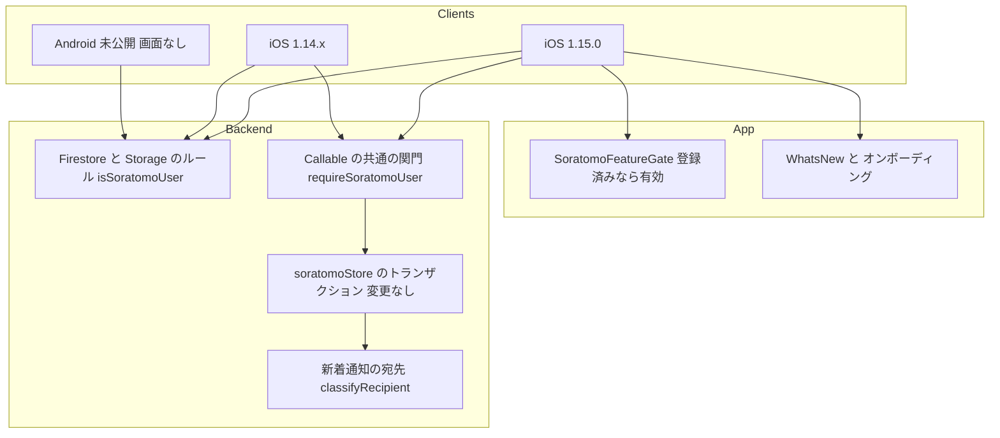
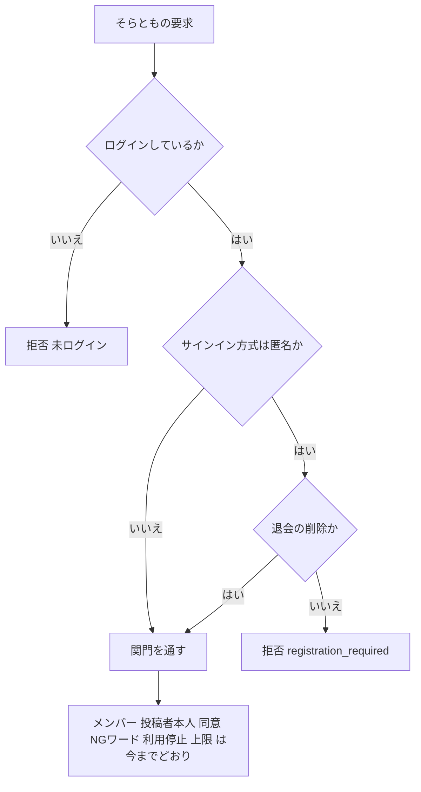
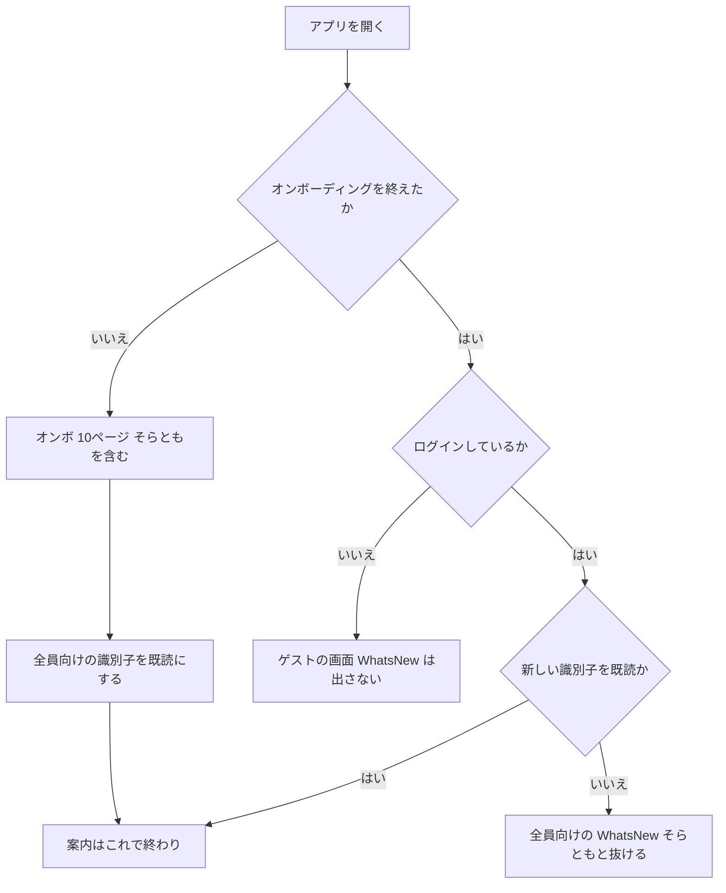
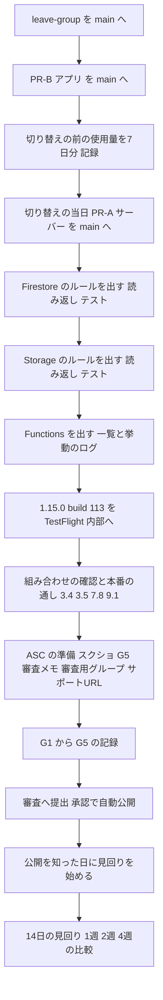

# Design Document — そらとも 一般公開の切り替え（soratomo-public-launch）⭐️

## Overview

**Purpose**: そらともを、機能フラグ（カスタムクレーム`soratomoBeta`）の内側から出し、1.15.0で「登録済みのアカウントでログインした全員」に開く。全員にクレームを配らず、アプリ・Firestore/Storageのルール・Cloud Functionsの3か所の関門を「登録済みでログインしているか」の判定に置き換える。

**Users**: 既存の利用者はアップデートの後に全員向けのWhat's Newで、新規の利用者はオンボーディングで、そらともと「グループを抜ける」を知る。審査の人は、審査用のアカウントと審査メモの手順で、そらともを確かめる。開発者は、本書の「リリース手順書」（Migration Strategy）に沿って、切り替え・提出・公開後14日の見回りを行い、公開の前後を比べる。

**Impact**: 関門の判定を「クレームがあるか」から「ログインしていて、匿名アカウントでないか」に変える。先行公開の紹介（「先行公開」バッジのシート）をやめ、全員向けのWhat's Newとオンボーディングに載せ直す。新着通知の宛先は、クレームで絞らなくなる。データの移し替えは無い。「グループを抜ける」の動きは、leave-group specが持つ（本書は関門・案内・同梱・順序だけ）。

### Goals
- 3か所の関門を、同じ規則（登録済みでログイン＝使える／未ログイン・匿名＝拒否／退会の削除だけは匿名も通す）にそろえる（1.1〜1.9・2.1〜2.6・4.1）。
- 審査の人と利用者が1.15.0を手にする前に、サーバーを開け終え、読み返して確かめる（3.1〜3.6）。
- 自動テストが、新しい判定（ログイン・匿名・メンバー・投稿者本人）を壊すと赤になることを、陽性対照つきで示す（10.1〜10.6）。
- 案内（What's New・オンボーディング）を1人1回にそろえ、先行公開の紹介を出さない（6.1・7.1〜7.10）。
- 公開判断の記録（G1〜G5）・審査の準備・14日の見回り・公開前後の比較を、1つの手順書にまとめる（5・8・9・11・12）。

### Non-Goals
- 「グループを抜ける」の動き（削除・引き継ぎ・入り直し・抜けた後の画面・計測）。leave-group specが持つ。
- App Checkの強制・レート制限・投稿の1日20件のサーバー側の判定（決定事項1）。
- 全員に対してそらともを止める仕組み（決定事項2）。Remote Configの導入。
- Android版のそらともの画面。クレームの一括の取り消し・付与のスクリプトの削除（6.2〜6.5）。
- App Storeの説明文の書き換え。issue #173の修正。新規の流入の出どころの調査。

## 設計の前提（現物で確かめた事実・2026-10-11・HEAD `22422a3`）

要件の「前提と制約」の行番号は、すべて現物と一致した。設計で新しく使う事実だけを書く。

| # | 事実 | 出どころ | 設計への効き方 |
|---|---|---|---|
| P1 | IDトークンには予約済みの項目`firebase.sign_in_provider`があり、匿名は`"anonymous"`、メールとパスワードは`"password"`。ルールでは`request.auth.token.firebase.sign_in_provider`で読める | Firebase公式「Rules and Auth」・`functions/node_modules/firebase-admin/lib/auth/token-verifier.d.ts:69-88`（`firebase`は省略できない項目） | ルールとFunctionsの匿名の判定に使う（research.mdの「匿名の判定」） |
| P2 | Callableの`request.auth.token`は、検証済みの`DecodedIdToken`そのもの | `functions/node_modules/firebase-functions/lib/common/providers/https.d.ts:39-46`（firebase-functions 7.4.0） | Functionsもルールと同じ項目で判定できる |
| P3 | 既存のFunctionsのテストは、匿名を`{ firebase: { sign_in_provider: "anonymous" } }`で表している | `functions/soratomo.test.js:504` | テストのトークンの形をこれにそろえる |
| P4 | iOSのログイン方式はメールとパスワードと匿名だけ。匿名ログインを呼ぶ画面は無い（`signInAnonymously`の呼び出しは`AuthViewModel.swift:121`の定義だけ）。Android版は匿名を作らない | grep（`Soramoyou/Soramoyou`）・`~/dev/soramoyou-android/.../AuthRepository.kt:25` | 匿名の拒否は、画面から見える変化を生まない |
| P5 | 匿名でログインすると`isAuthenticated = true`になり、`MainTabView`が出る | `AuthViewModel.swift:135`・`ContentView.swift:54-56` | 匿名でも全員向けのWhat's Newは出る。P4により到達しないので受け入れる（Error Handling） |
| P6 | Rulesのテストは、拒否を期待するケースが「エラーで拒否」されたら期待外れとして数える。許可を期待するケースはエラーなら拒否として期待外れになる | `scripts/rules_test_soratomo.py:306-313`・`rules_test_storage_soratomo.py`の同じ関数 | ログインしたケースのトークンには必ず`firebase.sign_in_provider`を入れる |
| P7 | `fastlane/Fastfile:70`は`automatic_release: true`（承認されたら自動で公開）。提出（`release_submit`）でも同じ値で`deliver`を呼ぶので、App Store Connectの画面で「手動で公開」に変えても、提出のときに上書きされる | `fastlane/Fastfile:57-73`・`:107-124` | 12.6のために、提出の道具に「手動で公開」の選択肢が要る（利用者の判断1）→ 2026-10-11 利用者が自動のままを選んだので作らない |
| P8 | プライバシーポリシーの原本はアプリの中の`SettingsView.privacyPolicyText`（最終更新日 2026年8月3日・そらともの記述なし）。ホストのHTMLは`scripts/build-privacy-policy-html.py`で作り、hostingへ出す | `SettingsView.swift:736-740`・`docs/app-privacy-label.md:68-77` | G5のポリシーの更新は、1.15.0のアプリの変更に含める |
| P9 | `deliver`は`skip_screenshots: true`・メタデータはリリースノートだけ | `fastlane/Fastfile:66-69` | スクリーンショット・審査メモ・プライバシーラベルはApp Store Connectで開発者が手で入れる（8.7） |
| P10 | 本番のルールの読み返しは、前例（release-gate tasks 17）で「rulesetの識別子・ハッシュの一致」と「読み返した本文にテストを流す」で行った。道具はリポジトリに無い（手元の一時的なもの） | `.kiro/specs/soratomo-release-gate/tasks.md:643-646` | 読み返しの道具を小さく足す（Components「運用」） |
| P11 | `.claude/handoffs/`はgitの管理外。公開前の基準値・予測・クエリは`.claude/handoffs/2026-10-11-材料/`にしか無い | `git status`（`?? .claude/handoffs/`） | 比べるための基準値・予測・クエリの型を、本specの`research.md`へ写す |
| P12 | leave-group specの`design.md`（並行で執筆中・未承認。2026-10-11に読んだ版）は、抜けるのCallableを`soratomoLeaveGroup`（8本目のCallable・`module.exports`の11本目）とし、`requireFlag: false`で作る。新しい関数は足さず、定期実行`soratomoHousekeeping`に仕事Cを足す。`firestore.rules`には拒否だけの`match`（`soratomoPendingLeaves`）を`soratomoConfig`の後に足し、`isSoratomoUser()`には触れない。`storage.rules`は変えない。抜ける入口はタイムラインの右上のメニュー | `.kiro/specs/soratomo-leave-group/design.md:7・17・281・286・452・462` | 本書は`soratomoLeaveGroup`を関門の変更の対象に入れ、`requireFlag: false`の1行を消す。leave-groupの設計が承認で変わったら突き合わせ直す（要確認1） |

## Requirements Traceability

| Requirement | Summary | Components | Interfaces | Flows |
|---|---|---|---|---|
| 1.1, 1.2, 1.6, 1.7, 1.8, 4.1 | 関門をクレームでなく「登録済みでログイン」で決める。抜けるも対象・退会の削除だけ匿名も通す | FirestoreRules・StorageRules・SoratomoCallableGate | `isSoratomoUser()`・`requireSoratomoUser`・`isRegisteredToken` | 関門の判定 |
| 1.3, 1.4 | 新着通知の宛先をクレームで絞らない。既存の規則（設定・ブロック・トークン・5分）は残す | SoratomoNotifyRecipients | `classifyRecipient` | — |
| 1.5, 5.1 | メンバー・投稿者本人・同意・NGワード・利用停止・上限・招待コードは変えない | FirestoreRules・StorageRules・（soratomoStore.jsは変更なし） | — | — |
| 1.9, 6.2 | 1.14.xのクレームのある人は、切り替えの途中と後も使える。クレームは取り消さない | 全部（新しい判定はクレームを見ない） | — | 切り替えの順序 |
| 2.1〜2.6 | アプリの入口・通知設定・退会の文・通知のタップを、登録済みなら出す。トークンを取り直さない | SoratomoFeatureGate・SoratomoRouter・SettingsView | `SoratomoFeatureGate.evaluate()` | — |
| 3.1〜3.6 | サーバーを開け終えてから1.15.0を配る。読み返し・組み合わせの確認・閉じ直さない | リリース手順書 | 読み返しの道具 | 切り替えの順序 |
| 4.2〜4.4 | Android版の退会の残りは定期実行が拾う。Android版を待たない。全員に開いたことを文書に書く | （変更なし）・文書の更新 | — | — |
| 5.2〜5.4 | 14日の見回り（見る場所・目安・記録） | リリース手順書「公開後14日の見回り」 | `soratomo-admin.js`（既存） | — |
| 6.1 | 先行公開の紹介を出さない | WhatsNewContent・MainTabView | — | 案内の表示 |
| 6.3〜6.5 | 公開後は新しく付けない・スクリプトの説明を直す・取り消すならskyMotionBetaを消さない | 文書の更新・`set-soratomo-beta-claim.js`の説明 | — | — |
| 7.1〜7.5 | 全員向けのWhat's New（新しい識別子）・オンボのページ・1人1回 | WhatsNewContent・MainTabView・OnboardingView | `WhatsNewGate.shouldPresent`（変更なし） | 案内の表示 |
| 7.6, 7.7, 7.9 | PR #163の取り込みの時期・文言を1.15.0に合わせる・スクリーンショットは1.15.0の版だけ | OnboardingView・リリース手順書 | — | 切り替えの順序 |
| 7.8, 7.10 | 宣伝する操作を実データで通す・文言は開発者の承認で確定 | リリース手順書 | — | — |
| 8.1〜8.7 | G1〜G5の記録・サポートURL・G5の更新・審査メモ・審査用のグループ | リリース手順書「G5と審査の準備」・docs/app-privacy-label.md・SettingsView（ポリシー） | — | 切り替えの順序 |
| 9.1〜9.3 | 計測の着弾（公開前・公開後7日） | リリース手順書「G4」 | PostHogのクエリ（research.md） | — |
| 9.4, 9.5 | 計測の名前と値は変えない。クレームが無いことでflag_offを記録しない | SoratomoRouter・SoratomoFeatureGate | — | — |
| 10.1〜10.6 | テスト・変異テスト・陽性対照・iOSの単体テスト・本番のルールへのテスト | テスト（ルール2本・Functions 2本・iOS 4本） | — | — |
| 11.1〜11.7 | 公開前後の比べ方 | リリース手順書「公開前後の比較」・research.md | PostHogのクエリ | — |
| 12.1〜12.6 | 1.15.0・build 113以上・1.14.1を出さない・同梱・絵文字の検査・公開の時刻 | リリース手順書（公開は今までどおり自動・判断1） | — | 切り替えの順序 |
| 13.1〜13.4 | そらとも以外の条件・ゲストと匿名のホーム・通知・退会の8手順を変えない | （変更しない範囲の明記）・テスト | — | — |
| 14.1〜14.3 | 文書の更新（上書きの注記の形） | 文書の更新 | — | — |

## Architecture

### Existing Architecture Analysis

- 関門は3か所に分かれている。アプリ（`SoratomoFeatureGate`が入口・設定・通知のタップの表示を決める）、ルール（`isSoratomoUser()`がFirestoreとStorageの読み書きを決める）、Functions（`requireSoratomoUser`がCallableを、`fetchFlaggedUids`＋`classifyRecipient`が通知の宛先を決める）。soratomo spec design.md:1135のとおり、3か所は同じ条件にしておく。
- 関門の後ろの判定（メンバー・投稿者本人・同意・NGワード・利用停止・上限）は、ルールの`isSoratomoMember`と`resource.data.authorId`、Functionsの`soratomoStore.js`のトランザクションにある。本書はここに触れない（1.5）。
- `isSoratomoUser()`は、Firestoreで6か所（`firestore.rules:587・596・604・613・631・636`）、Storageで3か所（`storage.rules:237・241・253`）から呼ばれる。関数の中身だけを変えれば、呼ぶ側は変わらない。
- アプリの`SoratomoFeatureGate`は環境オブジェクトで、5つの画面（`ContentView`・`MainTabView`・`SettingsView`・`SoratomoEntryButton`・`GuestTabView`経由の`HomeView`）が読む。

### Architecture Pattern & Boundary Map



**Architecture Integration**:
- 選んだ形: 既存の3か所の関門を残し、中身の条件だけを「登録済みでログイン」に置き換える。関門の名前（`isSoratomoUser()`・`requireSoratomoUser`・`SoratomoFeatureGate`）は変えない。呼ぶ側の差分を最小にし、変異テストの置き換え元を1か所に保つため。
- 境目: 抜けるの動きはleave-group。本書は、抜けるのCallable（`soratomoLeaveGroup`）が関門の既定値（匿名を拒否）で動くようにすることだけを持つ（Components「Callableの共通の関門」）。
- 新しい部品: Functionsの純粋関数`isRegisteredToken`（ルールと同じ規則をテストしやすい形で1か所に置く）・本番のルールの読み返しの小さな道具。どれも3.3・10.6のために要る（提出の道具は変えない・判断1）。

### Technology Stack

| Layer | Choice / Version | Role in Feature | Notes |
|---|---|---|---|
| iOS | Swift / SwiftUI（既存）・FirebaseAuth（既存） | 判定を`currentUser`の種類だけで行う | 新しい依存なし。IDトークンを読まなくなる |
| Backend | Cloud Functions v2・firebase-functions 7.4.0・firebase-admin 14.5.0（既存） | Callableの関門・通知の宛先 | 新しい依存なし |
| Rules | Firestore / Storage のセキュリティルール（`rules_version = '2'`） | 関門の条件 | `request.auth.token.firebase.sign_in_provider` |
| 運用 | Rules REST API（読み取り）・fastlane deliver（既存） | 本番のルールの読み返し・提出（既存のまま） | 読み取りは`firebase` CLIのトークンを使い、値を出さない |
| 計測 | PostHog（プロジェクト 430627・既存） | G4と公開前後の比較 | クエリの型は`research.md` |

## System Flows

### 関門の判定（ルールとCallableで同じ規則）



- 「匿名か」は`firebase.sign_in_provider == "anonymous"`で決める。項目が読めないトークンは「匿名と同じく拒否」に倒す（ルールでは読み取りのエラーで拒否、Functionsでは文字列でなければ拒否）。本番のIDトークンには必ずある（P1）。
- ルールに「退会の削除」の分岐は無い。退会の削除はFunctions（Admin SDK）が行い、ルールを通らないため。

### 案内の表示（1.15.0）



- 先行公開の紹介の経路は消すので、どの枝でもそらともの紹介は1回だけ（7.5・6.1）。先行公開の紹介をすでに見たテスト用アカウントが、もう一度全員向けで見るのは許す（7の補足）。
- ゲストがあとでログインすると、`MainTabView`が出たところで全員向けのWhat's Newが出る（既存の仕組みのまま）。

### 切り替えの順序



- 守る条件は1つだけ: **クレームの無いアカウントが1.15.0を手にする前に、3か所を開け終えて確かめる**（3.1・3.2）。3か所の間の順は、1.14.xへ影響しない（1.14.xはクレームの無い人に入口を出さず、クレームのある人は開ける前も後も通る＝1.9）。
- 3か所の中では、読み返しが速く確実なルールから出し、挙動の確かめに時間のかかるFunctionsを最後にする。
- PR-A（サーバー）は切り替えの当日にマージして、そのまま出す。先にマージすると、その間に別の理由でルールやFunctionsをmainから出したとき、予定より早く開くため（壊れた画面は出ないが、画面を通さない直接の要求を受ける期間が延びる）。
- 1.15.0の版は、サーバーを開けた後にだけTestFlightへ出す。開ける前に1.15.0の開発版を触るのは、クレームのあるテスト用アカウント（S3）だけにする（leave-group specの受け入れの確認を含む）。
- PR-B（アプリ）をmainへ入れた後は、1.15.0以外の版をmainから作らない。PR-Bの入ったアプリは、クレームの無い人にも入口を出すので、サーバーを開ける前に出すと「入口は出るのに拒否される」画面になる（3.1・3.2）。1.14.xの急ぎの修正が要るときは、PR-Bより前のコミットから枝を切る。

## Components and Interfaces

| Component | Domain/Layer | Intent | Req Coverage | Key Dependencies (P0/P1) | Contracts |
|---|---|---|---|---|---|
| FirestoreRules（`isSoratomoUser()`の中身） | Backend: ルール | 登録済みでログインした人だけを通す | 1.1, 1.5〜1.9, 4.1, 13.1 | `request.auth.token.firebase`（P0） | State |
| StorageRules（`isSoratomoUser()`の中身） | Backend: ルール | 画像の読み取り・保存・削除で同じ規則 | 1.1, 1.5〜1.9, 4.1, 13.1 | 同上（P0） | State |
| SoratomoCallableGate（`requireSoratomoUser`・`soratomoCallable`） | Backend: Functions | Callableの関門。退会の削除だけ匿名を通す | 1.1, 1.2, 1.6〜1.9, 4.1 | `isRegisteredToken`（P0） | Service |
| `isRegisteredToken` | Backend: Functions（soratomoCore.js） | 登録済みのトークンかを返す純粋関数 | 1.7, 10.1 | なし | Service |
| SoratomoNotifyRecipients（`classifyRecipient`と配線） | Backend: Functions | 宛先をクレームで絞らない | 1.3, 1.4 | なし | Service |
| SoratomoFeatureGate | iOS | 登録済みなら有効。トークンを読まない | 2.1〜2.6, 9.5, 13.2 | FirebaseAuth `currentUser`（P0） | State |
| SoratomoRouter（`resolvePending`） | iOS | 通知のタップの解決から、クレームの理由を除く | 2.6, 9.4, 9.5, 13.3 | SoratomoFeatureGate（P0） | Service |
| WhatsNewContent・MainTabView | iOS | 全員向けのWhat's Newに載せ直し、先行公開の紹介を消す | 6.1, 7.1〜7.3, 7.5, 7.7 | — | State |
| OnboardingView | iOS | PR #163のページ（文言を1.15.0に合わせる） | 7.4〜7.7 | — | — |
| SettingsView | iOS | 退会の文・通知設定は判定のまま。ポリシーの本文（G5） | 2.4, 2.5, 8.3, 8.4, 13.4 | SoratomoFeatureGate（P0） | — |
| 読み返しの道具（`scripts/read-deployed-rules.py`・新規） | 運用 | 本番のルール2本を読み、識別子・時刻・ハッシュと本文を出す | 3.3, 10.6 | Rules REST API（P0） | Batch |
| リリース手順書（本書のMigration Strategy） | 運用 | 切り替え・確認・提出・見回り・比較を1か所に | 3, 5, 7.8, 8, 9, 11, 12 | — | — |

### Backend: Firestore / Storage ルール

#### FirestoreRules・StorageRules（`isSoratomoUser()`の中身の置き換え）

| Field | Detail |
|---|---|
| Intent | そらとものパスを、登録済みでログインした人だけに開く |
| Requirements | 1.1, 1.5, 1.6, 1.7, 1.9, 4.1, 13.1 |

**Responsibilities & Constraints**
- 関数の名前と呼ぶ側（Firestore 6か所・Storage 3か所）は変えない。中身だけを次の判定式にする。

```
// firestore.rules（573〜575行）と storage.rules（222〜224行）の両方で同じ式
function isSoratomoUser() {
  return isAuthenticated() && request.auth.token.firebase.sign_in_provider != 'anonymous';
}
```

- 「匿名でない」を条件にし、「メールとパスワードだけ」にはしない。P4のとおり、いまのログイン方式はメールとパスワードと匿名だけなので、どちらでも結果は同じ。将来ほかの方式（Appleでサインインなど）を足したとき、ルールを開け直さずに済むほうを選んだ（research.mdの「匿名の判定」）。
- `get('soratomoBeta', false)`の読み方は消す。`skyMotionBeta`の判定（`firestore.rules:474・530`・`storage.rules:200`）には触れない（13.1）。
- `firebase`の項目を`get`で既定値つきに読まない。本番のトークンには必ずあり（P1）、無いときはエラーで拒否される（閉じる側に倒れる）。テストでは、この形のおかげで「トークンの形の書き忘れ」がエラーとして見つかる（P6）。
- コメント（`firestore.rules:568-572`・`storage.rules:210`と`219-221`）を、「3か所で同じクレームを要求する」から「3か所で同じ『登録済みでログイン』を要求する。匿名は拒否。1.15.0で一般公開（soratomo-public-launch）」に直す（14.1）。`isSoratomoMember`の「`isSoratomoUser()`の後ろに`&&`でつなぐ」の注意（`firestore.rules:579`・`storage.rules:227`）はそのまま正しい。

**Contracts**: State [x]

| パス | 読み取り | 作成 | 削除 | 変わること |
|---|---|---|---|---|
| `soratomoGroups/{g}`（get）・`members`・`skies`（read） | 登録済み＋メンバー | — | — | クレームの無いメンバーが読めるようになる。匿名のメンバー（作れないが）は拒否 |
| `skies/{s}` | 同上 | `false`のまま | 登録済み＋投稿者本人 | 同上 |
| `soratomoUsers/{uid}`・`/groups` | 登録済み＋本人 | `false` | `false` | 同上 |
| Storage `soratomo/{g}/{a}/{s}/{f}` | 登録済み＋メンバー | 登録済み＋本人のパス＋メンバー＋形と大きさ | 登録済み＋本人のパス | 同上 |

**Implementation Notes**
- Integration: 本番へは`firebase deploy --only firestore:rules`と`--only storage`を別々に出し、それぞれ読み返す（Migration）。
- Validation: ルールのテスト2本（Testing Strategy）。本番から読み返した本文にも流す（10.6）。
- Risks: 匿名でログインした人がメンバーの文書を持つことは無い（参加のCallableが匿名を拒否する）ので、匿名の拒否は多層防御として働く。

### Backend: Cloud Functions

#### SoratomoCallableGate（`requireSoratomoUser`・`soratomoCallable`）

| Field | Detail |
|---|---|
| Intent | Callableの入口で、ログインと「匿名でないこと」を確かめる。退会の削除だけ匿名も通す |
| Requirements | 1.1, 1.2, 1.6, 1.7, 1.8, 1.9, 4.1 |

**Responsibilities & Constraints**
- 選択肢`requireFlag`（`functions/soratomo.js:126-141`）を消し、逆向きの既定値を持つ選択肢`allowAnonymous`（既定 `false`）に置き換える。`true`にしてよいのは`soratomoDeleteMyData`だけ（`:257`の`requireFlag: false`を`allowAnonymous: true`に）。
- **leave-groupとの約束**: leave-groupの`soratomoLeaveGroup`は`requireFlag: false`で作られる（P12）。本書の実装でその1行を消し、選択肢を何も渡さない形（既定＝匿名を拒否）にする。抜けるは利用停止中・未同意の人も受け付ける（leave-groupの要件9の3・4）が、それはトランザクションの側の判定で、関門は変えない。消し忘れを防ぐため、`soratomoCallable`は知らない選択肢の名前（`requireFlag`を含む）を受け取ったら、モジュールの読み込みの時点で例外を投げる（テストもデプロイも、その時点で止まる）。
- クレーム`soratomoBeta`は読まない（1.1）。クレームのある人（1.14.x）は、登録済みなのでそのまま通る（1.9）。
- 拒否の理由は新しい`registration_required`（code `permission-denied`）。`flag_off`は返さなくなる。`REASON_TO_CODE`の`flag_off`（`:59`）と`soratomoStore.js:53`のJSDocの`flag_off`は、どこからも使われなくなるので消す。
- 1.15.0のアプリは`registration_required`を知らないが、`mapCallableError`が「理由を知らない`permission-denied`」として`.permissionDenied`に写す（`SoratomoGroupService.swift:352-379`の`:374`）。Callableを呼ぶほかのサービスも、すべてこの1つの写しを通る（`SoratomoSkyService.swift:280`・`SoratomoModerationService.swift:102`・`SoratomoGuidelineService.swift:110`・`SoratomoAccountDeletionService.swift:107`）。アプリの変更は要らない。匿名に入口は出ないので、ふつうは届かない。

**Contracts**: Service [x]

##### Service Interface
```typescript
// functions/soratomoCore.js（純粋関数・node:test で検証）
/** 検証済みの ID トークンが「登録済みのアカウント」のものか。
 *  firebase.sign_in_provider が文字列で、"anonymous" でないときだけ true。
 *  token が無い・firebase が無い・sign_in_provider が文字列でない → false（閉じる側に倒す） */
function isRegisteredToken(token: DecodedIdTokenLike | undefined): boolean;

type DecodedIdTokenLike = { firebase?: { sign_in_provider?: unknown } };

// functions/soratomo.js
type SoratomoCallableOptions = {
  allowAnonymous?: boolean;            // 既定 false。true は soratomoDeleteMyData だけ
  runtime?: CallableRuntimeOptions;    // 既存のまま
  respond?: (result: object) => object;
  okLogFields?: (result: object, data: object) => object;
};
/** 知らない選択肢の名前（requireFlag を含む）を渡すと、読み込みの時点で Error を投げる */
function soratomoCallable(name: string, body: (uid: string, data: object) => Promise<object>,
  options?: SoratomoCallableOptions): CallableFunction;

/** 返すのは uid。失敗は HttpsError:
 *  - 未ログイン → "unauthenticated"（今までどおり）
 *  - allowAnonymous が false で isRegisteredToken が false → "permission-denied"・details.reason "registration_required" */
function requireSoratomoUser(request: CallableRequest, opts: { allowAnonymous: boolean }): string;
```
- Preconditions: `request.auth`はfirebase-functionsが検証したもの（P2）。
- Postconditions: 返したuidは認証のuid。要求の本文のuidは使わない（既存のまま）。
- Invariants: クレームを読まない。拒否のログは`{name}: rejected { uid, reason }`（既存の形）で、`reason`は`unauthenticated`か`registration_required`。

**Implementation Notes**
- Integration: ファイルの頭の説明（`functions/soratomo.js:2-20`）を直す。2行目のCallableの本数と20行目の「10本」は、leave-groupの後の本数（Callable 8本・全部で11本。P12・要確認1）にする。`:79`・`:128-130`・`:241-242`・`:256`の「クレーム」「フラグ」の説明も直す。
- Validation: Testing Strategyの「Functions」。
- Risks: 選択肢の名前の検査を足すことで、leave-groupの実装が先にmainへ入った状態で`requireFlag: false`が残っていると、本書の実装のテストが読み込みで落ちる。これは狙いどおり（消し忘れを見つける）。

#### SoratomoNotifyRecipients（新着通知の宛先）

| Field | Detail |
|---|---|
| Intent | 宛先をクレームで絞らず、既存の規則（設定・ブロック・トークン・5分の間引き）だけで絞る |
| Requirements | 1.3, 1.4 |

**Responsibilities & Constraints**
- `fetchFlaggedUids`（`functions/soratomo.js:273-291`）と、その呼び出し（`:344`）を消す。通知のたびの`getAuth().getUsers`が1回減る。`getAuth`は定期実行（`sweepUsersWithoutAccount`）が使うので、読み込みは残す。
- `classifyRecipient`（`functions/soratomoCore.js:193-210`）の引数から`hasFlag`を消し、最初の`flag_off`の分岐（`:202`）を消す。順序は「設定OFF → ブロック → トークン無し」。
- 集計`summarizeNotifyOutcomes`（`:269-289`）と対応表（`:248-258`）は変えない。ログの`flagOff`の項目は、公開後はいつも0になる。1.14期のログと同じ形で読めるように残す（14日の見回りで、ログの形が変わらない）。
- 匿名の宛先を除く分岐は足さない。匿名は参加できないので、メンバーにいない。

**Contracts**: Service [x]
```typescript
function classifyRecipient(args: { userData: object | null | undefined; posterId: string }):
  "eligible" | "pref_off" | "blocked" | "no_token";
```

### iOS

#### SoratomoFeatureGate

| Field | Detail |
|---|---|
| Intent | 登録済みのアカウントでログインしていれば有効。IDトークンを読まない |
| Requirements | 2.1〜2.6, 9.5, 13.2 |

**Responsibilities & Constraints**
- 型は残し、環境オブジェクトとして読む5つの画面は変えない。`isEnabled`の意味が「クレームがある」から「登録済みでログイン」に変わるだけで、入口（`SoratomoEntryButton.swift:33`）・通知設定（`SettingsView.swift:346`）・退会の文（`:230`）は書き換えずに2.1・2.4・2.5を満たす。
- 判定は`currentAccountKind()`だけで決める: `nil` → 無効（未ログイン）・匿名 → 無効（匿名）・登録済み → 有効。通信しないので、起動時に通信できなくても入口が出る（2.3）。
- 消すもの: `DisabledReason.claimMissing`と`.tokenUnavailable`・`claimKey`（`:93`）・`needsForcedRefresh`と世代（`:105-112`。待ちが無くなり、古い結果が後から上書きする競合が起きないため）・`reevaluateIfTokenUnavailable()`（`:163-166`）と、その呼び出し（`SoramoyouApp.swift:103-107`）。
- 窓口のプロトコル`SoratomoClaimsProviding`は`claims(forceRefresh:)`を持たなくなるので、`SoratomoAccountProviding`に名前を変え、本番の窓口を`FirebaseSoratomoAccountProvider`にする。実装している4か所（`ContentView.swift:157`・`GuestTabView.swift:191`・`MainTabView.swift:422`・テストのモック`SoratomoFeatureGateTests.swift:17`）を合わせて直す。

**Contracts**: State [x]
```swift
@MainActor protocol SoratomoAccountProviding {
    func currentAccountKind() -> SoratomoAccountKind?   // 既存の enum（registered / anonymous）
}
@MainActor final class SoratomoFeatureGate: ObservableObject {
    enum DisabledReason: Equatable { case signedOut, anonymous }
    enum State: Equatable { case unknown, enabled, disabled(DisabledReason) }
    @Published private(set) var state: State          // 初期値 unknown
    var isEnabled: Bool                                // state == .enabled
    @discardableResult func evaluate() -> State        // 同期。通信しない
    func reset()                                       // サインアウトで unknown へ
}
```
- `evaluate()`は同期の関数にする。呼ぶのは`ContentView.swift:100-104`の`.task(id:)`だけで、`await`を外す（警告を残さない）。
- 判定前（`unknown`）は、ログインが確定してから最初の`evaluate()`までの一瞬だけになる。

#### SoratomoRouter（`resolvePending`）

- `case .unknown, .disabled(.tokenUnavailable)`（`SoratomoRouter.swift:219`）を`case .unknown`にする。無効（匿名）は今までどおり保留を捨てて`flag_off`を記録する。クレームが無いことで`flag_off`を記録する経路は無くなる（9.5）。イベントの名前と値は変えない（9.4）。
- 説明のコメント（`:196-206`・`:220-223`）の「フラグ」を「そらともを使えない（匿名）」に直す。

#### WhatsNewContent・MainTabView（全員向けのWhat's Newへの載せ直し）

| Field | Detail |
|---|---|
| Intent | 1.15.0の全員向けの紹介にそらともと「グループを抜ける」を載せ、先行公開の紹介をやめる |
| Requirements | 6.1, 7.1, 7.2, 7.3, 7.5, 7.7 |

**Responsibilities & Constraints**
- `currentID`を新しい値`"2026-10-soratomo-public"`にする。過去の値（`2026-09-sky-camera`・`2026-09-sky-ae`・`2026-09-ranking-recommended`・`2026-09-ranking-sky-ae`・`2026-10-soratomo-beta`）のどれとも違うので、1.12.0までを既読にした人にも出る（7.2）。過去の値の一覧はコメントに足す。
- `pages`を2ページに替える。1ページ目「そらとも」（何ができるか・入口の場所）、2ページ目「グループの出入り」（招待コードで参加・あとから抜けられる）。抜けるの説明は、leave-groupの画面と同じ言葉にする（いまの設計ではタイムラインの右上のメニュー。7.3・要確認1）。そらともの紹介の文は3行で埋まる（`WhatsNewContent.swift:62`）ため、抜けるは別のページにする。バッジは「新機能」。
- 入口のボタンは文字の無いアイコン（`person.2.circle`）なので、文では「ホーム右上の（アイコン）ボタン」と書き、ページのアイコンも同じ記号にする。いまの先行公開の文「ホームの『そらとも』から」は画面と合わないので使わない（7.7）。
- 消すもの: `soratomoIntroID`・`soratomoIntroSeenKey`・`soratomoIntroHeadline`・`soratomoPages`（`WhatsNewContent.swift:41-68`）・`WhatsNewGate.shouldPresentSoratomoIntro`（`:152-164`）・`MainTabView`の`WhatsNewKind.soratomo`と`lastSeenSoratomoIntro`と`maybeShowSoratomoIntro()`（`MainTabView.swift:28-36`・`:133-138`・`:150`・`:177-179`・`:209-211`・`:222-248`）。端末に残る既読のキー`lastSeenSoratomoIntro`は読まれなくなるだけで、消さない。
- 全画面のカバーの`item:`の仕組み（`:18-27`・`:129`）は、種類が1つになっても変えない（実機で直した経緯があるため・コメントのとおり）。
- 文言は実装の段で利用者に見せて確定する（7.10）。

#### OnboardingView（PR #163の取り込み）

- PR #163の`47e5fcc`のページ（「みんなと共有」の直後・アイコン`person.2.circle`・配色はWhat's Newのそらともと同じ）を、PR-B（アプリ）に取り込む。#163の残りのコミット（スクリーンショットの素材と作り方）も同じPRに入れ、#163はPR-Bへのリンクを書いて閉じる（7.6の「同時」。このリポジトリはsquashでマージするので、#163が自動で閉じないため）。
- 直すもの: コメントの「1.14」を「1.15.0」に。説明の文を、What's Newの1ページ目と同じ言い方にそろえる（7.7）。オンボのページは1枚（7.4）で、抜けるには触れない。
- 完了の処理（`OnboardingView.swift:119-124`）は変えない。新しい`currentID`を既読にするので、オンボの後に全員向けのWhat's Newは出ない（7.5）。

#### SettingsView

- 退会の確認の文（`SettingsView.swift:226-232`）は、判定の意味が変わることで2.5を満たす。単体テストで確かめられるよう、文を作る部分を純粋な静的関数`deleteAccountConfirmationMessage(isSoratomoEnabled: Bool) -> String`に出す（10.5。`MainTabView.canShowWhatsNewAfterDelay`と同じ型）。文そのものは変えない。
- 通知設定の「そらとも通知」（`:344-354`）は変えない。
- G5: プライバシーポリシーの本文（`privacyPolicyText`・`:736-`）に、そらともで変わる内容を足し、最終更新日を直す（8.3・8.4）。足す内容は「G5と審査の準備」の表のとおり。文案は実装の段で開発者の承認を取る。

#### 版数と、そのほかの説明の直し
- `project.pbxproj`の`MARKETING_VERSION`を1.15.0、`CURRENT_PROJECT_VERSION`を113以上（4か所とも）にする。113はApp Store Connectの最大のbuild（112）より大きい値として、archiveの直前にASCの実測を読んで決める（12.1）。
- `SoratomoEntryButton.swift:8-9・30-32`・`SoratomoError.swift:21`（`flagOff`の説明＝「1.14.xまでのサーバーの理由。1.15.0のサーバーは返さない」）・`SoratomoGroupService.swift:333・348`の説明を直す。計測の列挙の`flagOff`は残す（9.4）。

### 運用

#### 読み返しの道具（`scripts/read-deployed-rules.py`・新規）

| Field | Detail |
|---|---|
| Intent | 本番のFirestoreとStorageのルールを読み、手元のファイルと比べられる形で保存する |
| Requirements | 3.3, 10.6 |

**Contracts**: Batch [x]
- Trigger: 開発者がルールを出した直後に実行する（読み取りだけ。本番に書かない）。
- Input: 保存先のディレクトリ（スクラッチパッド）。認証はルールのテストと同じ`firebase` CLIのトークン（`~/.config/configstore/firebase-tools.json`）。トークンは出力しない。
- Output: リリース`cloud.firestore`と`firebase.storage/soramoyou-ios.firebasestorage.app`ごとに、rulesetの識別子・更新の時刻・本文のsha256の頭12桁を出し、本文を`<dir>/firestore.rules`と`<dir>/storage.rules`に保存する。手元のファイルのsha256の頭12桁も並べ、一致しなければ終了コード1。
- 保存した本文に、そのままルールのテスト2本を流す（テストの道具は、ルールのパスを引数で受け取る）。
- Idempotency: 読み取りだけなので、何度でも実行してよい。

#### 提出の道具（変えない）
- 利用者の判断1で「今までどおり自動で公開」に決まった（2026-10-11）。`--manual-release`は作らない。
- 公開は承認と同時に起きる。見回り（6-1）は、公開の知らせ（App Store Connectのメール・`asc_ensure_build.py --check-only`の`READY_FOR_SALE`）を受けた日から始める（12.6）。

#### リリース手順書
- 本書の「Migration Strategy」をリリース手順書とする（手順・確かめ方・見回りの目安・比べ方を1か所に置く）。結果は、本specの`tasks.md`の各タスクの「結果」に書く（release-gate specの16〜18と同じ型）。
- 公開前の基準値・予測・PostHogのクエリの型は、gitの管理外の`.claude/handoffs/`にしか無いので、本specの`research.md`へ写す（P11）。

## Data Models

変更なし。新しいコレクション・項目・インデックスは無い。端末の`UserDefaults`の`lastSeenSoratomoIntro`は読まれなくなる（消さない）。

## Error Handling

### Error Strategy
関門の失敗は、今までと同じく「理由つきの拒否」で返し、アプリは既存の写し（`mapCallableError`）で一般的な失敗として出す。新しい画面や文言は足さない。

### Error Categories and Responses
| 場面 | サーバーの応答 | アプリ（1.15.0） | 備考 |
|---|---|---|---|
| 未ログインの要求 | `unauthenticated`（Callable）・拒否（ルール） | `.permissionDenied` | 今までどおり。入口が出ないので、ふつうは来ない |
| 匿名アカウントの要求（退会の削除以外） | `permission-denied`・`registration_required`（Callable）・拒否（ルール） | `.permissionDenied`（理由を知らないので） | P4により画面からは届かない。ログの`rejected`で見つける（見回り） |
| `firebase.sign_in_provider`の無いトークン | 匿名と同じく拒否 | — | 本番では起きない。閉じる側に倒す |
| 1.14.xのクレームのある人 | 通る（1.9） | — | 1.14.xは`flag_off`を受け取らなくなる |
| 1.15.0が古いサーバー（開ける前）に当たる | `flag_off`（Callable）・拒否（ルール） | `.flagOff`の一般的な失敗 | 手順で起こさない（開ける前の1.15.0はS3だけで触る） |
| 起動時に通信できない | — | 判定は通信しないので、登録済みなら入口が出る（2.3） | 操作の失敗はsoratomo specの要件12のとおり |
| 匿名で`MainTabView`が出る | — | 入口は出ない。全員向けのWhat's Newは出る | P4・P5により到達しないので受け入れる（要件への差し戻し5） |

### 切り替えの途中の失敗
- 3か所のどれかのデプロイが失敗したら、1.15.0を配らずに止める（3.2）。途中の状態は1.14.xを壊さない（System Flowsの「守る条件」）。直して出し直すか、出した分をFirebaseのコンソールの前のrulesetへ戻す。戻してよいのは、1.15.0をクレームの無いアカウントへ配る前だけ（3.6）。
- 1.15.0を配った後は、全員に対して閉じ直さない（3.6・決定事項2）。止める手段は利用者ごとの利用停止（`soratomo-admin.js suspend`）と、次の版での修正。

### Monitoring
- Callableの拒否は既存のログ`{name}: rejected { uid, groupId?, skyId?, reason }`に出る。公開後に見る理由は`registration_required`（アプリ以外からの要求の疑い）と`not_found`（招待コードの総当たりの疑い）。
- 新着通知の集計`onSoratomoSkyCreated: summary`の形は変えない。`flagOff`は公開後いつも0。
- 見回りの手順と目安は、Migration Strategyの「公開後14日の見回り」。

## Testing Strategy

テストは「先に直したテストを、変える前のコードに流して赤を見る（陽性対照・10.4）→ コードを変えて緑 → 変異テスト」の順で行う。共有のstashは使わない（同じブランチで、テストのコミットをコードのコミットより先に置く）。

### ルールのテスト（`scripts/rules_test_soratomo.py`・`scripts/rules_test_storage_soratomo.py`）
- **トークンの形**: ログインしたケースのトークンを`{ "firebase": { "sign_in_provider": <方式> }, ...クレーム }`で作る。`case()`の`claim`の代わりに方式を持たせる（`rules_test_soratomo.py:74-77`・`:259-260`、Storageは`:82-85`・`:197-198`）。方式を書き忘れると、許可を期待するケースが「エラーで拒否」になって見つかる（P6）。
- **登場人物**: `NOCLAIM`（クレーム無し・`password`・g1のメンバー）は残し、期待を**許可**に変える。`ANON`（`anonymous`・g1のメンバーの文書あり）を足す。`MEMBER`などは`password`＋クレーム`soratomoBeta`（1.9: クレームのある人も通る）、`NOCLAIM`は`password`＋`skyMotionBeta`だけ（別のクレームに左右されないことも見る）。
- **ケース（Firestore）**: 「フラグ」の節（`:83-90`）を「ログインの種類」の節に替える。クレーム無しのメンバー: グループの取得・メンバー一覧・投稿一覧・自分の投稿の削除・自分の所属数の取得・自分の所属の写しの一覧 → 許可／投稿の作成 → 拒否（`if false`のまま）。匿名のメンバー: 同じ6つ → 拒否。
- **ケース（Storage）**: 「フラグ」の節（`:91-95`）を替える。クレーム無しのメンバー: 画像を読む・自分のパスへ保存・自分の画像を削除 → 許可。匿名のメンバー: 同じ3つ → 拒否。
- **変異テスト（10.2・10.3）**: 置き換え元を`CLAIM`（`rules_test_soratomo.py:208`・Storage `:131`）から次の`REGISTERED`に替える。ルールの中に1回だけ現れる（`isSoratomoUser()`の本文）。

  `REGISTERED = "isAuthenticated() && request.auth.token.firebase.sign_in_provider != 'anonymous'"`

  | 壊し方 | 置き換え | 期待外れになるケース |
  |---|---|---|
  | 匿名の判定を外す | `REGISTERED` → `isAuthenticated()` | 匿名のメンバーの拒否 |
  | 匿名の判定を逆にする | `!= 'anonymous'` → `== 'anonymous'`（`REGISTERED`の中で） | 登録済みの許可と匿名の拒否の両方 |
  | 登録済みの判定を常に偽 | `REGISTERED` → `false` | すべての許可 |
  | ログインの判定を外す | `REGISTERED` → `request.auth.token.firebase.sign_in_provider != 'anonymous'` | 未ログインのケース（エラーで拒否＝期待外れ。P6） |
  | ログイン・匿名・メンバーの判定をすべて外す | `REGISTERED` → `true` と `MEMBER_EXISTS` → `return true;` | 未ログイン・非メンバーの拒否（既存の組み合わせの置き換え先） |
  | メンバー判定を外す／常に偽 | 既存のまま | 既存のまま |
  | 削除の投稿者判定を外す／削除の条件をすべて外す | 既存のまま（投稿者本人の判定） | 既存のまま |

  Storageでは、上の4つ（匿名を外す・逆・常に偽・ログインを外す）を同じ形で入れ、既存の「クレームを直接読む」（`:151`）は消す。「読み取りのクレーム判定を外す」（`:157`）と「削除のクレーム判定を外す」（`:176`）は、置き換え先の文字列はそのままで名前を「…の登録済み判定を外す」に変える（匿名のケースが期待外れになる）。どの壊し方も置き換え元が1回だけ現れることを、既存の検査（`:335-339`）で確かめる（10.3）。
- **陽性対照（10.4）**: テストの変更を先にコミットし、ルールを変える前の`firestore.rules`と`storage.rules`に通常の実行を流す。期待外れが「クレーム無しのメンバー」の許可のケース（Firestore 6件・Storage 3件）だけであることを記録する（匿名のケースは、古いルールでもクレームが無いので条件で拒否され、緑のまま）。ルールを変えた後に、同じテストが全件緑になり、変異テストも全部が期待外れを1件以上出すことを確かめる。

### Functions（`functions/soratomo.test.js`・`functions/soratomoCore.test.js`）
- トークン: `ON`（`soratomo.test.js:182`）を、登録済み`{ firebase: { sign_in_provider: "password" } }`を既定にした形に替え、`authOf`の既定もそれにする。クレームのある1.14.xの人は`{ soratomoBeta: true, firebase: { sign_in_provider: "password" } }`で表す。
- `CALLABLES`（`:239-246`）に`soratomoLeaveGroup`（`{ groupId }`）を足して7本にする。
- テストの置き換え:
  - 「クレームが無い・trueでなければflag_off」（`:254-266`）→ 「クレームの無い登録済みは、7本とも関門で止められない（拒否されるならドメインの理由で、`registration_required`でも`flag_off`でもない）」と「クレーム無しで作成・参加・投稿・通報・同意が通る」。
  - 新しく「匿名は7本ともpermission-denied（`registration_required`）で、何も書かない」「`firebase`の無いトークンも同じく拒否」「クレームのある登録済みも通る（1.9）」。
  - 退会の削除の匿名のテスト（`:499-530`）はそのまま残す（1.8）。
  - 通知: 種のクレーム（`:563`の`claims`）に関係なく、クレームの無い宛先へ送られる（`:586-616`の`flagOff: 1`は`0`に、`sent`が1増える）。「宛先の絞り込みでAuthを読まない」（`getUsersCalls`が0回）。「フラグの確認に失敗」（`:649-657`）は「Authが失敗しても送る」に替える。
  - 選択肢の名前の検査: `requireFlag`を渡すと読み込みで例外になる。
- `soratomoCore.test.js`: `classifyRecipient`のテスト（`:250-285`）から`hasFlag`を外し、順序のテストを「設定OFF→ブロック→トークン無し」にする。`isRegisteredToken`のテストを足す（`password`・`apple.com`→真、`anonymous`・`firebase`無し・トークン無し・方式が文字列でない→偽）。
- 陽性対照: テストの変更を先にコミットし、変える前の`soratomo.js`・`soratomoCore.js`で流して、クレーム無しのケースと通知のケースが赤になることを記録する。コードを変えた後の「わざと壊したsoratomo.js」の確認は、スクラッチパッドの一時的なworktreeで行う（①匿名の判定を外す→匿名のテストが赤、②`allowAnonymous`の既定を`true`にする→同じく赤、③クレームの確認を戻す→クレーム無しのテストが赤、④宛先の絞り込みを戻す→通知のテストが赤）。
- 実行は`npm run test:emulator`（既存。`firebase emulators:exec --only firestore`）。

### iOS（XCTest）
- `SoratomoFeatureGateTests`: 書き直す。登録済み→有効（クレームの有無に関係ない）・匿名→無効（匿名）・未ログイン→無効（未ログイン）・初期値は判定前・`reset()`で判定前・`evaluate()`はモックの窓口の`currentAccountKind()`だけを読む。トークンの強制更新・世代・再評価のテスト（`:126-256`の多く）は消す。陽性対照: まず古い窓口のまま「クレームの無い登録済み（`claims`が空）→有効」のテストを足して赤を見てから、判定を変える。
- `SoratomoRouterTests`: `.claimMissing`（`:216`・`:257`・`:323`・`:659`）を`.anonymous`に替える。`testResolvePending_tokenUnavailableKeepsPendingUntilEnabled`（`:231`）は消す。未ログインと判定前のテストは残す。
- `WhatsNewGateTests`: 先行公開の紹介のテスト（`:79-112`）を消す。「`currentID`が過去の5つの値のどれとも違う」を足す（7.2の回帰の柵）。`testRealCurrentIDBehavior`は残す。
- 退会の文: `SettingsView.deleteAccountConfirmationMessage(isSoratomoEnabled:)`の真と偽のテストを足す（10.5）。入口と通知設定は`isEnabled`をそのまま読むので、判定のテストで受け持つ。
- 10.5の「案内の表示の判定」: 全員向けのWhat's Newの判定（`WhatsNewGate.shouldPresent`）はアカウントの種類を受け取らず、既存のテストのまま受け持つ。未ログイン（ゲスト）は`MainTabView`に来ないのでWhat's Newが出ず、匿名には出る（差し戻し5）。先行公開の紹介（アカウントで分けていた唯一の案内）は消すので、アカウントの種類ごとの案内の判定は残らない。
- 実行は負荷の縛り（`uptime`・`pgrep -x xcodebuild`・`nice -n 19`・`-jobs 4`）を守り、共用でないシミュレーター（DCFBF2D6）で行う。

### 本番のルールへのテスト（10.6）
- ルールを出した直後に、読み返しの道具で保存した本番の本文へ、ルールのテスト2本（通常）を流し、全件緑を確かめる（Migration 1-2・1-3）。

### E2E（本番・1.15.0のTestFlight）
- Migrationの「組み合わせの確認」と「本番の通し」。宣伝する操作（7.8）・クレームの無い宛先への通知（1.3）・計測の着弾（9.1・9.2）を同じ通しで見る。

## Security Considerations

- **開く範囲**: 公開後、そらともバックエンドは「登録済みでログインした全員」（iOS・Android・改造したアプリ）から要求を受ける（4.1・4.4）。メンバー判定・投稿者本人・同意・NGワード・利用停止・上限（1人10グループ・1グループ20人）・招待コードはそのまま効く（1.5・5.1）。改造したアプリからの1日20件を超える投稿は、見回りで見つけて利用停止で止める（決定事項1）。
- **匿名**: ルールとCallableの両方で拒否する（多層防御・1.7）。登録にメールの確認が無いので、使い捨ての登録済みアカウントは作れる。これは既存の公開の機能と同じ水準として受け入れ、見回りの目安で見つける。
- **閉じる側に倒す**: サインイン方式が読めないトークンは拒否する（ルールはエラー、Functionsは`isRegisteredToken`の偽）。
- **開けてから公開までの間**: 画面を通さない直接の要求を受ける期間を短くするため、PR-Aは切り替えの当日にマージし、開けた日から見回りを始める（要件の14日はその上に重ねる）。
- **審査メモの招待コード**: 審査の人へ渡した招待コードは、承認の後にS3が再発行する。招待コードはリポジトリとログに書かない（ASCの審査メモにだけ入れる）。
- **ログと個人情報**: 新しく出すのは理由の文字列`registration_required`だけ。uid以外の個人情報は出さない（既存の約束のまま）。
- **クレームを残すこと**: 1.15.0とサーバーはクレームを読まないので、残っても権限は増えない（6.2）。`skyMotionBeta`の判定には触れない（13.1）。

## Migration Strategy（リリース手順書）

本節を、1.15.0の切り替え・提出・公開後の作業の手順書とする。本番・App Store Connect・端末の操作は、1手ずつ開発者のGOを取ってから行う（AIは単独で実行しない）。各段の結果は`tasks.md`の該当タスクに「結果」として書く。データの移し替えは無い。

### 段と手順

| 段 | 手順 | 読み返して確かめること | 要件 |
|---|---|---|---|
| 0-1 | leave-group specの実装をmainへ入れる。本番への反映（`soratomoLeaveGroup`・定期実行の仕事C・ルールの拒否だけの`match`）と受け入れの確認は、leave-groupの手順で、PR-Aのマージより前に行う（開発版とクレームのあるS3で）。このときのルールの反映は、まだクレームの判定のまま | leave-groupのtasks.mdの結果 | 12.3, 12.4 |
| 0-2 | クレームの無い登録済みのテスト用アカウントS5を作る（App Storeの1.14.0で新規登録。クレームは付けない）。S5のuidを除外の条件4に足し、公開前の基準値をその条件で出し直す | 本番のAuthで作成の時刻とクレーム無しを読む（GO）。基準値の差を記録 | 3.4, 3.5, 11.6 |
| 0-3 | 切り替えの前の7日分の使用量を記録する（Firebaseのコンソール: Firestoreの読み取り・書き込み・削除、Storageの保存量と転送量、Functionsの呼び出し回数。日ごと） | 7日分の表 | 5.4 |
| 0-4 | PR-B（アプリ: 判定・What's New・オンボ・ポリシーの本文・版数・テスト）をmainへ。文言（What's New・オンボ・ポリシー）は開発者の承認を取ってから。これ以降、1.15.0以外の版をmainから作らない（1.14.xの修正はPR-Bより前のコミットから） | 単体テスト緑・ビルドの警告なし・`grep -rn "soratomoIntroID\|claimMissing\|tokenUnavailable\|soratomoBeta" Soramoyou/Soramoyou`が0件 | 2, 6.1, 7, 8.3, 10.5, 12.1 |
| 0-5 | G5の文案（ラベルの変更点・年齢区分の答え・審査メモ）を用意し、開発者の承認を取る | 承認の日時 | 8.3〜8.5, 8.7 |
| 1-1 | 切り替えの当日。PR-A（サーバー: ルール2本・Functions・テスト・文書）をmainへ。`git fetch`の後、mainの先頭にleave-group・PR-A・PR-Bが入っていることを`git log`で見る。作業ツリーがcleanで`HEAD == origin/main`のところから出す | 出し元のコミットを記録。`grep -rn "requireFlag\|soratomoBeta" functions/*.js firestore.rules storage.rules`がテスト以外で0件 | 3.3 |
| 1-2 | `firebase deploy --only firestore:rules --project soramoyou-ios` | 読み返しの道具でrulesetの識別子・時刻・ハッシュが手元と一致。保存した本文に`rules_test_soratomo.py`（通常）を流して全件緑 | 3.3, 10.6 |
| 1-3 | `firebase deploy --only storage --project soramoyou-ios` | 同じく一致。`rules_test_storage_soratomo.py`（通常）を全件緑 | 3.3, 10.6 |
| 1-4 | そらともの関数だけを名前で指定して出す（`firebase deploy --only functions:<そらともの関数の名前をカンマで>`）。出す前に、本番とmainの`functions/`の差がそらともの分だけであることを`git log`で確かめる | デプロイの出力で全部の更新が成功。`firebase functions:list`の名前と数が`index.js`の公開と一致（leave-groupの後の本数・要確認8）・リージョンとランタイムが既存と同じ。挙動は2-2のログで確かめる | 3.3 |
| 1-5 | 3か所の後、1.14.xのS3が投稿する | ログ`soratomoCreateSky: ok`（uid S3） | 1.9 |
| 2-1 | ASCの最大のbuildを読み、113以上の番号を決めてpbxprojの値と合わせる。archive（負荷の縛り）→ アップロード → 内部のTestFlight | ASCでbuildが`VALID`になったことを読む（ログの表示でなく現物） | 12.1 |
| 2-2 | 「組み合わせの確認」と「本番の通し」（下の表） | 下の表 | 1.3, 3.4, 3.5, 7.1〜7.5, 7.8 |
| 2-3 | G4: 通しの時間帯で、そらとものイベントの件数を除外の条件あり・なしで出す | 除外なしで各イベントが1件以上・除外ありで0件 | 9.1, 9.2 |
| 3-1 | `appstore-release.sh prepare --version 1.15.0 --build <N>`。リリースノートは絵文字と異体字セレクタをコードポイントで検査する | 版・build・リリースノート（バイト一致） | 12.1, 12.5 |
| 3-2 | スクリーンショット（PR #163の6.5インチ用とiPad用。既存の8枚の2枚目）を、1.15.0の版にだけ入れる（開発者） | ASCの1.15.0の版のスクリーンショットの並び。1.14.0（公開中）は変わっていない | 7.9 |
| 3-3 | G5: ポリシーをhostingへ出し（`build-privacy-policy-html.py`→`firebase deploy --only hosting`）、ラベル・年齢区分・審査メモをASCで直す（開発者）。審査用のグループを用意する | ポリシーのURLを開いて新しい本文と最終更新日。ASCの画面を開発者が目視 | 8.3〜8.7 |
| 3-4 | サポートURLをASCから読み、開いて連絡先が載っていることを確かめる（release-gate tasks.mdの19） | 確かめた日時 | 8.2 |
| 3-5 | G1〜G5の完了の記録を残す（soratomo spec 17.2・下の「公開判断の記録」） | 記録の行 | 8.1 |
| 4-1 | `appstore-release.sh submit --version 1.15.0 --build <N> --yes`（GO）。前提: leave-groupの受け入れの確認が済んでいる・1.14.1（build 112）は出さない | `WAITING_FOR_REVIEW`・build・リリースノート | 12.2, 12.4, 12.6 |
| 5-1 | 承認と同時に自動で公開される（判断1）。公開の知らせを受けた日のうちに見回り（6-1）を始め、通報には24時間以内に対応する | `READY_FOR_SALE`と公開の日時を記録 | 11.4, 12.6 |
| 5-2 | 審査用のグループの招待コードを、S3が再発行する。審査の人の投稿・通報が残っていれば見る | 再発行の時刻 | Security |
| 5-3 | 公開の後は、新しくクレームを付けない。付けたクレームは取り消さない | — | 6.2, 6.3 |
| 6-1 | 公開後14日の見回り（下）。開けた日（1-2）から始める | 毎日の記録 | 5.2, 5.3 |
| 6-2 | 公開から7日でG4の残り（除外の外の利用者からのイベント） | 下の「G4」 | 9.3 |
| 6-3 | 公開から1週・2週・4週で比べる（下） | 記録 | 11.1〜11.7 |

### 組み合わせの確認（3.4）と本番の通し（3.5）

端末の割り当て（どの端末にどの版とアカウントを入れるか）は、実施のときに開発者に聞く（いまさわれる端末を先に確かめる）。

| 利用者 | 確かめる時点 | 版とアカウント | 期待 | 見るもの |
|---|---|---|---|---|
| 1.14.x・クレーム無し | 1-1の前と1-4の後 | App Storeの1.14.0・S5 | 入口が出ない | ホームの右上を目視 |
| 1.14.x・クレームあり | 1-1の前と1-5 | 1.14.x・S3 | 使える | タイムラインの表示と投稿・ログ`soratomoCreateSky: ok` |
| 1.15.0・クレーム無し | 2-2 | TestFlightの1.15.0・S5（1.14.0の上に入れる） | 使える（下の通し） | 画面とログ |
| 1.15.0・クレームあり | 2-2 | TestFlightの1.15.0・S3 | 使える | 同上 |
| Android版 | 1-1の前 | 端末では見ない | 画面が無い | `~/dev/soramoyou-android`で`soratomo`のgrepが0件（読むだけ）。サーバーの規則は自動テストが受け持つ（4.1） |

- 表の「後」の列（1.15.0を公開した後）は、サーバーの状態が「途中」と同じで、1.15.0の版も同じなので、2-2の結果で確かめたものとする。「1.14.x・クレーム無しは、更新すれば使える」は、S5を1.14.0から1.15.0に上げて使えることで見る（要件への差し戻し3）。
- 本番の通し（S5・TestFlightの1.15.0。相手はS3）。上から順に行う。
  1. 1.14.0で使っていた端末に1.15.0を入れて開くと、全員向けのWhat's Newがそらともと抜けるの2ページで1回出る。閉じて開き直すと出ない（7.1・7.5）。
  2. 作成: S5がグループを作る（ガイドラインの全文→同意→表示名→作成）。ログ`soratomoAgreeGuideline: ok`・`soratomoCreateGroup: ok`（uid S5）。招待の共有を1回行う。
  3. 参加: S3のグループに、S5が招待コードで参加する。ログ`soratomoJoinGroup: ok`。
  4. 投稿と通知: S5が1枚投稿する（`soratomoCreateSky: ok`）。S3が同じグループに投稿し、S5の端末に通知が届く。集計のログ`onSoratomoSkyCreated: summary`で`sent`が1以上・`flagOff`が0（1.3。クレームの無い宛先へ届く）。
  5. 通報: S5がS3の投稿を通報する（`soratomoReportSky: ok`・Discordへの転送）。`soratomo-admin.js review-report <ID> --result no_violation`で閉じる（GO）。
  6. ブロック: S5がS3をブロックし、S3の投稿がS5のタイムラインから消える。
  7. 抜ける: S5がS3のグループを、タイムラインの右上のメニューから抜ける（ログ`soratomoLeaveGroup: ok`・uid S5）。
  8. オンボ（新規の利用者）: 共用でないシミュレーター（DCFBF2D6）に1.15.0の開発版を新しく入れ、オンボにそらとものページが1枚出て、その後にWhat's Newが出ないことを見る（7.4・7.5）。
- 2〜7で、案内で宣伝する操作（作成・招待コードでの参加・投稿・抜ける）を1回ずつ通したことになる（7.8）。

### G4（計測の着弾・9.1〜9.3）
- 2-3: 通しの時間帯で、`soratomo_opened`・`soratomo_group_created`・`soratomo_group_joined`・`soratomo_post_created`・`soratomo_invite_shared`・`soratomo_report_submitted`・`soratomo_user_blocked`・`soratomo_guideline_result`の件数を、除外の条件をかけない場合とかける場合で出す。TestFlightの版は除外の条件2（`$is_testflight`）で、S5は条件4でも除かれるので、かけた場合は0件になる（9.2）。クエリの型は`research.md`。
- 6-2: 公開から7日の時点で、同じイベントを除外の条件をかけて出し、0件でないことを確かめる（9.3）。0件のイベントがあれば、そのイベントを出す画面がまだ使われていないのか、届いていないのかを分けて記録する。

### G5と審査の準備（8.3〜8.7）

| 対象 | 原本の置き場 | 変える内容（骨子。文案は0-5で承認） | 反映 |
|---|---|---|---|
| プライバシーポリシー | `SettingsView.privacyPolicyText`（アプリ）→`build-privacy-policy-html.py`→hosting | そらとも（招待したグループのメンバーだけに見える投稿・画像・表示名）・退会でそらともの投稿と参加も消える・通報の記録は通報者や投稿者が退会しても残す・通報の内部IDと理由と時刻を開発者の通知用のDiscordへ送る（キャプション・名前・画像は送らない）・ガイドラインへの同意の版と日時を残す・最終更新日 | 1.15.0のアプリと、提出の前のhosting |
| プライバシーラベル | `docs/app-privacy-label.md`（ASCの入力表）と`PrivacyInfo.xcprivacy` | 増える項目があるかを確かめる（写真・その他のユーザーコンテンツ・ユーザーID・名前は申告済み。通報の理由と同意の記録が「その他のユーザーコンテンツ」に入るか）。変えるなら表とマニフェストを同時に直す | ASC（開発者）・マニフェストを変える場合はアプリ |
| 年齢区分 | ASCの年齢区分の質問 | ユーザー生成コンテンツと、利用者どうしのやりとり（非公開のグループ）の答えを、そらともを含めて見直す | ASC（開発者） |
| 審査メモ | 本specの`tasks.md`のG5のタスクに文案を置く（招待コードは書かない） | 下の骨子 | ASC（開発者） |

- 審査メモの骨子（ガイドライン2.3.1は新機能を具体的に書くことを求める。2.1はデモのアカウントとバックエンドを動かしておくことを求める）:
  1. 新機能の説明: 「そらとも」は、招待コードで参加する最大20人の非公開グループで、空の写真を見せ合う機能。ホーム右上のボタンから開く。
  2. 確かめ方: デモのアカウントでログイン → ホーム右上のボタン → ガイドラインに同意 →「招待コードで参加」に`<招待コード>`（ASCにだけ書く）→ タイムラインで投稿 → 他人の投稿の「…」から通報・ブロック → グループを抜ける（leave-groupの画面の名前で書く）→「グループを作る」で作成。
  3. 退会の削除: デモのアカウントを消すと次の審査で使えないので、「新しく登録したアカウントで、設定→アカウントの削除」と書く（アプリは登録で確認メールを送らないので、すぐ試せる）。
  4. モデレーション（ガイドライン1.2）: NGワードでの受け付けの拒否・通報（24時間以内に確認）・ブロック・利用停止・連絡先（設定のお問い合わせとサポートURL）。
- 審査用のグループ（8.6）: S3がオーナーのグループを1つ作り、空の写真を2〜3枚投稿しておく。デモのアカウントはメンバーにしない（審査の人が参加から試せるように）。審査の間は招待コードを再発行しない。審査の人が抜けても、S3が残る。
- デモのアカウント（既存・uid `FvPXCf…`）: 表示名が無ければ参加の前に入力を求められること、ガイドラインに未同意なら全文が出ることを、メモの手順に入れる。

### 公開判断の記録（8.1・8.2）
soratomo spec 17.2の記録として、本specの`tasks.md`の該当タスクと、release-gate `tasks.md`の19の「結果」に次を書く。
- G1・G2: release-gate specで完了（16.1〜16.4・17・18の結果を要約し、ガイドラインの本文の承認の日時と版を書く）。
- G3: 1.15.0のWhat's Newとオンボの文言の承認の日時と、2-2の1と8の結果。
- G4: 2-3の結果（6-2は公開後に追記）。
- G5: 3-3の結果（ポリシーのURLと最終更新日・ラベル・年齢区分・審査メモの入力の日時）。
- サポートURL: 3-4の日時と、開いて見た連絡先。

### 公開後14日の見回り（5.2〜5.4）

開けた日（1-2）から、公開の後14日までの毎日1回、次を見て`tasks.md`に1行ずつ書く。目安は初期値で、7日目に見直す。

| 見る場所 | 見るもの | 乱用を疑う目安（初期値） |
|---|---|---|
| Functionsのログ（Cloud Logging。Firebase MCPの`functions_get_logs`でも可） | 前日の`soratomoCreateGroup: ok`・`soratomoJoinGroup: ok`・`soratomoCreateSky: ok`・`soratomoReportSky: ok`の件数と、uidごとの件数。`rejected`の理由ごとの件数 | 1人が24時間にグループを3件以上作る／1人が1つのグループに24時間で21件以上投稿する（アプリの上限の20件を超える＝改造したアプリ）／1人の参加の`not_found`が1時間に10件以上（招待コードの総当たり）／`registration_required`が出る（アプリ以外からの要求） |
| Firebaseのコンソールの使用量 | Firestoreの読み取り・書き込み・削除、Storageの保存量と転送量、Functionsの呼び出し回数（日ごと） | 0-3の7日の最大の2倍を超えた日（そらともの分かを、ログの件数で切り分ける） |
| PostHog | そらとものイベントの日ごとの件数（除外の条件をかける） | ログの件数と大きく食い違う（アプリ以外からの要求の疑い） |
| Discordの通報のチャンネル | 新しい通報 | 1件でもあれば、24時間以内に`show-report`→`review-report`（release-gate 8.1） |

- 乱用を疑ったら、`scripts/soratomo-admin.js`で調べ、release-gate specの要件8の利用停止（`suspend <uid>`）で止める（GO）。手順はrelease-gate design.mdの「運用: 管理スクリプト」の表（657〜673行）のとおり。
- ログに出すのはuidの頭6文字と件数だけにする（記録にも同じ）。

### 公開前後の比較（11.1〜11.7）
- 定義・除外の条件・区切り（日本時間・月曜始まりの週）は、公開前の基準値と同じにする。クエリの型と基準値・予測は`research.md`の「公開前の基準値と、比べるためのクエリ」に写した。
- 公開から1週・2週・4週の時点で、次を1つの表に並べる: 直近7日の利用者・日ごとの利用者・週ごとの利用者・新規登録（Firestoreの`users`）・投稿した人÷週ごとの利用者・1週後の継続率（11.2）、そらともを開いた人の数と、グループを作成または参加した人の数（11.3）、公開の日時と、直近7日の利用者のうち1.15.0で開いた人の割合（11.4）、予測の幅（`research.md`に写した値）。
- 「効果あり」とみなす基準と、届かなかったときの読み方は、公開の前に決める（11.5・利用者の判断2）。
- 結果は言い切らず、新規の流入の波とApp Storeでの露出の変化が混ざることを添える（11.7）。除外の条件を変えたら、基準値を出し直してから比べる（11.6）。

## 文書の更新（要件 14）

既存のspecの文は消さず、「（⚠️2026-10-xx 上書き: 一般公開（`.kiro/specs/soratomo-public-launch/`の要件N）で…に変わった）」の注記を足す（14.2。soratomo specの要件13の9・10と同じ形）。日付は実装でmainへ入れる日にする。コードのコメントは注記でなく、新しい姿に書き換える。

| ファイル | 箇所（2026-10-11の行） | 直し方 | 入れるPR |
|---|---|---|---|
| `docs/firestore-schema.md` | 342 | 「クレーム`soratomoBeta`とメンバー判定」を「登録済みでログイン（`firebase.sign_in_provider`が`anonymous`でない）とメンバー判定」に。「1.15.0から、Android版のアカウントを含むログインした全員に開いている」を1行足す（4.4・14.3） | PR-A |
| soratomo `requirements.md` | 要件1の1・3・6・7（57・59・62・63行）、要件10の10・14（218・222行）、要件17（331〜345行）、決定事項13・14（407・408行） | 注記。1の6・7は「クレームでなく登録済みでログインかで判定する（匿名は拒否）」、1の1・3・10の10・14は「1.15.0から登録済みの全員に表示」、17は「G1〜G5の記録は1.15.0の公開判断で残した」 | PR-A |
| soratomo `design.md` | 7・30・322〜327・810・917・956・1135・1169行の付近 | 注記。1135行には「3か所を同時に変えた（1.15.0）。Android版のアカウントを含むログインした全員に開いている」と書く（14.3）。30行と322〜327行は要件に挙がっていないが、同じ「クレームで判定」の記述なので合わせて直す | PR-A |
| release-gate `requirements.md` | 要件3の7（156行）・要件12の2（294行） | 注記。3の7は「1.15.0から、登録済みの全員の退会の確認に1文を含める（public-launch 2.5）」、12の2は「判断の時点は1.15.0の提出の前」 | PR-A |
| release-gate `tasks.md` | 19（669〜674行） | 「結果」にサポートURLの確認と公開判断の記録を書く（8.2） | 記録の段（3-4・3-5） |
| `functions/soratomo.js` | 2・11・20行ほか（ヘッダー）と`:79`・`:128-130`・`:241-242`・`:256`・`:274-275`・`:319` | 本数をleave-groupの後の値に（Callable 8本・全部で11本・P12）。クレームとフラグの説明を、登録済みと匿名の説明に | PR-A |
| `functions/soratomoCore.js` | 194〜199行 | `classifyRecipient`の説明から`hasFlag`とフラグOFFを消す | PR-A |
| `firestore.rules` | 568〜572行 | 「3か所で同じ『登録済みでログイン』を要求する。匿名は拒否。1.15.0で一般公開した」に | PR-A |
| `storage.rules` | 210・219〜221行 | 同上 | PR-A |
| `WhatsNewContent.swift` | 41〜68行（44〜47行のコメントを含む） | 先行公開の節ごと消える。新しい`currentID`のコメントに、過去の値の一覧と「1.15.0で全員向けに載せ直した」経緯を書く | PR-B |
| `scripts/set-soratomo-beta-claim.js` | 12行・29行 | 「1.15.0からはそらともの利用に影響しない。1.14.xでの確認のためだけに残す。公開の後は新しく付けない。取り消すときもskyMotionBetaは消さない（合成の仕組みのまま）」に（6.3〜6.5） | PR-A |
| `docs/app-privacy-label.md` | 全体の「最終確認」と表 | G5の結果（変える項目があれば）と最終確認の日付 | 3-3の後 |

- 4.4と14.3（Android版を含む全員に開いたこと）は、`docs/firestore-schema.md`とsoratomo `design.md`の1135行の注記の2か所に書く。

## 利用者の判断が要る点

### 1. 承認された後、いつ公開するか（審査・やり直しが効かない）
提出の道具は「承認されたら自動で公開」で動いている（P7）。審査は夜中にも通るので、このままでは、開発者が見回りと通報への対応をできない時刻に公開されることがある（12.6）。公開は取り消せない。

| 案 | 内容 | 帰結 |
|---|---|---|
| A（推奨） | 1.15.0は「手動で公開」で提出し、承認の後に開発者がASCで公開を押す。提出の道具に`--manual-release`を足す | 12.6をそのまま満たす。承認から公開まで、押すのを待つ時間だけ遅れる。道具の変更（小）とテストが要る |
| B（**決定**） | 今までどおり「承認されたら自動で公開」 | 道具を変えない。公開の時刻を選べず、12.6を満たせないことがある（要件の変更が要る） |
| C | 「日時を指定して公開」（ASCの画面で、承認の後に公開する一番早い日時を決める） | 時刻を選べるが、提出の道具が提出のときに自動の公開で上書きするので、Bと同じく道具の変更が要る。承認が指定の日時より遅れると、承認の時点で公開される |

**決定: B 今までどおり自動で公開（2026-10-11 利用者）**。要件12.6を「公開を知った日のうちに見回りを始める」に言い直した（requirements.mdの決定事項3）。

推奨はA（採らなかった）。理由: 公開の時刻を確実に選べるのはAだけで、道具の変更は既存の照合（マニフェスト）に1項目足す程度で済む。

### 2. 「効果あり」とみなす基準（製品の判断・11.5）
公開の前に決める（`docs/roadmap.md`の段階Bの判定ゲートと同じく、測る前に決める）。数字はどれも除外の条件をかけた値。

| 案 | 基準 | 届かなかったときの読み方 |
|---|---|---|
| A | そらともの使われ方で見る: 公開から2週の時点で「そらともを開いた人」が30人以上、かつ「グループを作成または参加した人」が10人以上 | 開いた人が少ない→入口が見つからない・興味を引けていない。開いた人は多いのに作成と参加が少ない→誘う相手がいない・招待が重い |
| B | 全体の利用者で見る: 公開から4週の「直近7日の利用者」が、予測の「中（新規110/週）×毎週1割減」の312を上回る | 下回る→そらともでは減りが止まらなかった。ただし新規の流入の波が混ざる（11.7） |
| C（推奨） | Aを主、Bを従にし、別々に記録する | A達成・B未達→そらともは使われたが、全体の減りは新規の流入の減りが主な原因（流入の調査＝別タスクへ）。A未達→Bにかかわらず、そらともの見せ方を先に直す |

**決定: C（推奨どおり・2026-10-11 利用者）**

推奨はC。理由: そらとも自体が使われたか（A）と、全体の減りが止まったか（B）は別の問いで、Bは新規の流入の波で大きく動く（9/28の週の266人→10/5の週の87人）。数字（30人・10人・312）は初期値で、1.15.0の普及率（11.4）を添えて読む。変えてよい。

## 要件への差し戻し

設計で見つけた、要件の読み方の確認です。直すかは利用者が決めます。直さない場合は、本書の読み方で進めます。

1. **3.3 Functionsの「一致」**: ルールは本文を読み返して比べられるが、Functionsは本番のコードを読み返す手段が手順に無い。本書は「出し元のコミットが`origin/main`の先頭・デプロイの出力で全部の更新が成功・関数の一覧が`index.js`の公開と一致・新しい挙動がログに出る（クレームの無いuidの`ok`・通知の`flagOff`が0）」を「一致を読み返して確かめた」とみなす。
2. **11.1・11.2の出どころ**: 基準値・予測・クエリが、gitの管理外の`.claude/handoffs/2026-10-11-材料/`にある。本書は`research.md`へ写し、そちらを正とする。要件の文の参照先を`research.md`に替えるかは任意。
3. **3.4の「後」の列**: 1.15.0を公開した後の見え方は、提出の前には文字どおりには見られない。サーバーと版が同じ「途中」の確認と、S5を1.14.0から1.15.0へ上げる確認で代える。
4. **8.5の退会の削除の確かめ方**: デモのアカウントで退会すると、以後の審査で使えなくなる。審査メモには「新しく登録したアカウントで」と書く。
5. **2.2と全員向けのWhat's New**: 匿名でログインすると`MainTabView`が出るので、全員向けのWhat's New（そらともの紹介）は匿名にも出る（P5）。匿名で入る画面が無いので（P4）、本書は直さない。2.2の「画面」にWhat's Newを含める読み方なら、匿名ではそらとものページを除く判定が要る。

## 要確認

確かめるまで「検証済み」と書かない。

| # | 事項 | 確かめ方 | 結果ごとの扱い |
|---|---|---|---|
| 1 | leave-groupのdesignとの突き合わせ（P12は執筆中の版を読んだもの）: Callableの名前・`requireFlag: false`・関数の本数・抜ける操作の置き場所と名前・ルールの変更（拒否だけの`match`の追加） | leave-groupの`design.md`が承認されたら読み直す | 変わっていれば、CALLABLES・関数の指定・ヘッダーの本数・要確認8・What's Newと審査メモの言葉を直す。leave-groupのルールのテストのケースも`case()`を通るので、本書のトークンの形の変更がそのまま効く。`REGISTERED`と変異テストの置き換え元が1回だけ現れることを確かめる |
| 2 | Rules test APIが、トークンの入れ子`firebase.sign_in_provider`を受け取るか（Firestore・Storage） | 新しいテストで、匿名のメンバーが「条件で拒否」（エラーでない）になり、登録済みが許可されること | 受け取れなければ、テストの方式を見直す（判定式は変えない） |
| 3 | 本番のAuthで有効なログイン方式（匿名・電話など） | 開発者がFirebaseのコンソールで読む（読むだけ） | どれでも設計は変えない。匿名が有効なら、見回りで`registration_required`を見る意味が増える |
| 4 | ~~`deliver`の`automatic_release: false`で、版の`releaseType`が`MANUAL`になるか~~（不要: 判断1で自動のまま） | 3-1の後にASCのAPIで読む | ならなければ、prepareの後に開発者がASCで「手動で公開」にし、submitの道具が上書きしないことを確かめる |
| 5 | プライバシーラベルと年齢区分が、版ごとかApp全体か（ラベルは公開すると、いまの1.14.0のページにも出る見込み） | 3-3でASCの画面を見る | App全体なら、1.15.0の公開の少し前に申告が先に出ることを受け入れる（多めの申告は、少なめの申告より安全） |
| 6 | PostHogの`$app_version`の値の形（例 `1.15.0`） | 1.15.0のTestFlightのイベントを1件読む | 普及率のクエリの条件に使う |
| 7 | GCPの予算のアラートがあるか | 開発者がコンソールで読む | 無ければ、見回りの補助に足すかを開発者に聞く（費用。任意） |
| 8 | 本番の関数の本数（10/10の照合で21本。leave-groupの`soratomoLeaveGroup`で22本の見込み） | 1-4の前に`index.js`の公開を数える | 一覧の照合の期待値にする |
| 9 | Functionsのログを、uidごとに数える方法（`gcloud logging read`の権限、または`functions_get_logs`の1回1000件の上限） | 開けた日（6-1の初日）に1回試す | 足りなければ、時間帯を分けて読む |
| 10 | 読み返しの道具が読むStorageのリリースの名前（`firebase.storage/soramoyou-ios.firebasestorage.app`はバケットの名前からの推定） | 道具を作るときに、Rules REST APIのリリースの一覧（読むだけ）で名前を確かめる | 違えば一覧の名前を使う |
