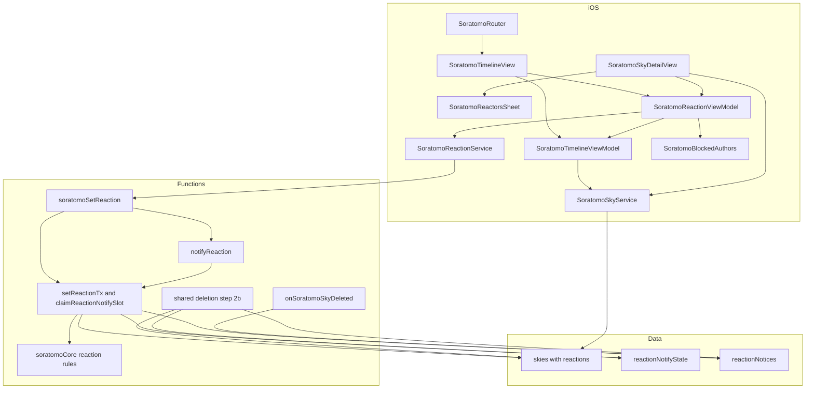
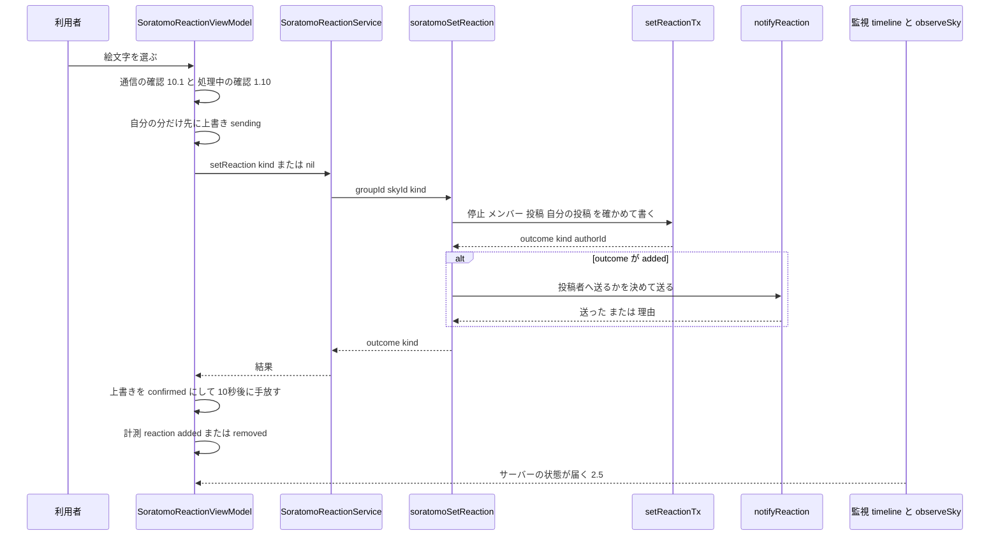
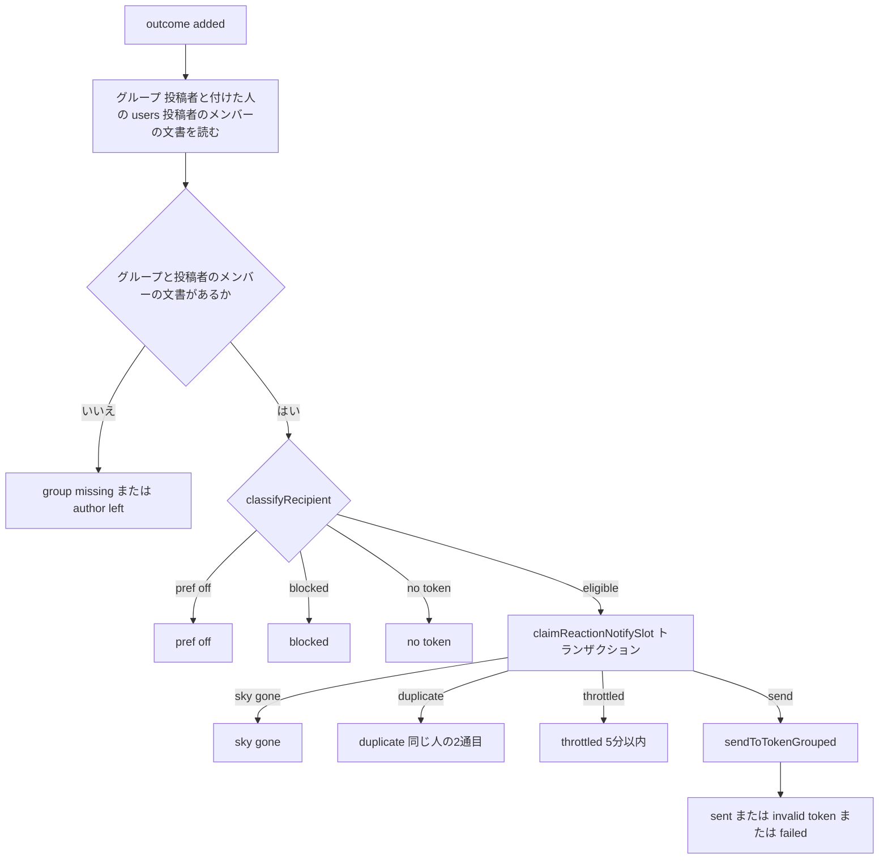
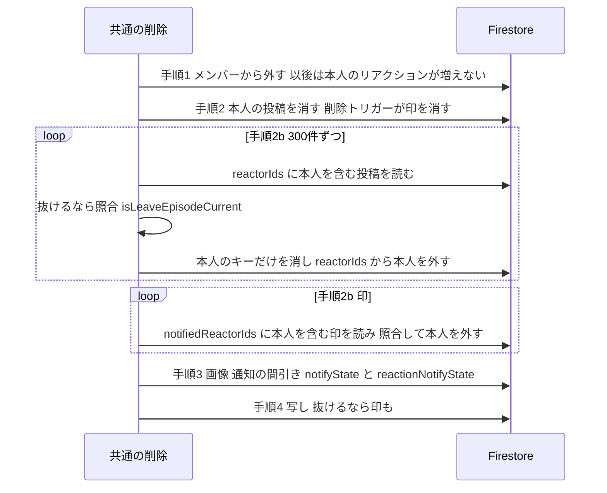
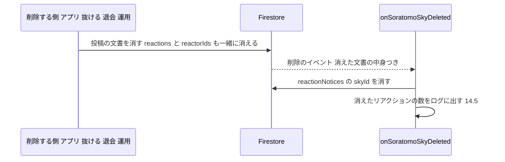

# Design Document — soratomo-reactions（そらとも：投稿へのリアクション）⭐️

## Overview

**Purpose**: そらとものメンバーが、ほかのメンバーの投稿に、決まった7種類の絵文字から1つを付けられるようにする。付いた数と押した人の一覧は、グループのメンバー全員が見られる。投稿者には、間引いたプッシュ通知が届く。
**Users**: グループのメンバー（付ける人・見る人）と、投稿者（通知を受ける人）。Android版・改造したアプリ・1.15.0のアプリからの要求にも、サーバーの規則が同じく効く（4.16）。
**Impact**:
- 投稿の文書（`soratomoGroups/{g}/skies/{s}`）に、`reactions`と`reactorIds`の2項目を足す。書き手はFunctions（Admin SDK）だけで、ルールの`update: false`は変えない。
- 新しいCallable`soratomoSetReaction`（9本目）と、投稿の削除トリガー`onSoratomoSkyDeleted`（3本目のトリガー）を足す。通知の記録のコレクションを2つ足す。
- 抜ける・退会・利用停止・アカウントの無い人の後始末に、本人が付けたリアクションの除去を足す。
- アプリは、タイムラインのカードの右下と投稿詳細に操作を置き、詳細から押した人の一覧をシートで出す。

### Goals
- リアクションの規則を、アプリに頼らずサーバーで守る（要件4）。規則は6つ（メンバーに限る・本人の分に限る・自分の投稿には付けない・決まった7種類・1人1つ・利用停止中は付けない）。
- 投稿が消えるとリアクションも消えることを、削除の経路と版に依らず、仕組みの上で保証する（要件8）。
- 1.15.0のアプリのタイムライン・投稿詳細・削除・通知のタップを壊さない（要件11）。
- 新着投稿の通知を、リアクションの通知のせいで止めない（6.6・6.14）。

### Non-Goals
- 自由な絵文字・文字・複数のリアクション・リアクションの通報とNGワード（要件の対象外）。
- リアクション専用の通知設定とミュート、配信済みの通知の取り消し、通知から投稿詳細を開くこと。
- 自分が付けたリアクションの履歴と、集計の画面。
- レート制限とApp Checkの強制（public-launch specの決定事項1のまま）。
- Android版の画面。
- 退会と抜けるの確認の文言の変更（決定事項P18）。

## 設計の前提

`.kiro/steering/`は無い。行番号は、HEAD`c1a1ea22`（＝`abaa3bdb`と同じコード）の現物で確かめた。1.15.0との関係は、メインがgit logで確かめた事実を使う（下のF1）。Swiftのパスは`Soramoyou/Soramoyou/`からの相対で書く。

| # | 事実 | 現物 | 設計への効き方 |
|---|---|---|---|
| F1 | 1.15.0（build 113・archiveの出し元`08023ea7`）の後、`SoratomoSkyService.swift`・`SoratomoModels.swift`・`SoratomoRouter.swift`・`GoldenHourNotificationManager.swift`・`project.pbxproj`は変わっていない | メインのgit log | 下のF2〜F6は、1.15.0のアプリの振る舞いそのもの |
| F2 | `decodeSky`は5つの項目を名前で読むだけで、知らない項目を見ない。`Codable`で読む口は無い | `Services/SoratomoSkyService.swift:417-447` | 投稿の文書に項目を足しても、1.15.0の変換は壊れない（11.2） |
| F3 | タイムラインは、変換後の投稿の並びと「続きがありうるか」が同じなら何もしない。`SoratomoSky`の`Equatable`にリアクションは無い | `ViewModels/SoratomoTimelineViewModel.swift:558`（1.15.0の後に変わっていないので、1.15.0でも同じ行） | リアクションだけの更新では、1.15.0は再描画しない。新しい版は`SoratomoSky`にリアクションを持たせるので、同じ行で再描画する |
| F4 | 投稿詳細は、覚え（`SoratomoSkyLookup`・ObservableObjectでない）をbodyで1回読むだけ。`:95-96`のコメントは「開いている間に変わるのは削除だけ」として読み直さない。投稿1件の監視は「有るか」しか届けない | `Views/Soratomo/SoratomoSkyDetailView.swift:95-97`・`:136-154`、`Services/SoratomoSkyService.swift:200`・`:575` | 覚えの更新だけでは、詳細はリアクションの変化に追従しない（2.5）。監視の`.present`にリアクションを載せる |
| F5 | 通知のタップは`didReceive`から`SoratomoRouter.receive`へ渡る。`parse`は`type == "soratomoPost"`のときだけ値を返し、それ以外は何もしない。デリゲートはこの1つだけ | `Services/GoldenHourNotificationManager.swift:242-254`、`Services/SoratomoRouter.swift:28`・`:42-50`・`:207-210`、`SoramoyouApp.swift:61` | `type`を`soratomoReaction`にすれば、1.15.0は落ちず、遷移せず、計測しない（11.4・11.5） |
| F6 | 前面での通知の表示は、全種類で`[.banner, .sound, .list]` | `Services/GoldenHourNotificationManager.swift:43` | 7.6は変更なしで満たす |
| F7 | 子ごと消すのは、グループごと消す2か所の`recursiveDelete`だけ。投稿の削除トリガーは無い | `functions/soratomoDeletion.js:235-247`・`:401`・`:640`・`:814-828`、`Services/SoratomoSkyService.swift:315-330`、`functions/soratomo.js:715-727` | 投稿の下の子は、1.15.0の削除で孤児になる。埋め込めば一緒に消える（要件8） |
| F8 | 間引きの記録`notifyState/{uid}`は、グループごと・受信者ごとに1件。`decideThrottle`は`lastSkyId === skyId`を「重複」とする | `functions/soratomoStore.js:493-508`、`functions/soratomoCore.js:251-257` | 共用すると新着投稿を間引く（6.6）。流用すると、別の人の同じ投稿へのリアクションを「重複」で落とす。別の記録と別の判定を作る |
| F9 | 宛先の分類は「そらとも通知OFF→ブロック（受信者の`blockedUserIds`に送り手）→トークン無し」。送り手は引数`posterId` | `functions/soratomoCore.js:219-227` | 受信者を投稿者、送り手を付けた人にして、そのまま使える（5.4・6.3・6.4） |
| F10 | 利用停止の判定は`assertNotSuspended`（`soratomoUsers/{uid}.suspendedAt`）。`createSkyTx`がトランザクションの中で使う。ファイルの外へは公開していない | `functions/soratomoStore.js:119-121`・`:331-337`、`functions/soratomoCore.js:421` | 新しいトランザクションを同じファイルに置き、同じ関数を使う（4.11） |
| F11 | アプリはCallableの失敗を`details.reason`で写す。知らない理由はcodeで写し、ほとんどが`.unknown`になる | `Services/SoratomoGroupService.swift:353-427` | 新しい理由（`self_reaction`・`invalid_reaction`）は種類を作らずに`.unknown`で受ける（4.15・10.4） |
| F12 | カードは全体が1つの`Button`。長押しのメニューは同じ`Button`に付いている。行の中身は`SoratomoTimelineRow` | `Views/Soratomo/SoratomoTimelineView.swift:390-445`・`:769-849` | 操作をラベルの中に置くと押せないことがある。ラベルの外（overlay）に置く（1.7・13.4） |
| F13 | Functionsのトリガーは、そらともの投稿の作成（`onDocumentCreated`）だけ。`index.js`のトリガーは別のパス（likes・comments・posts・follows・users・publicProfiles・feedback） | `functions/soratomo.js:435-438`、`functions/index.js:4-12` | 投稿の文書の更新で、新着投稿の通知や既存の通知は動かない（12.6）。`lastActivityAt`は作成のトリガーだけが書く（12.7） |
| F14 | `firestore.indexes.json`の`fieldOverrides`は空。配列のarray-containsは自動の単一項目インデックスで動く | `firestore.indexes.json:242`、research.md | 本人のリアクションを引くクエリに、インデックスの追加は要らない |
| F15 | 送信の部品`sendToTokenGrouped`は、スレッドIDと置き換えキーを付け、無効なトークンを消し、バッジを付けない | `functions/pushHelpers.js:95-127` | 6.15は同じ部品で満たす |
| F16 | 前例`recommendationNotices`は、印の`create()`で「外して入れ直しても通知は最初の1回」を守る（TTLで消える） | `docs/firestore-schema.md:296-317` | 同じ考え方で印を置く。ただし期限は設けない（6.8） |

## 絵文字のセット

送る値・保存する値・計測の`kind`は、下の「名前」にする。絵文字は表示側（アプリの`SoratomoReactionKind`とFunctionsの`REACTION_KINDS`）の対応表で引く。2か所の値は、両方の単体テストで7行とも固定する。

| 並び順 | 名前（保存・計測の`kind`） | 絵文字 | コードポイント | UTF-16の単位数 | VoiceOverの日本語名 |
|---|---|---|---|---|---|
| 1 | `sunset` | 🌅 | U+1F305 | 2 | 夕焼け |
| 2 | `cloud` | ☁️ | U+2601 U+FE0F | 2 | くも |
| 3 | `rainbow` | 🌈 | U+1F308 | 2 | 虹 |
| 4 | `sparkles` | ✨ | U+2728 | 1 | きれい |
| 5 | `eyes` | 👀 | U+1F440 | 2 | 見たよ |
| 6 | `red_heart` | ❤️ | U+2764 U+FE0F | 2 | 赤いハート |
| 7 | `blue_heart` | 💙 | U+1F499 | 2 | 青いハート |

- 並び順は、メニューの選択肢と、数の表示の並びに使う（数の多い順に並べ替えない）。
- 表示と通知文の絵文字は、FE0F付きの形（表の値）で出す。
- 🌅のUnicodeの名前は「SUNRISE」だが、アプリでは「夕焼け」と呼ぶ（決定事項P1）。名前は`sunset`にそろえる。
- 退けた案（絵文字そのものを送り、サーバーで正規化する）: 正規化の規則をアプリとサーバーの両方に持たせる必要がある。改造したアプリからの似た文字（肌の色の修飾・ZWJの組み合わせ）も、1つずつ拒否する必要がある。名前なら「7つのどれか」を比べるだけで、要件4.5は表示の対応表の問題になる（research.md）。

## Requirements Traceability

| Requirement | Summary | Components | Interfaces | Flows |
|-------------|---------|------------|------------|-------|
| 1.1 | カードと詳細に操作を置く | SoratomoReactionMenuButton・SoratomoTimelineView・SoratomoSkyDetailView | `choose` | 付ける |
| 1.2 | 選択肢は7種類だけ | SoratomoReactionMenuButton | `SoratomoReactionKind.allCases` | — |
| 1.3, 1.4, 1.5 | 付ける・選び直す・外す | SoratomoReactionViewModel | `choose`→`setReaction(kind:)` | 付ける |
| 1.6 | 自分の投稿に出さない | SoratomoReactionViewModel | `canReact` | — |
| 1.7, 1.8 | カードの押せる範囲 | SoratomoTimelineView（overlay） | — | — |
| 1.9 | 受け付けたら結果に合わせる | SoratomoReactionViewModel（上書き） | `overlays` | 付ける |
| 1.10 | 処理中は重ねて受け付けない | SoratomoReactionViewModel | `isSending` | — |
| 1.11 | 隠した投稿には出さない | 既存（タイムラインの`isHidden`・詳細の「表示できません」） | — | — |
| 2.1, 2.2, 2.3, 2.4 | 数・自分の印・0件・自分の投稿 | SoratomoReactionSummary・SoratomoReactionSummaryView | `make` | — |
| 2.5 | 10秒以内に反映 | SoratomoSky.reactions（タイムラインの監視）・`SoratomoSkyPresence.present`（詳細の監視） | `observeTimeline`・`observeSky` | 付ける |
| 2.6 | サーバーの値から決める | SoratomoReactionViewModel（上書きは10秒で手放す） | `overlays` | — |
| 2.7 | 無い投稿・古い投稿 | SoratomoReactions.decode（無い＝空・投げない） | `decodeSky` | — |
| 3.1, 3.5 | 詳細から開く・誰でも見られる | SoratomoSkyDetailView・SoratomoReactorsSheet | — | — |
| 3.2, 3.3, 3.4 | 名前・アイコン・代替の表示 | SoratomoReactorsSheet・既存のSoratomoProfileStore | `prefetch`・`displayName(for:)` | — |
| 3.6 | 人数＝数の合計 | SoratomoReactionSummary（同じ集合から作る） | `total`・`reactors` | — |
| 3.7 | ほかの人の分を変える操作を出さない | SoratomoReactorsSheet（表示だけ） | — | — |
| 3.8 | 読み込めないときの表示 | SoratomoReactorsSheet | — | — |
| 4.1, 4.2 | メンバーだけ・本人の分だけ | setReactionTx（認証のuidとメンバーの文書） | API Contract | 付ける |
| 4.3 | 自分の投稿は拒否 | setReactionTx（`self_reaction`） | API Contract | 付ける |
| 4.4, 4.5, 4.6 | 決まった7種類だけ | soratomoCore.isReactionKind（名前で比べる） | API Contract | — |
| 4.7 | 投稿が無いときは拒否 | setReactionTx（`sky_not_found`） | API Contract | 付ける |
| 4.8, 4.9, 4.10 | 1人1つ・同時でも1つ・数の一致 | setReactionTx（地図のキー・トランザクション）。数は読むときに数える | Data Models | 付ける |
| 4.11 | 利用停止中は拒否 | setReactionTx（`assertNotSuspended`） | API Contract | 付ける |
| 4.12 | 未ログイン・匿名は拒否 | 既存の`requireSoratomoUser` | — | — |
| 4.13 | メンバーだけが読める | 既存の`skies`の`read`（変えない） | — | — |
| 4.14 | 同意を理由に拒否しない | setReactionTx（同意を読まない） | — | — |
| 4.15 | 理由を返す | REASON_TO_CODE・`mapCallableError` | API Contract | — |
| 4.16 | どのクライアントでも同じ | サーバーだけで守る | — | — |
| 5.1, 5.2, 5.3 | ブロックした人を数と一覧から除く | SoratomoReactionSummary（`blockedUserIds`）・既存のSoratomoBlockedAuthors | `make` | — |
| 5.4 | ブロックしていれば通知しない | notifyReaction（`classifyRecipient`） | — | 通知 |
| 5.5 | ブロックを理由に拒否しない | setReactionTx（ブロックを読まない） | — | — |
| 5.6 | 除いたことを知らせない | 何も足さない | — | — |
| 6.1, 6.2 | 投稿者だけへ送る | notifyReaction | Event Contract | 通知 |
| 6.3, 6.4 | そらとも通知（未保存はON） | 既存の`classifyRecipient`（`soratomoPrefEnabled`） | — | 通知 |
| 6.5, 6.6 | 5分の間引き・新着と別の枠 | claimReactionNotifySlot・decideReactionNotify・`reactionNotifyState` | — | 通知 |
| 6.7 | 外す・選び直すで送らない | soratomoSetReaction（`added`のときだけ送る） | — | 通知 |
| 6.8 | 同じ人の同じ投稿で1通まで | `reactionNotices`（送った印） | — | 通知 |
| 6.9, 6.10, 6.11 | 題・本文・「だれか」・キャプション無し | buildReactionNotification | — | — |
| 6.12, 6.13, 6.14 | 種類・スレッド・置き換えキー | notifyReaction（data・grouping） | Event Contract | — |
| 6.15 | トークン・バッジ・音 | 既存の`sendToTokenGrouped` | — | — |
| 6.16 | 送信の失敗で取り消さない | soratomoSetReaction（確定の後に送り、投げない） | — | 通知 |
| 6.17 | 1分以内 | Callableの中で送る | — | 通知 |
| 6.18 | 版で分けない | notifyReaction（版を見ない） | — | — |
| 7.1, 7.2, 7.3, 7.4 | タップでタイムラインへ | SoratomoRouter（`soratomoReaction`を受ける） | `parse` | — |
| 7.5 | 既存の通知を変えない | SoratomoRouter（`soratomoPost`は今のまま） | — | — |
| 7.6 | 前面の表示 | 既存（F6） | — | — |
| 7.7, 7.8, 7.9, 7.10 | 設定の説明 | SettingsView | — | — |
| 8.1, 8.2, 8.3, 8.4, 8.5 | 投稿の削除で消える | 埋め込み（投稿の文書と一緒に消える）・onSoratomoSkyDeleted（印） | — | 投稿の削除 |
| 8.6 | 削除の後は出さない | 埋め込み（投稿が無ければ出ない） | — | — |
| 8.7 | 一覧を開いている間に削除 | SoratomoSkyDetailView（`becameUnavailable`）・SoratomoReactorsSheet | — | — |
| 8.8 | 付けようとした投稿が無い | SoratomoReactionViewModel（`skyGone`→`onSkyGone`） | — | 付ける |
| 9.1, 9.2, 9.3 | 抜けるで本人の分を消す | leaveSoratomoGroup（手順2b）・既存の仕事C | `removeUserReactionsInGroup` | 片づけ |
| 9.4 | 入り直した後に及ばない | 手順2bの照合（`isLeaveEpisodeCurrent`） | — | 片づけ |
| 9.5, 9.6 | 退会で全グループの分を消す | deleteUserDataInGroup（手順2b）・既存の`soratomoDeleteMyData` | `removeUserReactionsInGroup` | 片づけ |
| 9.7 | 利用停止で消す | 既存の`suspendSoratomoUser`（同じ部品） | — | 片づけ |
| 9.8 | アカウントの無い人 | 既存の仕事A | — | — |
| 9.9 | 運用の削除 | 既存の`scripts/soratomo-admin.js`（同じ部品） | — | — |
| 9.10, 9.11 | 冪等・ほかの人に及ばない | removeUserReactionsInGroup（本人のキーだけを`FieldPath`で消す） | — | — |
| 9.12 | 解除で戻さない | 何も足さない | — | — |
| 9.13 | ほかのメンバーの画面から消える | 既存の監視（F3・F4の変更後） | — | — |
| 9.14, 9.15 | 端末の覚えを消す | 既存（`SoratomoSkyLookup.forget(groupId:)`・`clearSessionState`） | — | — |
| 10.1, 10.2 | オフラインは始めない・積まない | SoratomoReactionViewModel（`isOnline`） | — | — |
| 10.3, 10.4 | 失敗で戻す・原因の文言 | SoratomoReactionViewModel・SoratomoReactionNotice | — | 付ける |
| 10.5 | 利用停止の文言 | 既存の`SoratomoError.suspended` | — | — |
| 10.6 | オフラインでも以前の数 | 既存のFirestoreのキャッシュ | — | — |
| 10.7 | 想定外は記録 | `SoratomoError.record` | — | — |
| 11.1, 11.2 | 古い版を壊さない | 埋め込み（F2・F3） | — | — |
| 11.3, 11.4, 11.5 | 通知の種類を分ける | notifyReaction（`soratomoReaction`）・1.15.0の現物（F5） | Event Contract | — |
| 11.6 | 1.15.0で通す | Migration | — | — |
| 12.1, 12.2, 12.3 | 既存のいいねと混ぜない | 別の項目・`SoratomoSky`の中だけ | — | — |
| 12.4, 12.5, 12.6 | 既存の通知設定と通知 | `classifyRecipient`（`notifySoratomo`だけ）・更新のトリガーは無い（F13） | — | — |
| 12.7 | 作成日時と一覧の並び | setReactionTx（2項目だけを更新）・F13 | — | — |
| 12.8 | ルールを緩めない | firestore.rules（拒否の`match`を足すだけ） | — | — |
| 12.9, 12.10, 12.11 | 既存の動き・メニュー・確認の文言 | SoratomoTimelineView（長押しのメニューの中身は同じ） | — | — |
| 12.12, 12.13 | 削除の範囲・Callableの応答 | soratomoDeletion（手順2bと記録の削除を足すだけ）・応答の形は同じ | — | — |
| 12.14, 12.15, 12.16 | テストと陽性対照 | Testing Strategy | — | — |
| 13.1, 13.2, 13.3, 13.4, 13.5 | VoiceOver | SoratomoReactionSummary・SoratomoReactionMenuButton・SoratomoReactorsSheet・SoratomoTimelineView | `accessibilityLabel` | — |
| 14.1, 14.2, 14.3 | ログに名前を出さない | `okLogFields`・SoratomoAnalytics（列挙だけ） | Monitoring | — |
| 14.4 | 通知1件ごとのログ | soratomoSetReaction（`notify`の項目） | Monitoring | 通知 |
| 14.5 | 削除の件数 | `reactionsDeleted`・onSoratomoSkyDeleted | Monitoring | 片づけ |
| 15.1, 15.2, 15.3, 15.4 | イベント | SoratomoAnalytics | `SoratomoEvent` | — |
| 15.5 | 通知のタップの`type` | SoratomoRouter・SoratomoAnalytics | `notificationOpened` | — |
| 15.6 | 画面名 | シートなので足さない（Decisions） | — | — |
| 15.7 | 本番の着弾の確認 | Migration | — | — |
| 16.1, 16.2, 16.3 | What's New | WhatsNewContent | `currentID` | — |
| 16.4, 16.5, 16.6, 16.7, 16.8, 16.9, 16.10 | リリース手順 | Migration | — | — |

## Architecture

### Existing Architecture Analysis

- 書き手はFunctionsだけ（`firestore.rules:578-581`）。アプリはCallableを呼び、Firestoreを読み、自分の投稿だけを消す。リアクションもCallableにする。ルールの`skies`の`create`・`update`は`false`のまま（12.8）。
- 規則の判定は、純関数（`soratomoCore.js`）・トランザクション（`soratomoStore.js`）・配線（`soratomo.js`）に分かれる。リアクションも同じ3層に置く。
- 削除は`soratomoDeletion.js`の共通の部品に集まる。手順1（メンバーを外す）→手順2（投稿）→手順3（画像・通知の間引き）→手順4（写し）の順。本人のリアクションの除去は手順2の後（手順2b）に足す。手順1の後はメンバーの文書が無いので、新しいリアクションは増えない（下の不変条件）。
- アプリは、サービスのprotocol（`SoratomoServiceContracts.swift`）とViewModelを分け、Callableの窓口をDataSourceで差し替える型。リアクションのサービスは新しいprotocolにする（既存の`SoratomoSkyServiceProtocol`は`SoratomoSkyPresence`の形だけが変わる）。
- 投稿詳細は、タイムラインのViewModelを借りて削除・通報・ブロックを行う（`dependencies.activeTimelineViewModel`）。リアクションのViewModelも同じ形で借りる。

### Architecture Pattern & Boundary Map



**Architecture Integration**:
- Selected pattern: 既存の「Callable→Admin SDKのトランザクション」と「共通の削除の部品」に、リアクションの項目・通知の記録・削除トリガーを足す。
- Domain/feature boundaries: 規則（メンバー・本人・7種類・1人1つ・停止・消す範囲）は、すべてサーバーが持つ（4.16）。アプリは、表示（ブロックの除外・楽観的な表示・VoiceOver）と端末の操作の制御だけを持つ。
- Existing patterns preserved:
  - Functions: `soratomoCallable`の包み・`REASON_TO_CODE`・トランザクションは読みを先に・ログは内部IDと件数だけ・`sendToTokenGrouped`。
  - 削除は「読む→照合→消す」の順と、抜けるの照合。
  - iOS: サービスのprotocolとDataSource・`activeTimelineViewModel`の借り方。
- New components rationale: 下のComponents and Interfacesの表。
- Steering compliance: steeringは無い。soratomo specとrelease-gate specの約束（collectionGroupを使わない・既存のルールを緩めない・既存の通知設定を変えない）を守る。

### Technology Stack

| Layer | Choice / Version | Role in Feature | Notes |
|-------|------------------|-----------------|-------|
| Backend | Cloud Functions v2（firebase-functions ^7.4.0・Node 22・asia-northeast1） | Callable 1本・Firestoreの削除トリガー1本・共通の削除の変更 | 新しい依存は無い |
| Data | Firestore（firebase-admin ^14.5.0） | `skies`の2項目・通知の記録の2コレクション | インデックスの追加は無い（F14） |
| Messaging | FCM（Admin SDK）とAPNs | 投稿者へのリアクションの通知 | 既存の`sendToTokenGrouped`をそのまま使う |
| iOS | SwiftUI（iOS 16）・FirebaseFunctions・FirebaseFirestore | 操作・表示・シート・ルーター | 新しい依存は無い |

## System Flows

### リアクションを付ける（アプリ→Callable→通知→監視）



- 選んだ絵文字が自分の今の絵文字と同じなら、`kind: nil`（外す）を送る（1.5）。違えば、その絵文字を送る（1.3・1.4）。
- 失敗したら上書きをすぐ消して元に戻し、失敗の文言を出す（10.3）。投稿がもう無いなら、タイムラインから取り除く（8.8）。
- 通知の送信は、応答を返す前に`await`する（応答の後の処理は進まない・research.md）。送信の失敗は結果の文字列にして投げない（6.16）。

### 通知を送るかの判定



- 分類の順は、既存の新着投稿の通知と同じ（設定OFF→ブロック→トークン無し→枠の確保）。
- 枠の確保は1つのトランザクションで、投稿の文書・送った印`reactionNotices/{skyId}`・間引きの記録`reactionNotifyState/{authorId}`を読む。`send`のときだけ、間引きの記録と印の両方を書く。間引かれたときは印を書かない。
- 投稿の文書を読むのは、削除トリガーが印を消した後に、確保が印を作り直さないため（削除が先なら`sky_gone`で書かない）。

### 抜ける・退会の片づけ（手順2bを足す）



- 最後の1人（`delete_group`）では、全投稿と`recursiveDelete`で消えるので、手順2bは行わない。
- 手順1の後は、本人のメンバーの文書が無い。`setReactionTx`はメンバーの文書を読むので、本人の新しいリアクションは作れない。したがって、1回の実行の中では、読んだ後に本人の分が増えない。
- 2つの実行が重なる場合（アプリの呼び出しと定期実行など）は、抜けるの照合で閉じる。照合が通った時点で入り直していないので、その前に読んだものは入り直す前のもの（leave-group specの「読む→照合→消す」と同じ）。

### 投稿の削除



- リアクションそのものは、投稿の文書と同時に消える。経路と版（1.15.0の削除を含む）に依らない（8.1〜8.5）。
- トリガーが消すのはサーバー専用の印だけ。トリガーが失敗して印が残っても、利用者に見える違いは無い（その投稿への通知を送らない側にしか効かない）。

## Components and Interfaces

| Component | Domain/Layer | Intent | Req Coverage | Key Dependencies | Contracts |
|-----------|--------------|--------|--------------|------------------|-----------|
| soratomoCoreのリアクションの規則（変更） | Functions | 7種類・通知文・間引きの判定の純関数 | 4.4〜4.6, 6.5, 6.8〜6.11 | — | Service |
| setReactionTx（新規） | Functions（`soratomoStore.js`） | リアクションを付ける・外す・選び直す | 4.1〜4.11, 4.14, 5.5, 12.7 | soratomoCore (P0) | Service |
| claimReactionNotifySlot（新規） | Functions（`soratomoStore.js`） | 間引きと1通までを1つのトランザクションで決める | 6.5, 6.6, 6.8 | soratomoCore (P0) | Service |
| soratomoSetReaction・notifyReaction（新規） | Functions（`soratomo.js`） | 入口と、投稿者への通知 | 4.12, 4.15, 5.4, 6.1〜6.18, 11.3〜11.5, 14.4 | setReactionTx (P0)・sendToTokenGrouped (P0) | API, Event |
| onSoratomoSkyDeleted（新規） | Functions（`soratomo.js`） | 投稿の削除で印を消し、件数を残す | 8.1〜8.5, 14.5 | — | Event |
| 共通の削除（変更） | Functions（`soratomoDeletion.js`） | 本人のリアクションと通知の記録を消す | 9.1〜9.11, 12.12, 14.5 | — | Service |
| firestore.rules（変更） | Rules | 通知の記録を誰にも読み書きさせない | 4.13, 12.8 | — | — |
| SoratomoReactionKind・SoratomoReactions・SoratomoReactionSummary（新規） | iOS Model | 7種類・投稿の中のリアクション・画面に出す数 | 1.2, 2.1〜2.4, 2.7, 3.6, 5.1〜5.3, 13.2, 13.3 | — | State |
| SoratomoSkyService（変更） | iOS Service | 変換と投稿1件の監視にリアクションを載せる | 2.5, 2.7, 9.13 | Firestore (P0) | Service |
| SoratomoReactionService（新規） | iOS Service | Callableの窓口 | 1.3〜1.5, 4.15 | FirebaseFunctions (P0) | Service |
| SoratomoReactionViewModel（新規） | iOS ViewModel | 操作・上書き・失敗・計測 | 1.3〜1.6, 1.9, 1.10, 2.6, 8.8, 10.1〜10.7, 15.1〜15.4 | SoratomoReactionService (P0)・SoratomoBlockedAuthors (P1) | State |
| リアクションの部品の画面（新規） | iOS View | 数の表示・メニュー・押した人の一覧 | 1.1, 1.2, 2.1〜2.3, 3.1〜3.8, 13.1〜13.5 | SoratomoProfileStore (P1) | — |
| SoratomoTimelineView・ViewModel（変更） | iOS View | カードの組み直し・消えた投稿の取り除き | 1.1, 1.7, 1.8, 8.8, 12.10 | SoratomoReactionViewModel (P0) | — |
| SoratomoSkyDetailView（変更） | iOS View | 詳細の操作と一覧の入口・監視の中身 | 1.1, 2.5, 3.1, 8.7 | SoratomoReactionViewModel (P0) | — |
| SoratomoRouter・SoratomoAnalytics（変更） | iOS | 通知のタップとイベント | 7.1〜7.5, 15.1〜15.5 | — | — |
| SoratomoDependencies・SettingsView・WhatsNewContent（変更） | iOS | 容れ物・設定の説明・案内 | 7.7〜7.10, 16.1〜16.3 | — | — |

### Backend: Functions

#### soratomoCoreのリアクションの規則（`functions/soratomoCore.js`・変更）

| Field | Detail |
|-------|--------|
| Intent | 7種類の名前と絵文字・通知文・間引きの判定を純関数で持つ |
| Requirements | 4.4, 4.5, 4.6, 6.5, 6.8, 6.9, 6.10, 6.11 |

**Contracts**: Service

##### Service Interface

```typescript
type ReactionKindName =
  | "sunset" | "cloud" | "rainbow" | "sparkles" | "eyes" | "red_heart" | "blue_heart";

interface ReactionKindDef {
  name: ReactionKindName;
  emoji: string;                         // 表の絵文字（FE0F を含む形）
}

/** 並び順は「絵文字のセット」の表のとおり。iOS の SoratomoReactionKind.allCases と一致させる */
const REACTION_KINDS: ReadonlyArray<ReactionKindDef>;

/** 7つの名前のどれかと完全に一致するときだけ真（絵文字・大文字・前後の空白・null は偽） */
function isReactionKind(value: unknown): value is ReactionKindName;

/** 通知文。題はグループ名、本文は「{名前}さんがあなたの空に{絵文字}を付けました」。名前が空なら「だれか」 */
function buildReactionNotification(args: {
  groupName: string;
  reactorName: unknown;                  // users/{付けた人}.displayName
  kind: ReactionKindName;
}): { title: string; body: string };

type ReactionNotifyDecision = "send" | "throttled" | "duplicate";

/**
 * 印に付けた人がいれば duplicate。最後に送ってから THROTTLE_MS（5分）以内なら throttled（5分ちょうども含む）。
 * それ以外（記録が無い・時刻が読めない・5分を過ぎた）は send。投稿IDは見ない（decideThrottle と違う）
 */
function decideReactionNotify(args: {
  state: { lastSentAt?: unknown } | null;   // reactionNotifyState/{投稿者}
  notifiedReactorIds: unknown;             // reactionNotices/{skyId}.notifiedReactorIds
  reactorUid: string;
  nowMs: number;
}): ReactionNotifyDecision;
```

- 間引きの間隔は既存の`THROTTLE_MS`（`:35`）を使う。表示名の代わりは既存の`FALLBACK_NAME`（`:46`）を使う（6.10）。
- 本文にキャプションを入れない（6.11）。`buildNotification`（新着投稿）は変えない。
- 退けた案（`decideThrottle`の流用）: `lastSkyId === skyId`を重複とするので、Aが投稿Pに付けて送った後、Bが同じPに付けた通知を落とす（F8）。

#### setReactionTx（`functions/soratomoStore.js`・新規）

| Field | Detail |
|-------|--------|
| Intent | 本人のリアクションを、規則を確かめてから1つのトランザクションで書く |
| Requirements | 4.1, 4.2, 4.3, 4.4, 4.6, 4.7, 4.8, 4.9, 4.10, 4.11, 4.14, 5.5, 12.7 |

**Contracts**: Service

##### Service Interface

```typescript
type ReactionOutcome = "added" | "replaced" | "removed" | "unchanged";

interface SetReactionParams {
  uid: string;          // request.auth.uid（配線が渡す）
  input: unknown;       // 要求の本文 { groupId, skyId, kind }。kind は名前か null（null は外す）
}

interface SetReactionResult {
  outcome: ReactionOutcome;
  kind: ReactionKindName | null;   // 書いた後の本人のリアクション
  authorId: string;                // 投稿者（通知の宛先。利用者へは返さない）
}

function setReactionTx(db: Firestore, params: SetReactionParams): Promise<SetReactionResult>;
```

- 判定の順（トランザクションの前→中）:
  1. `invalid_input`（前）: 本文が物でない・`groupId`か`skyId`が`isAutoId`でない・`kind`の鍵が無い。
  2. `invalid_reaction`（前）: `kind`が`null`でなく、`isReactionKind`でもない（4.4・4.6）。
  3. トランザクションで`soratomoUsers/{uid}`・`members/{uid}`・投稿の文書を`getAll`で読む。
  4. `suspended`: `assertNotSuspended`（F10・4.11）。
  5. `not_member`: メンバーの文書が無い（4.1）。
  6. `sky_not_found`: 投稿が無い（4.7）。
  7. `self_reaction`: 投稿の`authorId`が本人（4.3）。外す要求も同じく拒否する（自分の投稿にリアクションは存在しない）。
- 書き方（`FieldPath`で本人のキーだけを指す。uidに`.`が含まれても他人のキーに触れない）:
  - 付ける・選び直す: `reactions.{uid}`に`{ kind, at: serverTimestamp }`、`reactorIds`に`arrayUnion(uid)`。今の`kind`と同じなら書かずに`unchanged`。
  - 外す: `reactions.{uid}`を`FieldValue.delete()`、`reactorIds`から`arrayRemove(uid)`。無ければ書かずに`unchanged`。
  - ほかの項目（`authorId`・`createdAt`・`caption`・`width`・`height`）とグループの文書には書かない（12.7）。
- 今の値が壊れている（地図でない・知らない名前）ときは、「付いている」とみなし、付ける要求は`replaced`、外す要求は`removed`にする（壊れた値を残さない）。
- 同意（`guidelineVersion`）とブロックの一覧は読まない（4.14・5.5）。
- 同じ人の同時の要求は、投稿の文書のトランザクションで直列になり、地図のキーが1つなので2つ残らない（4.9）。数は保存せず、読むときに数える（4.10）。

#### claimReactionNotifySlot（`functions/soratomoStore.js`・新規）

| Field | Detail |
|-------|--------|
| Intent | 投稿者への通知を送るかを、間引きと1通までの両方で1回だけ決める |
| Requirements | 6.5, 6.6, 6.8 |

**Contracts**: Service

##### Service Interface

```typescript
function claimReactionNotifySlot(db: Firestore, params: {
  groupId: string;
  skyId: string;
  authorId: string;      // 受信者（投稿者）
  reactorUid: string;    // 付けた人
  nowMs: number;
}): Promise<ReactionNotifyDecision | "sky_gone">;
```

- 1つのトランザクションで、投稿の文書・`reactionNotices/{skyId}`・`reactionNotifyState/{authorId}`を読む。
- 投稿が無ければ何も書かずに`sky_gone`。あれば`decideReactionNotify`で決める。
- `send`のときだけ、`reactionNotifyState/{authorId}`に`{ lastSentAt }`を書き、`reactionNotices/{skyId}`の`notifiedReactorIds`に`arrayUnion(reactorUid)`で足す（無ければ作る）。
- 新着投稿の`notifyState/{uid}`には触れない（6.6）。送信が後で失敗しても、書いた記録は戻さない（既存の`claimNotifySlot`と同じ）。

#### soratomoSetReaction・notifyReaction（`functions/soratomo.js`・新規）

| Field | Detail |
|-------|--------|
| Intent | 本人のリアクションの入口。新しく付いたときだけ、投稿者へ通知する |
| Requirements | 4.12, 4.15, 4.16, 5.4, 6.1, 6.2, 6.3, 6.4, 6.7, 6.12, 6.13, 6.14, 6.15, 6.16, 6.17, 6.18, 11.3, 11.4, 11.5, 14.1, 14.2, 14.3, 14.4 |

**Responsibilities & Constraints**
- `soratomoCallable`で作る。選択肢は`respond`と`okLogFields`だけ（登録済みのログインを求め、匿名は拒否する・4.12）。置き場は`soratomoLeaveGroup`の後（`:333`の後）。`module.exports`に足す。
- 本体: `setReactionTx`→`outcome === "added"`なら`notifyReaction`を`await`→応答。`replaced`・`removed`・`unchanged`では送らない（6.7）。再試行で`unchanged`になった要求も送らない（後から送ることになり、6.5に触れうるため）。
- `notifyReaction`は例外を投げない。失敗は結果の文字列（`failed`）にし、`warn`のログに`errorName`と`errorCode`だけを出す（6.16）。
- `REASON_TO_CODE`（`:64-85`）に2つを足す: `self_reaction: "failed-precondition"`・`invalid_reaction: "invalid-argument"`。`SoratomoDomainError`の理由の型（`soratomoStore.js:53-55`のJSDoc）にも足す。

##### API Contract

| Callable | Request | Response | Errors（`code`・`details.reason`） |
|----------|---------|----------|-----------------------------------|
| `soratomoSetReaction` | `{ groupId: string, skyId: string, kind: ReactionKindName \| null }` | `{ outcome: "added" \| "replaced" \| "removed" \| "unchanged", kind: ReactionKindName \| null }` | `unauthenticated`／`permission-denied`・`registration_required`／`invalid-argument`・`invalid_input`／`invalid-argument`・`invalid_reaction`／`permission-denied`・`suspended`／`permission-denied`・`not_member`／`not-found`・`sky_not_found`／`failed-precondition`・`self_reaction`／`internal` |

- 4.15の5つの理由（メンバーでない・投稿が無い・自分の投稿・絵文字が違う・利用停止）は、それぞれ別の`details.reason`で返る。
- 成功のログ（`okLogFields`）: `soratomoSetReaction: ok`。項目は`uid`・`groupId`・`skyId`・`outcome`・`kind`（名前）・`notify`。名前の文字列は列挙の値で、個人情報でない（14.1〜14.3）。
- `notify`の値（14.4）: 送らなかったとき`null`。送ろうとしたとき次のどれか。
  - `sent`・`throttled`（間引き）・`duplicate`（同じ人の2通目）・`no_token`（トークン無し）・`failed`・`invalid_token`（送信失敗）。
  - `pref_off`（通知設定OFF）・`blocked`（ブロック）。
  - `author_left`（投稿者がもうメンバーでない）・`group_missing`・`sky_gone`（14.4の6つに足した理由・要件への差し戻しD2）。

##### Event Contract（投稿者へのプッシュ通知）

| 項目 | 値 |
|---|---|
| 宛先 | 投稿の`authorId`だけ（6.2）。付けた人とほかのメンバーへは送らない |
| `notification.title` | グループ名（6.9） |
| `notification.body` | `{表示名}さんがあなたの空に{絵文字}を付けました`。表示名が空なら`だれか`（6.10）。キャプションは入れない（6.11） |
| `data` | `{ type: "soratomoReaction", groupId, postId }`（6.12・11.3）。値はすべて文字列 |
| スレッドID（`aps.thread-id`） | `soratomo-{groupId}`（新着投稿と同じ・グループごと・6.13） |
| 置き換えキー（`apns-collapse-id`） | `soratomo-reaction-{groupId}`（新着投稿の`soratomo-{groupId}`と別・6.14）。グループ単位は利用者の決定（U2のA・2026-10-18） |
| 音・バッジ・無効なトークン | 既存の`sendToTokenGrouped`のまま（音は既定・バッジ無し・無効なトークンは消す・6.15） |
| 宛先の判定 | `classifyRecipient({ userData: 投稿者のusers, posterId: 付けた人 })`（F9）。既存の3つの通知設定は読まない（12.4） |
| アプリの版 | 見ない（6.18）。1.15.0は`type`を知らないので、タップしても何もしない（F5） |

- 読む文書は、グループ・投稿者のメンバーの文書・投稿者と付けた人の`users`の4件（`getAll`）。
- 送り出しはCallableの中なので、ふつう1秒以内（6.17）。

#### onSoratomoSkyDeleted（`functions/soratomo.js`・新規）

| Field | Detail |
|-------|--------|
| Intent | 投稿が消えたら、その投稿の送った印を消し、消えたリアクションの数をログに残す |
| Requirements | 8.1, 8.2, 8.3, 8.4, 8.5, 14.5 |

**Contracts**: Event

##### Event Contract
- Subscribed events: `onDocumentDeleted({ document: "soratomoGroups/{groupId}/skies/{skyId}", region: REGION })`。再試行は付けない（既存のトリガーと同じ）。
- 処理: 消えた文書の中身（`event.data`）の`reactions`の鍵の数を数える（地図でなければ0）。`soratomoGroups/{groupId}/reactionNotices/{skyId}`を消す（無くても成功する）。
- ログ: `soratomoReaction: sky_deleted` `{ groupId, skyId, reactionsDeleted }`（14.5）。失敗は`soratomoReaction: sky_deleted_failed` `{ groupId, skyId, errorName, errorCode }`をerrorで出し、例外を投げない。
- 冪等: 印の削除は何度でも同じ結果。グループごとの削除では、投稿の数だけ発火する。
- 退けた案: 定期実行で孤児の印を拾う（グループの数と印の数に比例して読む）。印を残す（消した空に関わる記録が残る）。

#### 共通の削除（`functions/soratomoDeletion.js`・変更）

| Field | Detail |
|-------|--------|
| Intent | 抜ける・退会・利用停止・後始末・運用の削除に、本人のリアクションと通知の記録の除去を足す |
| Requirements | 9.1, 9.2, 9.3, 9.4, 9.5, 9.6, 9.7, 9.8, 9.9, 9.10, 9.11, 12.12, 14.5 |

**Contracts**: Service

##### Service Interface

```typescript
/**
 * 手順2b: そのグループで本人が付けたリアクションと、印の中の本人を消す（ほかのメンバーの投稿に付けたもの）。
 * 1. skies を where("reactorIds", "array-contains", uid) で300件ずつ読み、消す前に beforeDelete（省略可）を呼ぶ。
 *    各文書を update で reactions.{uid} を delete・reactorIds から arrayRemove(uid)（同時に10件まで）。
 *    update には前提条件 { lastUpdateTime: 読んだ文書の updateTime } を付ける（読んだ後に書き換わった文書には書かない）。
 *    NOT_FOUND（読んだ後に投稿が消えた）は数えずに飛ばす。set(merge) は使わない（消えた投稿を作り直すため）。
 *    FAILED_PRECONDITION（読んだ後に書き換わった）は数えずに飛ばす。クエリは毎回先頭から読むので、次の区切りで読み直し、
 *    照合（beforeDelete）を通ってから消す。
 * 2. reactionNotices を where("notifiedReactorIds", "array-contains", uid) で同じく読み、照合し、arrayRemove(uid)。
 *    1 と同じ前提条件を付け、FAILED_PRECONDITION は同じく次の区切りへ回す。
 * 区切りごとに締め切りを確かめる。beforeDelete が偽なら、その区切りを消さずに stopped: true。
 */
function removeUserReactionsInGroup(
  db: Firestore,
  params: { uid: string; groupId: string },
  pastDeadline: () => boolean,
  beforeDelete?: () => Promise<boolean>
): Promise<{ done: boolean; deleted: number; stopped?: true }>;   // deleted は消した投稿のリアクションの数
```

- 差し込む場所:

| 呼び手 | 場所 | 照合 | 足すもの |
|---|---|---|---|
| `deleteUserDataInGroup`（`:358`・退会・利用停止・後始末・運用） | 手順2（`:386-392`）の後、残るメンバーがいる（`leave`）ときだけ | なし（既存の手順と同じ） | 手順3（`:403-405`）で`reactionNotifyState/{uid}`も消す |
| `leaveSoratomoGroup`（`:573`・抜ける） | 手順2（`:618-628`）の後、`leave`のときだけ | `stillCurrent`（`isLeaveEpisodeCurrent`・`:507`）。外れたら`superseded` | `finishLeaveTx`（`:540`）で`reactionNotifyState/{uid}`も消す |

- `delete_group`では行わない（全投稿の削除と`recursiveDelete`で、リアクション・印・間引きの記録が消える）。
- 戻り値に`reactionsDeleted`を足す。`deleteUserDataInGroup`・`leaveSoratomoGroup`の結果、`deleteSoratomoUserData`の合計（`:719`）。
- ログに件数を足す。`soratomoDeleteMyData`・`soratomoLeaveGroup`の`okLogFields`、仕事Cの`soratomoLeave: swept`（`soratomo.js:649`）。仕事Aの`soratomoDeletion: summary`は合計をそのまま出すので自動で載る（14.5）。
- 利用者へ返す応答（`{ done }`・`{ done, groupDeleted }`）は変えない（12.13）。
- 冪等: 消した分はクエリに再び当たらない。何度呼んでも、1回で成功した場合と同じ（9.10）。消すのは本人のキーと本人のuidだけ（9.11）。
- 解除（`unsuspendSoratomoUser`）は変えない。消したリアクションは戻らない（9.12）。
- 退会の手順4は、手順2bを終えた後にしか来ない。応答の`done: true`は、リアクションを消し終えた後に返る（9.6）。1.15.0のアプリも、今どおり`done`まで呼び直してからアカウントを消す。

**Implementation Notes**
- Validation: 1区切りの照合は2件の読み（leave-group specと同じ）。
- Risks: 照合と更新の間は不可分でない。
  - 照合の後に入り直しても、更新するのは照合の前に読んだ投稿の本人のキーだけ。
  - ただし、入り直した後の新しいリアクションも同じキーに書かれる。照合の後・更新の前に入り直して付け直すと、その1件を消しうる。
  - 入り直しの参加は、片づけ中（写しがある）なら`leave_pending`で断られる（`joinGroupTx`・`soratomoStore.js:285`）。
  - よって、この重なりが起きるのは次の場合だけ。2つの実行が重なり、片方が手順4を終え、本人が入り直して付けた後に、もう片方が更新する。
  - この隙間は、更新の前提条件（`lastUpdateTime`）で閉じる（利用者の決定・2026-10-18）。
    - 入り直して付け直すと、投稿の文書の`updateTime`が変わるので、照合の前に読んだ時刻を条件にした更新は`FAILED_PRECONDITION`で失敗し、何も消さない。
    - 次の区切りで読み直すと、照合が入り直しを見つけて`superseded`で止まる。新しいリアクションは残る（9.4）。
    - 入り直したがまだ付けていない場合は、文書が変わっていないので、抜ける前のリアクションを消す（正しい結果）。
    - ほかのメンバーが同じ投稿に付けた・外した場合も失敗するが、次の区切りで読み直して消す。締め切りに達したら`done: false`で次の呼び出しへ回す（9.3）。
    - 前提条件は、`DocumentReference.update`と`WriteBatch.update`の引数で渡せる。型の定義（`functions/node_modules/@google-cloud/firestore/types/firestore.d.ts`の`:1529`・`:1321`）で確かめた。

### Backend: ルール・インデックス・ルールのテスト

- **firestore.rules**: `soratomoGroups/{groupId}`の中、`notifyState`の`match`（`:636-638`）の後に、拒否だけの`match`を2つ足す。`skies`の`match`（`:621-633`）の条件は変えず、コメントを1行足す。冒頭のコメント（`:578-580`）の書き手の一覧に「リアクションと、リアクションの通知の記録」を足す。

  ```
      // 投稿（アプリは読み取りと削除だけを行う。作成は Callable、更新はしない）
      // リアクション（reactions・reactorIds）も投稿の項目。書き手は Callable（soratomoSetReaction）と片づけ（Admin SDK）だけ
      match /skies/{skyId} {
        ...（変えない）
      }

      // リアクションの通知の間引き（文書 ID は投稿者の uid）。Functions の内部の記録なので、誰にも読ませない
      match /reactionNotifyState/{uid} {
        allow read, write: if false;
      }

      // リアクションの通知を送った印（文書 ID は投稿 ID）。Functions の内部の記録なので、誰にも読ませない
      match /reactionNotices/{skyId} {
        allow read, write: if false;
      }
  ```

- **storage.rules**: 変えない。
- **firestore.indexes.json**: 変えない。足すクエリは次の2つで、どちらもコレクションの範囲の配列の単一項目（array-contains）。自動のインデックスで動く（F14）。アプリの読み取りのクエリは増えない（16.7の対象は無い。本番の確認はMigrationの要確認Q4）。

| クエリ | 置き場 | インデックス |
|---|---|---|
| `soratomoGroups/{g}/skies` where `reactorIds` array-contains `uid` | 手順2b | 自動（array-contains） |
| `soratomoGroups/{g}/reactionNotices` where `notifiedReactorIds` array-contains `uid` | 手順2b | 自動（array-contains） |

- **scripts/rules_test_soratomo.py**:
  - `CASES`に足す（`:188-194`の「投稿の更新と削除」の並び）。
    - `更新 メンバーが他人の投稿に自分のリアクションを足す`: DENY（`reactions`と`reactorIds`だけが違う`update`）。
    - `更新 投稿者が自分の投稿の reactions を消す`: DENY。
    - `更新 非メンバーがリアクションを足す`: DENY。
    - `削除 投稿者がリアクションの付いた自分の投稿を削除`: ALLOW（`existing`に`reactions`と`reactorIds`を入れる）。
    - `削除 リアクションを付けたメンバーが他人の投稿を削除`: DENY。
    - `読取 非メンバーがリアクションの付いた投稿を取得`: DENY。
  - `closed_collection_cases()`（`:206-233`）の対象に、グループの下の2つを足す（`GROUP + "/reactionNotifyState/" + AUTHOR`・`GROUP + "/reactionNotices/s1"`）。立場は投稿者・付けた人・ほかのメンバー・未ログイン。`get`・`list`・`create`・`update`・`delete`をすべてDENY。
  - `MUTANTS`（`:254-290`）に2つを足す。
    - 「リアクションの通知の間引きの読み書きを許す」: `match /reactionNotifyState/{uid} {\n        allow read, write: if false;`の`if false`を`if true`へ。
    - 「リアクションの通知の印の読み書きを許す」: `match /reactionNotices/{skyId} {\n        allow read, write: if false;`を同じく。
  - 新しい`update`のDENYは、既存の壊し方「投稿の更新を許す」で期待外れになる。新しいALLOWの削除は「登録済みの判定を常に偽」で、DENYの削除は「削除の投稿者判定を外す」で、非メンバーの取得は「メンバー判定を外す」で期待外れになる。
  - 置き換え元の文字列が1回だけ現れることは、既存の検査（`:376-381`）が確かめる。`match /notifyState/{uid}`と`match /reactionNotifyState/{uid}`は、先頭の`match /n`と`match /r`で別の文字列になる。

### iOS

#### SoratomoReactionKind・SoratomoReactions・SoratomoReactionSummary（`Models/SoratomoReactions.swift`・新規）

| Field | Detail |
|-------|--------|
| Intent | 7種類と、投稿の中のリアクションと、画面に出す数（ブロックの除外と自分の上書きを反映）を型で持つ |
| Requirements | 1.2, 2.1, 2.2, 2.3, 2.4, 2.7, 3.6, 5.1, 5.2, 5.3, 13.2, 13.3 |

**Contracts**: State

##### State Management

```swift
/// リアクションの絵文字（7種類・並びは表示の順・rawValue は保存と計測の名前）
enum SoratomoReactionKind: String, CaseIterable, Sendable {
    case sunset, cloud, rainbow, sparkles, eyes
    case redHeart = "red_heart", blueHeart = "blue_heart"
    /// 表の絵文字（FE0F を含む形）
    var emoji: String { get }
    /// VoiceOver の日本語名（夕焼け・くも・虹・きれい・見たよ・赤いハート・青いハート）
    var spokenName: String { get }
}

/// 1 人分のリアクション
struct SoratomoReaction: Equatable, Sendable {
    let kind: SoratomoReactionKind
    /// 付けた・選び直した時刻（サーバーの時刻。読めなければ nil）
    let reactedAt: Date?
}

/// 投稿に付いたリアクション（uid → 1 人分）
struct SoratomoReactions: Equatable, Sendable {
    static let empty: SoratomoReactions
    let byUser: [String: SoratomoReaction]
    /// Firestore の `reactions` の値から作る。投げない
    /// - 無い・地図でない → 空（地図でないときはパスと項目名だけをコンソールに出す）
    /// - 値が地図でない・`kind` が知らない名前 → その 1 人分だけ飛ばす（新しい版で種類が増えても落ちない）
    static func decode(_ raw: Any?) -> SoratomoReactions
}

/// 自分の分の一時の上書き（送っている間と、確定してから 10 秒）
enum SoratomoReactionOverride: Equatable, Sendable {
    case set(SoratomoReactionKind)
    case removed
}

/// 画面に出す数と一覧（1 つの集合から作るので、一覧の人数と数の合計は必ず一致する・3.6）
struct SoratomoReactionSummary: Equatable, Sendable {
    struct Count: Equatable, Sendable {
        let kind: SoratomoReactionKind
        let count: Int
    }
    /// 絵文字の並び順で、1 以上のものだけ（2.1・2.3）
    let counts: [Count]
    /// 自分が付けた絵文字（2.2）
    let myKind: SoratomoReactionKind?
    /// counts の合計
    let total: Int
    /// 押した人の一覧の行（新しい順。同じ時刻・時刻の無いものは uid の順）
    let reactors: [SoratomoReactorEntry]

    /// - ブロックの一覧（`blockedUserIds`）にいる人を除く（5.1〜5.3）
    /// - 自分の分は上書きがあれば上書きを使う（1.9）
    static func make(
        reactions: SoratomoReactions,
        myUid: String?,
        myOverride: SoratomoReactionOverride?,
        blockedUserIds: Set<String>
    ) -> SoratomoReactionSummary

    /// VoiceOver の読み上げ（13.2・13.3）。例: 「リアクション、夕焼け3人、虹1人。あなたは夕焼けを付けています」
    var accessibilityLabel: String { get }
}

/// 押した人の一覧の 1 行（表示名とアイコンは画面が SoratomoProfileStore から出す）
struct SoratomoReactorEntry: Identifiable, Equatable, Sendable {
    let id: String                     // uid
    let kind: SoratomoReactionKind
    let reactedAt: Date?
}
```

- `SoratomoSky`（`Models/SoratomoModels.swift:66`）に`var reactions: SoratomoReactions = .empty`を足す。既定値つきの`var`にするので、既存の`SoratomoSky(...)`の呼び出しは変わらない。型の説明（`:62-65`の「作成と削除だけで、更新しない」）を「リアクションはサーバーが更新する」に直す。`Post`へ変換する口は作らない（12.3）。
- 投稿者本人のリアクションは保存されない（4.3）。万一あっても数え、操作は出さない（1.6）。

#### SoratomoSkyService（`Services/SoratomoSkyService.swift`・変更）

| Field | Detail |
|-------|--------|
| Intent | タイムラインの変換と投稿1件の監視に、リアクションを載せる |
| Requirements | 2.5, 2.7, 9.13 |

- `Field`（`:373-379`）に`reactions = "reactions"`を足す。`reactorIds`はアプリでは読まない。
- `decodeSky`（`:417`）は、最後に`SoratomoReactions.decode(data[Field.reactions])`を入れる。リアクションの形が壊れていても投稿を飛ばさない（2.7）。
- 投稿1件の監視の結果の型を広げる（`SoratomoServiceContracts.swift:173-178`）。

  ```swift
  enum SoratomoSkyPresence: Equatable, Sendable {
      /// 投稿がある（端末のキャッシュの結果を含む）。いまのリアクションを持つ
      case present(SoratomoReactions)
      /// 投稿がもう無い（サーバーで確かめた不在だけ）
      case gone
  }
  ```

- `resolveObservedSky`（`:575`）に`data: [String: Any]?`の引数を足し、`.present(SoratomoReactions.decode(data?[Field.reactions]))`を返す。監視は1本のまま（同じ文書へ2本目のリスナーを張らない）。
- 影響: 詳細の`case .success(.present), .failure: break`（`SoratomoSkyDetailView.swift:145`）と、既存のモックとテストの`.present`を`.present(_)`か`.present(.empty)`に直す。

#### SoratomoReactionService（`Services/SoratomoReactionService.swift`・新規）

| Field | Detail |
|-------|--------|
| Intent | Callable`soratomoSetReaction`の窓口 |
| Requirements | 1.3, 1.4, 1.5, 4.15 |

**Contracts**: Service

##### Service Interface

```swift
/// サーバーが返した結果
enum SoratomoReactionOutcome: String, Sendable {
    case added, replaced, removed, unchanged
}

struct SoratomoReactionChange: Equatable, Sendable {
    let outcome: SoratomoReactionOutcome
    /// 書いた後の自分のリアクション
    let kind: SoratomoReactionKind?
}

/// リアクションのサービス（SoratomoServiceContracts.swift に置く）
protocol SoratomoReactionServiceProtocol: Sendable {
    /// 自分のリアクションを kind にする（nil なら外す）。Callable `soratomoSetReaction`・20 秒
    func setReaction(groupId: String, skyId: String, kind: SoratomoReactionKind?)
        async throws(SoratomoError) -> SoratomoReactionChange
}

/// Functions の窓口（テストで差し替える。形は SoratomoSkyDataSource と同じ）
protocol SoratomoReactionDataSource: Sendable {
    func callCallable(_ name: String, payload: [String: Any], timeout: TimeInterval) async throws -> Any
}
```

- 送る値: `["groupId": …, "skyId": …, "kind": kind?.rawValue ?? NSNull()]`。
- 制限時間は既存の`SoratomoGroupService.callTimeout`。失敗は`SoratomoGroupService.mapCallableError`で写す。
  - `not_member`→`.notMember`、`sky_not_found`→`.skyGone`、`suspended`→`.suspended`、通信と制限時間切れ→`.network`。
  - `self_reaction`・`invalid_reaction`・`invalid_input`は種類を作らず`.unknown`（F11）。新しい版のアプリは自分の投稿に操作を出さず、7つの名前しか送らないので、起きたら想定外として記録する。
- 戻り値の形が違うときは失敗にしない（サーバーは書いた後に返す）。`SoratomoError.record`に固定の文脈で残し、`outcome: .unchanged`と送った`kind`で返す（`createSky`と同じ考え方）。

#### SoratomoReactionViewModel（`ViewModels/SoratomoReactionViewModel.swift`・新規）

| Field | Detail |
|-------|--------|
| Intent | 1つのグループの投稿へのリアクションの操作・上書き・失敗の文言・計測を受け持つ |
| Requirements | 1.3, 1.4, 1.5, 1.6, 1.9, 1.10, 2.6, 8.8, 10.1, 10.2, 10.3, 10.4, 10.5, 10.7, 15.1, 15.2, 15.3, 15.4 |

**Contracts**: State

##### State Management

```swift
@MainActor
final class SoratomoReactionViewModel: ObservableObject {
    enum Phase: Equatable { case sending, confirmed }
    struct Overlay: Equatable {
        let value: SoratomoReactionOverride
        let phase: Phase
        let token: UUID                    // 10 秒後の手放しで、新しい上書きを消さないための札
    }
    /// 投稿 ID → 自分の分の一時の上書き（このグループの投稿だけ）
    @Published private(set) var overlays: [String: Overlay] = [:]
    /// 失敗の知らせ（出し終えたら画面が nil に戻す）
    @Published var notice: SoratomoReactionNotice?
    let groupId: String

    init(
        groupId: String,
        reactionService: any SoratomoReactionServiceProtocol,
        blockedAuthors: SoratomoBlockedAuthors,
        currentUid: @escaping () -> String?,
        isOnline: @escaping @MainActor () -> Bool,
        onSkyGone: @escaping @MainActor (SoratomoSky) -> Void,
        confirmedLifetimeNanoseconds: UInt64 = 10_000_000_000,
        sleep: @escaping @Sendable (UInt64) async -> Void = { try? await Task.sleep(nanoseconds: $0) },
        logEvent: @escaping (SoratomoEvent) -> Void = SoratomoAnalytics.log
    )

    /// 操作を出してよいか（ログイン中で、自分の投稿でない・1.6）
    func canReact(to sky: SoratomoSky) -> Bool
    /// この投稿の要求を送っている間か（1.10）
    func isSending(_ sky: SoratomoSky) -> Bool
    /// 画面に出す数（server は監視の最新。タイムラインは sky.reactions、詳細は observeSky の値）
    func summary(for sky: SoratomoSky, server: SoratomoReactions) -> SoratomoReactionSummary
    /// メニューで絵文字を選んだ（同じ絵文字なら外す・違えば付ける／選び直す）
    func choose(_ kind: SoratomoReactionKind, for sky: SoratomoSky, server: SoratomoReactions,
                source: SoratomoModerationSource) async
    /// 押した人の一覧を開いた（soratomo_reactions_viewed）
    func didOpenReactors(count: Int)
}

/// 失敗の知らせ（文言は固定。内部のエラーコードは出さない・10.4）
enum SoratomoReactionNotice: Equatable {
    case failed(SoratomoError)
    var userMessage: String { get }
}
```

- `choose`:
  1. `canReact`でない・送っている間なら何もしない（1.6・1.10）。
  2. いまの自分の絵文字（`summary(...).myKind`）と同じなら外す、違えば付ける（1.3〜1.5）。
  3. 通信が無ければ送らずに`notice = .failed(.network)`、`soratomo_reaction_failed`（`reason: offline`）を記録して終える（10.1・10.2）。
  4. 上書きを`.sending`で入れる（楽観的な表示）。`setReaction`を呼ぶ。
  5. 成功: 上書きを`.confirmed`にして、10秒後に同じ札のときだけ消す。`added`→`reaction_added`（`replaced: false`）、`replaced`→`reaction_added`（`replaced: true`）、`removed`→`reaction_removed`、`unchanged`→記録しない。
  6. 失敗: 上書きをすぐ消す（10.3）。`notice = .failed(error)`。`.skyGone`なら`onSkyGone(sky)`（8.8）。`.unknown`なら`SoratomoError.record`（10.7）。`soratomo_reaction_failed`を記録する。
- `SoratomoBlockedAuthors`の`$ids`を購読し、変わったら`objectWillChange`を送る（5.2。ブロックの保存で、手動で更新しなくても数が変わる）。
- 文言（`SoratomoReactionNotice.userMessage`）:

| 種類 | 文言 |
|---|---|
| `.network` | `SoratomoError.network.userMessage`（通信できませんでした…） |
| `.skyGone` | `SoratomoError.skyGone.userMessage`（この投稿はもうありません） |
| `.notMember` | このグループのメンバーではないため、リアクションできませんでした |
| `.suspended` | `SoratomoError.suspended.userMessage`（停止とお問い合わせの方法・10.5） |
| それ以外 | リアクションできませんでした。時間をおいてもう一度お試しください |

- 端末に操作を積まない（Callableは送信の列を持たない・10.2）。オフラインの間も、監視のキャッシュの数は出したまま（10.6）。

#### リアクションの部品の画面（`Views/Soratomo/SoratomoReactionViews.swift`・新規・要約）

- `SoratomoReactionSummaryView(summary:)`: 数の表示（押せない）。絵文字と数のカプセルを、絵文字の並び順に並べる。自分が付けた絵文字のカプセルは、色付きの枠と太字で見分けられるようにする（2.2）。`total == 0`なら何も出さない（2.3）。VoiceOverでは`summary.accessibilityLabel`の1つの要素（13.2）。
- `SoratomoReactionMenuButton(summary:isSending:onChoose:)`: `Menu`。中身は7つの`Button`で、表示は「{絵文字} {日本語名}」、いまの絵文字には`checkmark`を付ける（1.2）。
  - ボタンの見た目: 付けていなければ`face.smiling`の記号、付けていればその絵文字。押せる範囲は44pt四方以上。
  - VoiceOver: ラベルは`リアクションを付ける`か`リアクションを変える。いまは{日本語名}`。ヒントは`同じ絵文字をもう一度選ぶと外れます`とする。項目は日本語名で読み、いまの絵文字に`isSelected`を付ける（13.1・13.3）。
  - 送っている間は無効にする（1.10）。
- `SoratomoReactorsSheet(entries:isUnavailable:profileStore:)`: 押した人の一覧のシート（3.1）。
  - 行は`UserAvatarView`・表示名・絵文字。表示名とアイコンは、`SoratomoProfileStore`の`displayName(for:)`・`photoURL(for:)`から出す。
  - 未設定と未取得は、メンバー一覧と同じ代替（「ユーザー」とプレースホルダー）にする（3.2〜3.4）。部品は`Views/Soratomo/SoratomoMembersView.swift:89-115`と同じ。
  - 開いたときに`profileStore.prefetch(uids:)`を呼ぶ。行はVoiceOverで「{表示名}、{日本語名}」の1つの要素（13.5）。
  - ほかの人の分を外す・変える操作は置かない（3.7）。題は「リアクション（{人数}人）」、右上に「閉じる」。
  - 中身は、詳細が持っているリアクション（監視の最新か、タイムラインの覚え）から作る。通信できなくても、以前に読み込んだ分を出す。中身を1件も読めていないときは「リアクションを読み込めませんでした」を出す（3.8）。
  - 開いている間に投稿が消えた・グループから外れたら「この投稿は表示できなくなりました」を出す（8.7）。

#### SoratomoTimelineView・SoratomoTimelineViewModel（変更・要約）

- ViewModelの組（`makeViewModels`・`Views/Soratomo/SoratomoTimelineView.swift:105-172`）に、`SoratomoReactionViewModel`を足して3つにする。`onSkyGone`は`[weak timeline] in timeline?.removeGoneSky($0)`。`@StateObject`で持ち、`.task`（`:303-307`）で`dependencies.activeReactionViewModel`に入れる。
- `SoratomoTimelineViewModel`に`func removeGoneSky(_ sky: SoratomoSky)`を足す。中身は既存の非公開の`removeFromTimeline`（`:652`）を呼ぶだけ。ほかは変えない。`SoratomoSky`の`Equatable`にリアクションが入るので、`:558`の比較でリアクションの変化も再描画される（2.5）。
- カード（`row(for:)`・`:390`）を次の形に組み直す。

  ```swift
  Button { router.path.append(.skyDetail(...)) } label: {
      VStack(alignment: .leading, spacing: 8) {
          SoratomoTimelineRow(...)                       // 変えない
          // リアクションの行（数の表示だけ・押すと詳細へ進む・1.8）。
          // 自分以外の投稿では、右下のボタンの分の高さと幅を空けておく
          SoratomoReactionSummaryView(summary: summary)
      }
  }
  .buttonStyle(.plain)
  .soratomoCard()
  .accessibilityHint("投稿を大きく表示します")          // 変えない
  .contextMenu { ... }                                    // 中身は変えない（12.10）。overlay より先に付ける
  .overlay(alignment: .bottomTrailing) {
      if reactionViewModel.canReact(to: sky) {
          SoratomoReactionMenuButton(...)                 // ラベルの外（1.7・13.4）
      }
  }
  .accessibilityElement(children: .contain)               // カードの Button と リアクションの操作を別の要素に
  ```

  - 数の表示はButtonのラベルの中なので、押すと詳細へ進み、VoiceOverではカードの読み上げに数が入る（1.8・13.2）。
  - リアクションの操作はラベルの外の`overlay`なので、押しても詳細へ進まない（1.7）。VoiceOverでは別の要素として選べる（13.4）。
  - 長押しのメニューは`overlay`より先に付けるので、リアクションの操作の上の長押しでは出ない。中身（削除、または通報とブロック）は変えない（12.10）。
- 失敗の知らせ（`reactionViewModel.notice`）は、タイムラインが一番上のときだけ出す（既存の`isShowingModerationNotice`・`:665-674`と同じ型）。

#### SoratomoSkyDetailView（変更・要約）

- `dependencies.activeReactionViewModel`を、グループIDが一致するときだけ借りる（`activeTimelineViewModel`と同じ・`:85-89`）。
- `@State private var liveReactions: SoratomoReactions?`を足す。監視（`:140-148`）の`.success(.present(let reactions))`で入れる。表示に使う値は`liveReactions ?? sky.reactions`（覚えの値は最初の表示だけに使う・2.5）。
- `detail(sky)`（`:192`）の投稿者の行の下に、リアクションの欄を足す。数の表示と、自分以外の投稿ならメニューのボタンを並べ、1人以上なら「押した人を見る（{人数}人）」のボタンを置く（3.1・3.5）。押すとシートを出し、`didOpenReactors(count:)`を呼ぶ。
- 借りたViewModelが無いとき（起きない想定）は、数の表示だけを出す。ブロックの除外は`dependencies.blockedAuthors`を見て行う。
- 失敗の知らせは、詳細が開いている間は詳細が出す（タイムラインは一番上でないので出さない）。
- 「…」のメニュー（削除、または通報とブロック）は変えない（12.10）。

#### SoratomoRouter・SoratomoAnalytics（変更）

- `SoratomoNotificationPayload`（`Services/SoratomoRouter.swift:23-59`）:
  - `enum SoratomoNotificationKind { case post, reaction }`を足し、`var kind: SoratomoNotificationKind = .post`を持たせる（既定値つきなので既存の呼び出しは変わらない）。
  - `static let reactionTypeValue = "soratomoReaction"`を足す。`parse`は`soratomoPost`か`soratomoReaction`で、`groupId`と`postId`が揃うときだけ返す。
  - 行き先は、どちらも「一覧の上にタイムライン」（7.1〜7.4・決定事項P14）。
- `SoratomoRouter`: 結果待ち（`awaitingGroupId`・`:144`）を、グループIDと通知の種類の組にする。記録は`.notificationOpened(result, type: kind.analyticsType)`にする。`signed_out`・`flag_off`・抜けたグループ（`:250-258`）も同じ種類で記録する。`soratomoPost`の振る舞いと記録は変えない（7.5）。
- `SoratomoAnalytics`（`Services/SoratomoAnalytics.swift`）に足すもの（イベント名とパラメータ名は英小文字のスネークケース・15.2）:

  ```swift
  enum SoratomoNotificationOpenType: String, CaseIterable { case postCreated = "post_created", reaction }
  enum SoratomoReactionFailAction: String, CaseIterable { case add, remove }
  enum SoratomoReactionFailReason: String, CaseIterable {
      case offline, network, notFound = "not_found", notMember = "not_member", suspended, unknown
      init(_ error: SoratomoError)          // .network→network・.skyGone→not_found・.notMember→not_member・.suspended→suspended・ほか→unknown
  }
  // SoratomoEvent に足す
  case reactionAdded(kind: SoratomoReactionKind, source: SoratomoModerationSource, replaced: Bool)   // soratomo_reaction_added
  case reactionRemoved(source: SoratomoModerationSource)                                              // soratomo_reaction_removed
  case reactionFailed(action: SoratomoReactionFailAction, reason: SoratomoReactionFailReason)         // soratomo_reaction_failed
  case reactionsViewed(reactionCount: Int)                                                            // soratomo_reactions_viewed
  // 既存を広げる（既定値つき。既存の値は変えない・15.5）
  case notificationOpened(SoratomoNotificationOpenResult, type: SoratomoNotificationOpenType = .postCreated)
  ```

  - `kind`は`SoratomoReactionKind.rawValue`（15.4）。`source`は通報とブロックと同じ型`SoratomoModerationSource`（`timeline`・`detail`）を使う（要件15の補足）。
  - 選び直しの失敗は`action: add`（要件15の表）。パラメータにuid・グループID・投稿ID・名前・キャプション・招待コードは型の上で入らない（15.3）。
  - `notificationOpened`のパラメータの`type`は`type.rawValue`にする（今の固定の`post_created`を置き換える・`:353-355`）。

#### SoratomoDependencies・SettingsView・WhatsNewContent（変更・要約）

- `SoratomoDependencies`（`Views/Soratomo/SoratomoDependencies.swift:82-201`）: `reactionService: any SoratomoReactionServiceProtocol`を足し、`live`で本物を入れる。`weak var activeReactionViewModel: SoratomoReactionViewModel?`を足す。`init`の引数が増えるので、`SoramoyouTests/SoratomoDependenciesTests.swift`とPreviewの組み立ても直す。
- `SettingsView`（`Views/SettingsView.swift:352-357`）は、「そらとも通知」の説明だけを直す。下書きは`そらともで友達が空を投稿したときと、あなたの空にリアクションが付いたときにお知らせします`とする。文言は利用者の承認で確定する（7.7・16.4・確認U3）。グループ単位でオフにできるとは書かない（7.8）。「リアクション通知」（`:327-333`）の名前・説明・既定値は変えない（7.9）。通知の事前説明の文言は変えない（7.10）。
- `WhatsNewContent`（`Services/WhatsNewContent.swift:31`・`:53-74`）: `currentID`を`"2026-10-soratomo-reactions"`にし、リアクションのページを1枚だけ置く（16.1・16.2・利用者の決定U1のA）。文言は確認U3。`WhatsNewGateTests.testCurrentIDDiffersFromPastIDs`の過去の値に`"2026-10-soratomo-public"`を足す。オンボーディングは変えない（16.3）。
  - 下書き: 記号`face.smiling`・題`空にリアクション`・本文`友達の空に、7つの絵文字から1つを選んで\n気持ちを送れます\nカードの右下のボタンから`（絵文字は本文に入れない）。

## Data Models

### Domain Model
- 集約は投稿（`skies/{s}`）。リアクションは投稿の中の値で、投稿と同じ寿命を持つ（投稿が消えれば消える）。
- 1人分のリアクションは「付けた人のuid→`{ kind, at }`」。1人が1つの投稿に持てるのは1つ（地図のキー）。
- 不変条件:
  - I1: `reactions`のキーの集合と`reactorIds`の集合は等しい。どちらも同じトランザクション（`setReactionTx`）か同じ`update`（手順2b）で書く。
  - I2: `kind`は7つの名前のどれか。書き手はサーバーだけ。
  - I3: キーに投稿者のuidは無い（`self_reaction`で拒否）。
  - I4: キーのuidは、書いた時点でそのグループのメンバー。抜けると退会の片づけで消える。片づけの途中（ふつう数秒）だけ、抜けた人の分が残る（要件9の補足）。
  - I5: リアクションの書き込みは、投稿の`authorId`・`createdAt`・`caption`・`width`・`height`とグループの文書を変えない（12.7）。
  - I6: 送った印に入っている付けた人には、その投稿について二度と通知しない（6.8）。印は投稿の削除・本人が抜ける・退会で消える。
- 件数の上限: メンバーは最大20人で、投稿者は付けられないので、ふつう19件以下。片づけの途中に入れ替わりがあると、一時的に20件になりうる。

### Physical Data Model

**`soratomoGroups/{groupId}/skies/{skyId}`（項目を足す）**

| 項目 | 型 | 意味 |
|---|---|---|
| `reactions` | map（キーはuid、値は`{ kind: string, at: timestamp }`） | 付けた人ごとのリアクション。無ければ0件。`at`はサーバーの時刻 |
| `reactorIds` | array of string | `reactions`のキーと同じuidの集合。片づけのクエリ（array-contains）のためだけに持つ。アプリは読まない |

- 1.15.0との互換: 1.15.0は2つの項目を読まない（F2）。リアクションだけの更新では再描画しない（F3）。削除のルールは`authorId`だけを見る（`firestore.rules:632`）。
- 大きさ: 1人あたり約60バイトで、最大20人でも約1.2KB。

**`soratomoGroups/{groupId}/reactionNotifyState/{authorUid}`（新規）**

| 項目 | 型 | 意味 |
|---|---|---|
| `lastSentAt` | timestamp | この投稿者へ、このグループのリアクションの通知を最後に送った時刻 |

**`soratomoGroups/{groupId}/reactionNotices/{skyId}`（新規）**

| 項目 | 型 | 意味 |
|---|---|---|
| `notifiedReactorIds` | array of string | この投稿について、投稿者へ通知を送った付けた人のuid（最大20） |

- 2つとも書き手はFunctionsだけ。ルールで誰にも読み書きさせない。
- 消える時点:
  - `reactionNotifyState/{uid}`: 本人が抜ける・退会・利用停止（手順3・`finishLeaveTx`）、グループごとの削除。
  - `reactionNotices/{skyId}`: 投稿の削除（トリガー）、グループごとの削除。中の本人のuidは、本人が抜ける・退会・利用停止（手順2b）。
- 端末: 新しく残すものは無い。上書きはメモリだけで、画面が閉じると消える。リアクションは`SoratomoSky`の中なので、既存の`SoratomoSkyLookup.forget(groupId:)`（抜ける）と`clearSessionState`（サインアウトと退会）で消える（9.14・9.15）。
- `docs/firestore-schema.md`のそらともの表（`:323-334`）の`skies`の行に2つの項目を足し、上の2つのコレクションの行を足す。「一致させる値」（`:346-351`）に、名前と絵文字の対応表（iOS`SoratomoReactionKind`⇔Functions`REACTION_KINDS`）を足す。

## Error Handling

### Error Strategy
- サーバーは、規則に反した要求を理由つきで断り、何も書かない。通知の失敗は理由をログに残すだけで、リアクションは取り消さない（6.16）。
- アプリは、失敗したら上書きを戻し、原因の分かる固定の文言を出す（10.3・10.4）。表示は、最後は必ずサーバーの状態（監視）に合う（2.6）。

### Error Categories and Responses

| 場面 | サーバー | アプリの表示と次の状態 | 計測 |
|---|---|---|---|
| オフラインで選んだ（10.1） | 呼ばない | 通信の文言。上書きを入れない | `soratomo_reaction_failed`（`offline`） |
| 通信の途中で切れた・制限時間切れ | 書いた可能性がある | 上書きを戻し、通信の文言。監視が届けば正しい数になる | `soratomo_reaction_failed`（`network`） |
| `not_member` | 何も書かない | メンバーでない文言（グループの監視が外れれば、既存の流れで一覧へ戻る） | `soratomo_reaction_failed`（`not_member`） |
| `sky_not_found` | 何も書かない | 「この投稿はもうありません」。タイムラインから取り除く（8.8） | `soratomo_reaction_failed`（`not_found`） |
| `suspended` | 何も書かない | 停止とお問い合わせの文言（10.5） | `soratomo_reaction_failed`（`suspended`） |
| `self_reaction`・`invalid_reaction`・`invalid_input`・`registration_required`・`internal` | 何も書かない | 「リアクションできませんでした…」。記録に残す（10.7） | `soratomo_reaction_failed`（`unknown`） |
| 応答の形の違い | 書いた | 成功として扱い、記録に残す | 記録だけ |
| 通知の送信の失敗 | リアクションは残る。`notify: failed`をログに | 影響なし | — |
| 削除トリガーの失敗 | 印が残る。errorのログ | 影響なし | — |
| 手順2bの途中の失敗・締め切り | 写し（と抜けるの印）が残り、次の呼び出しが続ける | 既存の抜ける・退会の扱いのまま | — |

### Monitoring
- `soratomoSetReaction: ok`の`notify`で、送った数と送らなかった理由の内訳を見る（14.4）。拒否は既存の包みが`soratomoSetReaction: rejected`（`uid`・`groupId`・`skyId`・`reason`）で出す。
- 削除の件数（14.5）:
  - 要件8は、`soratomoReaction: sky_deleted`の`reactionsDeleted`。
  - 要件9は、`soratomoDeleteMyData: ok`・`soratomoLeaveGroup: ok`・`soratomoLeave: swept`・`soratomoDeletion: summary`の`reactionsDeleted`。
- どのログも、グループ名・表示名・キャプション・招待コード・通知トークンを含めない（14.2）。

## Testing Strategy

### 陽性対照（先に「今の現物で赤になる」ことを確かめる）

`~/.claude/rules/workflow.md`の「検証の作法」のとおり、直す前に失敗を確かめる。陽性対照が取れなかったものは「検証済み」と書かない（12.16）。

| # | 場面 | 赤（今の現物か、わざと壊した形） | 緑（直した後） |
|---|---|---|---|
| C1 | メンバーが他人の投稿の`reactions`を直接書く | ルールの壊し方「投稿の更新を許す」でALLOWになる | DENY |
| C2 | 抜けた人のリアクションが、ほかのメンバーの投稿に残る | 今の`leaveSoratomoGroup`は手順2bを持たず、残る | 消える。ほかの人のリアクションは残る |
| C3 | 遅れた片づけ（照合を外した手順2b）が、入り直した後のリアクションを消す | 照合を渡さずに流すと、新しいリアクションが消える | `superseded`で止まり、新しいリアクションが残る |
| C4 | リアクションの通知の記録を`notifyState`にした形 | 直後の新着投稿の通知が`throttled`になる | 新着投稿の通知は`sent` |
| C5 | 判定に`decideThrottle`を使った形で、Aの通知から10分後にBが同じ投稿に付ける | `duplicate`で送らない | `decideReactionNotify`は`send` |
| C6 | 1.15.0の`parse`に`soratomoReaction`を渡す | nil（今の現物・遷移も記録もしない＝11.4・11.5の確認） | 新しい`parse`は`.reaction`の行き先を返す |
| C7 | `SoratomoSky`の`Equatable`からリアクションを外した形で、リアクションだけを変える | タイムラインの`skies`が変わらない | 変わる（2.5） |
| C8 | `SoratomoReactions.decode`が壊れた値で投げる形 | 投稿が`decodeSkies`で飛ばされる | 投稿は残り、リアクションは空（2.7） |
| C9 | 投稿の削除トリガーを外した形で、リアクションの付いた投稿を消す | `reactionNotices/{skyId}`が残る | 消える。ログに件数が出る |
| C10 | 手順2bの読みと更新の間に、本人が入り直して付け直す（前提条件を外した形） | 新しいリアクションが消える | 前提条件で更新が失敗し、次の区切りの照合で`superseded`。新しいリアクションが残る |

### Functions（エミュレーター・`npm run test:emulator`と`npm test`）

#### soratomoCore.test.js（純関数・npm test）
- `REACTION_KINDS`の7行（並び・名前・絵文字のコードポイント）を固定する（iOSの`SoratomoReactionKindTests`と同じ値）。
- `isReactionKind`: 7つの名前だけが真。絵文字・FE0Fの無い形・大文字・前後の空白・`null`・数は偽（4.4〜4.6）。
- `buildReactionNotification`: 題・本文の形・名前が空のときの「だれか」・キャプションを入れない（6.9〜6.11）。
- `decideReactionNotify`: `duplicate`・`throttled`（5分ちょうどを含む）・`send`。記録の無い場合と、時刻の読めない場合。投稿IDに左右されない（陽性対照C5）。

#### soratomoStore.test.js（エミュレーター）
- `setReactionTx`: 付ける・選び直す・外す・同じものは`unchanged`。`reactions`のキーと`reactorIds`が等しい（I1）。ほかの項目とグループの文書が変わらない（12.7）。
- 拒否: `invalid_input`・`invalid_reaction`・`suspended`・`not_member`・`sky_not_found`・`self_reaction`。いずれの場合も文書を書かない。同意の無い人も付けられる（4.14）。投稿者にブロックされた人も付けられる（5.5）。
- 同時実行（4.9・4.10）: 同じ人が違う絵文字で20回並べても1件。19人が並べると19件。想定内の失敗は要確認3の型で許す。
- `claimReactionNotifySlot`: `send`の後は`throttled`。同じ付けた人は5分を過ぎても`duplicate`。別の投稿者は別に数える。投稿が無ければ`sky_gone`で何も書かない。新着投稿の`claimNotifySlot`は影響を受けない（陽性対照C4）。

#### soratomo.test.js（`.run()`で呼ぶ）
- `soratomoSetReaction`: 未ログインは`unauthenticated`、匿名は`registration_required`（4.12）。応答は`{ outcome, kind }`だけ。各理由が決めた`code`と`details.reason`になる（4.15）。
- 通知: `added`で投稿者へ1通。`data`は`{ type: "soratomoReaction", groupId, postId }`、スレッドIDと置き換えキーは決めた値、本文の形、キャプションが無い。
- 送らない場合: `replaced`・`removed`・`unchanged`、設定OFF・未保存はON、ブロック、トークン無し、5分以内の別の人、外して付け直した同じ人（6.3〜6.8）。送信の失敗でリアクションが残る（6.16）。
- 新着投稿の通知: リアクションの通知の直後でも`onSoratomoSkyCreated`は送る（6.6）。
- ログ: `notify`の値、名前・キャプション・コード・トークンが出ていない（14.2〜14.4）。
- `onSoratomoSkyDeleted`: 印が消える・件数のログ・2回目も成功（陽性対照C9）。
- 関数の数: `module.exports`の本数（13本）と、選択肢の名前の検査が通ること。

#### soratomoDeletion.test.js（エミュレーター）
- 抜ける: 本人のリアクションと印の中の本人が消え、ほかの人の分は残る。`reactionNotifyState/{uid}`も消える（陽性対照C2）。最後の1人では手順2bを行わず、全部が消える。
- 入り直しとの競合（9.4）: 既存の`:921`の型で、片づけの後に入り直して付けたリアクションが、遅れた実行で消えない（陽性対照C3）。
- 退会・利用停止・アカウントの無い人: すべてのグループで本人の分が消えてから`done: true`（9.5〜9.8）。
- 締め切り: 300件を超えるリアクションで`done: false`、続きで消し切る（9.3・9.10）。
- 更新の前に投稿が消えた（NOT_FOUND）: 投げずに飛ばし、数えない。
- 更新の前に投稿が書き換わった（FAILED_PRECONDITION）: 投げずに飛ばし、数えない。次の区切りで読み直して消す。読みと更新の間に入り直して付け直すと、新しいリアクションが残る（陽性対照C10・9.4）。
- 既存のテスト: 期待値に`reactionsDeleted: 0`を足す以外は変えずに通る（12.12・12.15）。

ルール（`scripts/rules_test_soratomo.py`）: 上の「Backend: ルール」の追加のケースと`MUTANTS`。通常と`--mutants`の両方を流す（陽性対照C1）。`scripts/rules_test_storage_soratomo.py`は変えずに通す。

### iOS（XCTest）

- `SoratomoReactionKindTests`（新規）: 7つの並び・名前・絵文字のスカラー（FE0Fを含む）・日本語名を固定する（Functionsと同じ値）。
- `SoratomoReactionsTests`（新規）: `decode`（無い・地図でない・知らない名前・値の形の違い）。`SoratomoReactionSummary.make`（並び・0件・自分の印・ブロックの除外・上書き・一覧の人数＝合計・新しい順）。`accessibilityLabel`の文。
- `SoratomoSkyServiceTests`: `decodeSky`がリアクションを読み、壊れたリアクションで投稿を飛ばさない（陽性対照C8）。`resolveObservedSky`が`.present(reactions)`を返す。
- `SoratomoReactionServiceTests`（新規・DataSourceのモック）: 送る値（名前・`NSNull`）、応答の読み方、失敗の写し方（`not_member`・`sky_not_found`・`suspended`・`self_reaction`・通信）。
- `SoratomoReactionViewModelTests`（新規）: オフラインでは呼ばない（`offline`）。送っている間は重ねない。成功の計測（`added`・`replaced`・`removed`・`unchanged`）。失敗で上書きを戻す。`skyGone`で`onSkyGone`を呼ぶ。上書きは10秒後（差し替えた`sleep`）に消え、新しい上書きは消さない。ブロックの変化で`objectWillChange`。自分の投稿には`canReact`が偽。
- `SoratomoRouterTests`: `soratomoReaction`の通知でタイムラインを開き、`type: reaction`で1回記録する。`soratomoPost`は今のまま`post_created`（陽性対照C6）。
- `SoratomoAnalyticsTests`: 4つの新しいイベントの名前とパラメータ、失敗の理由の写し方、`notificationOpened`の`type`。
- `SoratomoTimelineViewModelTests`: リアクションだけが変わった結果で`skies`が変わる（陽性対照C7）。`removeGoneSky`。
- `WhatsNewGateTests`: 新しい`currentID`が過去の6つと違う。
- `SoratomoDependenciesTests`: 組み立ての引数。

### 実データでの確かめ（`docs/pre-release-checklist.md`の§0・§2・§4）
- テスト用アカウント2〜3人で、付ける・選び直す・外す・押した人の一覧（名前とアイコン）・通知の届き方を目視する（16.5・16.6）。
- 1.15.0のビルドで、リアクションの付いた投稿のタイムライン・投稿詳細・投稿の削除と、リアクションの通知のタップを1回ずつ通す（11.6）。
- VoiceOverで、カードの2つの要素・数の読み上げ・メニュー・一覧の行を通す（13.1〜13.5）。

## Security Considerations

- 規則はすべてサーバーにある（4.16）。クライアントのルールは緩めない（12.8）。リアクションの書き込みは、Callable（本人のuidだけ）と片づけ（Admin SDK）だけ。
- 自由な文字列を保存しない（4.6）。名前の7つ以外は`invalid_reaction`。
- 本人のキーだけを`FieldPath`で書くので、uidの文字に左右されず、他人のキーに触れない（4.2・9.11）。
- 押した人の一覧は、グループのメンバー全員が見られる（決定事項D2）。メンバーでない人は、既存の`skies`の`read`で読めない（4.13）。通知の記録は誰も読めない。外したリアクションの跡は、メンバーが読める場所に残らない（送った印はサーバー専用）。
- ブロックは片方向のまま。拒否せず、知らせない（5.5・5.6）。
- レート制限とApp Checkは対象外（public-launch specの決定事項1）。1つの投稿への連打は、Callableの`unchanged`と、端末の「送っている間は受け付けない」で軽くなる。通知は5分の間引きと1通までで抑える。
- 個人情報: サーバーのログ・アプリの記録・計測は、内部IDと件数と列挙の値だけ（14.1〜14.3）。表示名は通知の本文と画面にだけ出す。

## Migration / リリース

- 順序（16.8）: Functions（`soratomoSetReaction`・`onSoratomoSkyDeleted`・共通の削除の変更）とルールを、リアクションを含む版を審査へ出す前に本番へ出す。インデックスのデプロイは無い。
- 先に出した後の1.15.0への影響: 抜ける・退会の応答の形は同じで、本人のリアクションも消えるだけ（まだリアクションは存在しないので件数は0）。削除トリガーは、1.15.0の投稿の削除でも動き、消すものが無ければ何もしない。
- デプロイの後、新しいCallableの公開呼び出しの許可を確かめる（release-gate specの要確認4と同じ手順）。
- 11.6・16.5・16.6は、「実データでの確かめ」のとおり。15.7は、4つのイベントと`type: reaction`が本番のPostHogに届くことを、public-launch specの要件9と同じ除外の条件で確かめる。
- 16.9: プライバシーラベル・ポリシー・審査メモに、リアクション（メンバーに見える反応・投稿者への通知）で変わる点があるかを確かめる。16.10: リリースノートに絵文字を入れず、提出の前にコードポイントで検査する。
- 実装と同時に直す文書:
  - `functions/soratomo.js`のヘッダー（Callable 9本・トリガー3本・定期実行1本・計13本、`soratomoSetReaction`と`onSoratomoSkyDeleted`の説明）。`functions/index.js`のそらともの公開のコメントの本数。
  - `docs/firestore-schema.md`（Physical Data Modelのとおり）。
  - release-gate specとleave-group specのdesign.mdの削除の範囲に、本書を指す「⚠️上書き」の1行（用語「そらともデータ」と「片づけ」にリアクションを足した旨）。

## 利用者の確認が要る事項

推測で決めず、推奨を付けて聞いた。本文は推奨で書いた。

**利用者の決定（2026-10-18・設計の承認と同時）**: U1はA（リアクションの1ページだけ）、U2はA（グループ単位`soratomo-reaction-{groupId}`）に決めた。U3の文言は、下書きのまま実装へ進み、実装の後に画面の操作の名前と場所に合わせて確定する（16.4）。「要件への差し戻し」のD1〜D4は、書いた解釈のまま承認した。あわせて、手順2bの入り直しとの隙間を、前提条件（`lastUpdateTime`）で閉じることに決めた（共通の削除のImplementation Notes）。

### U1: What's Newのページの構成（16.1・16.2）

1.15.0のWhat's New（そらともの紹介2ページ）を見ずに、1.14.x以前から直接更新した既存の利用者は、新しい`currentID`で初めてWhat's Newを見る。

| 選択肢 | 帰結 |
|---|---|
| A. リアクションの1ページだけ（**推奨**） | 1.15.0のページを見た人に同じ紹介を繰り返さない。1.14.x以前から飛んだ人は、そらとも自体の紹介を見ない（ホームの入口からは使える） |
| B. そらともの2ページ＋リアクションの1ページ | 飛んだ人にも届く。1.15.0の紹介を見た人には、同じ2ページがもう一度出る |
| C. 既読の値で出し分ける | 両方に合う。What's Newの判定（`WhatsNewGate`）とページの選び方を変える必要があり、作る物と試す物が増える |

### U2: リアクションの通知の置き換えキー（6.14）

| 選択肢 | 帰結 |
|---|---|
| A. グループ単位`soratomo-reaction-{groupId}`（**推奨**） | 通知センターには、グループごとに最新のリアクションの通知が1通だけ残る（新着投稿の通知と同じ考え方）。前のリアクションの通知は置き換わって消える |
| B. 投稿単位`soratomo-rx-{groupId}-{skyId}` | 投稿ごとに最新の1通が残る。別の投稿へのリアクションは消えない。通知センターの行は増える |
| C. 置き換えない | すべて残る。5分の間引きの範囲で増える |

どれも新着投稿の通知とは置き換わらない（6.14）。

### U3: 文言の承認（7.7・16.4）

- 設定の「そらとも通知」の説明の下書きは、`そらともで友達が空を投稿したときと、あなたの空にリアクションが付いたときにお知らせします`とする。
- What's Newのページ（下書き）: 題「空にリアクション」、本文「友達の空に、7つの絵文字から1つを選んで\n気持ちを送れます\nカードの右下のボタンから」。
- 実装の後、実際の画面の操作の名前と場所に合わせて確定する（16.4）。

## 要件への差し戻し

どれも、要件の本文を直さなくても設計は進められる。解釈を本書のとおりにしてよいか、利用者に確かめたい。

- **D1（6.8と9）**: 送った印は、付けた人のデータとして、本人が抜ける・退会・利用停止のときに印から外す（9の範囲）。そのため、抜けて入り直した後に同じ投稿へ付け直すと、通知がもう1通出うる。6.8の「多くても1通」は、同じメンバーである間の約束と読む。
- **D2（14.4）**: 送らなかった理由に、14.4の6つ（間引き・同じ人の2通目・トークン無し・送信失敗・通知設定OFF・ブロック）に加えて、`author_left`（投稿者がもうメンバーでない）・`group_missing`・`sky_gone`（確保の時点で投稿が消えていた）を残す。
- **D3（15.1）**: 再試行などでサーバーが`unchanged`を返したときは、`soratomo_reaction_added`・`soratomo_reaction_removed`を記録しない（変わっていないため）。
- **D4（12.12）**: 削除の戻り値とログに`reactionsDeleted`を足す。リアクション以外の消す範囲と既存の件数の値は変えない。利用者へ返す応答の形も変えない。

## 要確認

- **Q1**: `onSoratomoSkyDeleted`が、`recursiveDelete`とバッチの削除（`deleteSkiesByQuery`）でも1件ずつ発火するか。エミュレーターで件数を数える。
- **Q2**: カードの`overlay`のメニューが、iOS 16〜26の実機で、カードのボタンと重ならずに押せるか。VoiceOverで2つの要素に分かれるか。長押しのメニューが、メニューのボタンの上で出ないか。
- **Q3**: FirebaseFunctions（iOS）が`NSNull`をJSONの`null`として送るか。エミュレーターで確かめる（送れなければ`kind`の鍵を省いた形を「外す」とする契約に直す）。
- **Q4**: 手順2bの2つのクエリが、本番でインデックスを足さずに動くか。デプロイの後、最初の抜けるのログに`FAILED_PRECONDITION`が無いことを確かめる。
- **Q5**: 既存のテストで、削除の戻り値を`deepStrictEqual`で比べている箇所の数（`reactionsDeleted`を足す範囲）。
- **Q6**: 既存のテストで、`SoratomoEvent.notificationOpened`と`SoratomoSkyPresence.present`をパターンで比べている箇所（値つきになるので書き方を直す）。
- **Q7**: Callableの応答時間（送信を含む）。テスト用アカウントで計り、楽観的な表示で待ちが目立たないことを確かめる。
